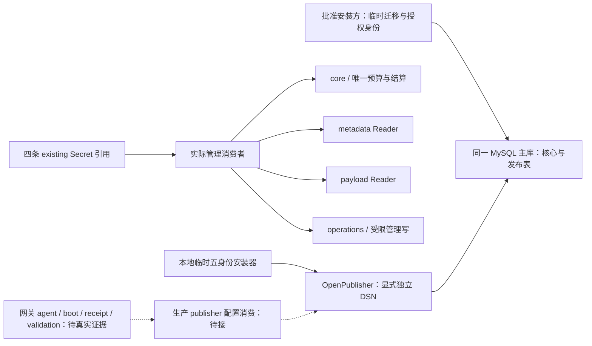

# 外部/私有来源运维输入与实际接线（2026-11-15 UTC）

本轮承接 MAAS-12 评论 `01a1dd45-de26-7165-8bcb-2c29778a0b4c` 和 MAAS-8 顶部交接。范围已确认，沿 MAAS-3 单一后端流补接点。源码核对截点是统一基线 `8dbf99ef59c847da775b83d0eeb7dc8f8bf48a9a`；后续跟随 `agent/MAAS-10-offline-metrics`，本文保留本次事实截点。

[两卡及逐字段结果](../intake/source-input-cards-20261115.json)保留原 12 组、62 个字段/责任；每字段有观察、依据、下一步和 `approved_value:null`。这是接续材料，不能被应用加载为 runtime 配置、批准注册表或生产证据。观察值与目标批准值分别记录。上游附件 ID/hash、16 份来源文件 hash/定位也在卡内。

查阅范围：MAAS-8 当前任务及两条讨论、MAAS-12 指定增量、MAAS-9 最新能力交付讨论、统一仓库的依赖/身份锁及候选 profile。以下“缺项”指这些材料中尚未核定的字段，不宣称工作区所有渠道均无批准记录。可直接提供已有批准记录号，由原责任人复核复用。

## 已有接点与最小差异

| 接点 | 本次源码事实 | 继续动作/责任 |
|---|---|---|
| 唯一内核 | 原 Go/MySQL 内核与管理接口已存在，保留已验范围 | MAAS-3 复用；不重建账本 |
| Publisher | `internal/release/mysqlstore/runtime.go:OpenPublisher` 显式接独立 DSN；检查非 root、选库、parseTime、禁 multiStatements、CURRENT_ROLE；自动启用完成 hook | 已有工厂。MAAS-3 补实际生产宿主/配置消费；MAAS-8 再挂真实引用 |
| 本地五身份 | `cmd/workbench/identities.go` 安装临时五身份；`cmd/workbench/main.go` 用独立 PublisherDSN 调工厂 | 已接本地管理演示，不能替生产装配证据；本轮未启动/替换工作台 |
| 管理四连接 | `cmd/control-api/main.go` 消费四条 DSN；metadata、payload、operations 分离；ModelGate 用 core DB 构造只读发布 gate | 不能描述为“core 在执行 publisher 写入”。该进程仍是 loopback bootstrap，不是生产推理宿主 |
| Operator | `cmd/operator/main.go` 构造空 Reconciler，readyz 返回 DependencyMissing | MAAS-3 补生产 adapters；不以 Chart 启用或 Pod 存活代替就绪 |
| Secret | `KubernetesSecretReader` 真正经注入 client 读取并验 namespace/UID/RV；`SecretAgent` 有绑定、快照与撤销库 | 已有实现库。目标 RBAC/agent 身份/本地交付通道和运行接线尚缺，不能概括“Secret 功能完全没有” |
| H3/validation | receipt 校验库及既有内核验证持久化可复用 | 仍须真实 issuer、接流集合/boot、有效配置和 protected validation 运行生产者/消费者；夹具与四 bool 不放行 |
| 私有运行时 | CR 有 weights/PVC/profile/image/groups/TP/PP/CPU/memory/GPU 字段；Compile 只生成 NONDEPLOYABLE ConfigMap 计划 | MAAS-3 补 runtime/placement 编译；MAAS-8/9 给批准输入。不能称已有可执行 LWS |

## 五身份、四环境引用和挂载图

| 身份 | 已有角色 | 当前消费/注入 | 目标状态 |
|---|---|---|---|
| core | maas_kernel_runtime + maas_release_reader | MAAS_MYSQL_DSN → kernel；ModelGate 只读 gate | principal/SecretRef/有效权限待核 |
| metadata | maas_release_history_reader | MAAS_HISTORY_READER_DSN → Reader.DB | 同上，禁止原 spec/业务写 |
| payload | maas_history_payload_reader | MAAS_HISTORY_PAYLOAD_DSN → Reader.PayloadDB | 同上，限原载荷读取范围 |
| operations | maas_release_operations_runtime | MAAS_OPERATIONS_DSN → Operations.DB | 有 INSERT 与受限 UPDATE，不能叫纯 SELECT |
| publisher | maas_release_publisher | workbench PublisherDSN → OpenPublisher 显式参数 | 生产配置消费缺入口；没有已消费的第五条 env |

Chart `templates/workloads.yaml` 仅用四条 `core.databaseSecrets.*`→`secretKeyRef(optional:false)`；通用配置/Secret 卷分别挂载到 `/etc/maas/config`、`/etc/maas/credentials`。挂卷不证明未来生产二进制消费这些文件。Operator 只挂 webhook TLS 与 K8s 运行身份，不能据此授其数据库或上游 Secret 全读权限。镜像拉取引用另用 `imagePullSecrets`。



图中安装方只表示职责，不是本轮已执行 GRANT。operations 的 UPDATE 列是 `state,reason,acknowledged,cr_uid,requested_generation,publication_id,updated_at`；publisher 完成 hook 只允许 `state,reason,publication_id,updated_at`。publisher 不继承整个 operations/core 角色，不可创建 operation 或改 action/spec/expected_rv。原脚本及 QA-R123 的实际权限正反证据继续按原 ac94/50354a7 范围引用；本轮 SQL 未改，不重跑数据库授权。CURRENT_ROLE、不同 Secret 键或不同 DSN 字符串都不能独立证明没有额外直接/继承权限；目标仍须核 CURRENT_USER/default role/继承 GRANT 和实际允许/拒绝。

## 外部卡的已得/待定

- **EXT-03**：Secret 引用结构、读取/绑定库、Chart existing Secret 通道已有；目标 namespace/name/key、UID/RV、安全交付记录和运行主体待批准。成员/安全负责人给非秘密引用；MAAS-3 接线；MAAS-8 核限定权限与轮换/重启失败关闭。
- **EXT-05**：Chart 0.2.3 是仓内工件版本；Higress 2.2.5 仍为历史候选。目标 K8s/Helm、Higress chart/controller/gateway/Envoy/CRD、Wasm/ABI 和镜像 digest/私库映射均须固定。不能由候选 tag 推导镜像存在或兼容。
- 目标 context/允许动作/namespace、服务/DNS/域名/TLS、mTLS CA/SAN、固定 endpoint 与出口 allowlist、真实 CNI 拒绝证据尚待原环境/网关负责人确认。Chart 支持 internal/hybrid 和 Higress reuse；引用名不是策略生效证明。Endpoint 必须来自批准注册，不接受用户任意 URL 或自动跨来源回退。
- boot/接流集合：需实际可能接新请求的实例集合、每实例启动代际、listener、route/config/plugin digest、凭证 UID/RV、issuer/时效/撤销同步和 validation 观察入口。新增/重启实例未获得本代际证据不能接流，失联/旧连接/过期回执不能从证明集合中无依据剔除。
- **EXT-06**：上述五身份及工厂属于已有代码；生产宿主/Secret/gateway/validation 装配属于 MAAS-3 的下一增量。EXT-01/02/04 的精确模型/站点、可信完整输出上界/final usage、价表/预算/验证 Key 与额度沿 MAAS-9/成员原记录收口，本轮不自行填值。

外部路线无需 GPU、LWS 或权重；可独立完成受控代码。首次真实调用仍须模型/profile/价表额度、安全凭证、环境及同一 Go/Higress/唯一结算链具备对应批准和证据。

## 私有卡：候选与完整组资源

候选记录已在 `tools/model_capabilities/profiles/sglang-r1-distill-qwen7b-candidate.json`：SGLang v0.5.18 / `71de97b264b04dcd514cf904003028aefe9775c8`，LWS v1.0.0 / `588881cada4fcc145e83eced00b88af920892ec6`，7B 模型 metadata revision `916b56a44061fd5cd7d6a8fb632557ed4f724f60`。执行仍 false、approval pending；1组/1Pod/1GPU、TP1/PP1 和 BF16/4096 都是原提案，不复制到目标值。

本地 GPU 研究已有独立授权/成果。历史 RTX4070 Laptop 8188MiB 记录不是目标集群容量。仓内 `engine-preflight.json` 曾记录另一 SmolLM-135M 路径 weights_present=false；没有据旧记录重新访问该路径，更不把它当本次已获权重或选择模型。已有本地研究、目标发布候选和实际批准组合三者分别记录。

| 字段组 | 待核字段与责任 | 阻塞操作 |
|---|---|---|
| SELF-01/02 | MAAS-9/成员批准模型/许可/精度、完整 tokenizer/template hash、输入/完整计费输出上界、usage 最终性及引擎后端；MAAS-8 核现有只读路径/PVC/hash/镜像 digest | 具体模型加载、硬预算与最终结算；不下载新权重 |
| SELF-03 | MAAS-8/9 固定 K8s/LWS/CRD/driver/device-plugin/CUDA/torch/NCCL；完整组数量/每组Pod/每Pod GPU、CPU/memory、TP/PP、resourceName、互联 | 实际调度、启动/就绪及兼容 |
| SELF-03 placement | 批准 placementProfileRef/revision、node selector/affinity/tolerations、zone/拓扑/RDMA、存储 locality；后端提供实际编译和rank/Service/startup/readiness | 真正 LWS 创建和更新 |
| SELF-03 峰值 | 同时存活的旧/新完整组、每卡 weights/KV/activation/graph/workspace/碎片/系统余量，节点CPU/内存及权重存储/预热 | 升级/回滚可用性；无余量保持 Pending，批准后才采用停机/分步策略 |
| SELF-04 | 目标动作授权、namespace/PVC/只读 mount/pull-secret、固定服务/网络/TLS/网关身份 | 目标写入/安装 |
| SELF-05/06 | 同一内核/发布证据与原 R 的权威用量；运行手册、RPO/RTO/保留期及恢复目标批准 | 平台 Callable 和相应 M09/A01–A34 验收 |

GPU 峰值按 `old_groups_at_peak × old_pods_per_group × old_GPUs_per_pod + new_groups_at_peak × new_pods_per_group × new_GPUs_per_pod` 计算，计入尚未退出的旧组，不能只用稳定态或单卡平均值。异构 leader/worker 时逐 Pod 求和。每卡显存须在目标模型/并行方式下实测峰值；共享权重/缓存的节省须另有证据，不能通用承诺“双倍显存”或零停机。各数值保持 null。

## 正常/失败路径与交付恢复

正常路径：原责任人复用批准记录→后端接真实工厂/四连接与证据端口→运维绑定目标引用/权限/版本→在对应授权下验证候选→原 MAAS-7 按外部、私有、生命周期、预算故障、安装恢复五段签收。原页面/UI16/GPU/QA 已过窗口不重开。

异常时保持已有行为：缺 DSN/role 或生产 adapter 不就绪；批准引用/Secret UID/RV/实例 boot/回执时效不匹配则关闭准入；commit ACK 未知沿原 command/request/operation 身份查询，不重发生成或重结算。先关新准入再排空，缺安全结束证据保留 finalizer/QUARANTINED；资源或 slot 回收不退未知预算。暂停/删除和跨模型 UID/共享资源按原 runbook。

平台 Chart、ModelRelease CRD、Higress/LWS CRD/插件与数据库迁移分别维护。平台 Chart 不接管每模型的共享基础设施；CRD 版本/存储兼容与历史对象在升级前核验，核心/发布 DDL 沿原唯一维护者和 expand/contract，不靠 Helm rollback 删除账本/tombstone/未知 held。恢复同一一致性点的请求/终态/operation/publication/slot/证据，按原身份查回、重新收敛真实门禁；RPO/RTO/保留期无批准不填默认。离线安装还需全部镜像、Wasm、CRD、工具与模型依赖/许可/摘要/私库映射和断网实证。

## 本轮检查口径

```text
python deploy/checks/inspect_source_inputs.py --negative-cases --output deploy/evidence/source-inputs-20261115.json
```

命令只核逐字段覆盖、pending/非执行身份、五角色/四实际 env、引用空值及16份来源字节/摘录。退出0只说明材料与所查源码一致，不能生成批准、读取Secret或证明SQL有效权限。独立篡改检查与结果另见 `deploy/evidence/source-input-negatives-20261115.json`。原部署预检仍应拒绝未齐的 internal/hybrid；本轮不重新跑旧整套检查、浏览器、数据库、GPU或目标安装。没有新增真实运行/性能/生产结论。