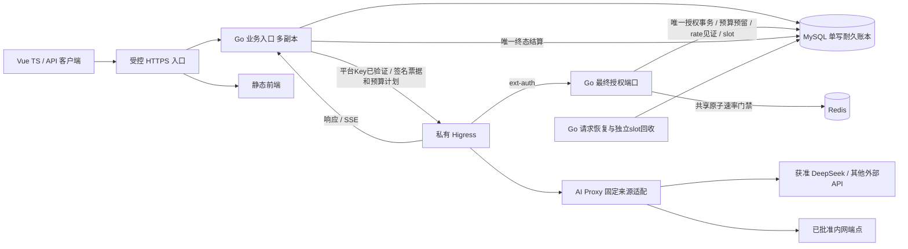
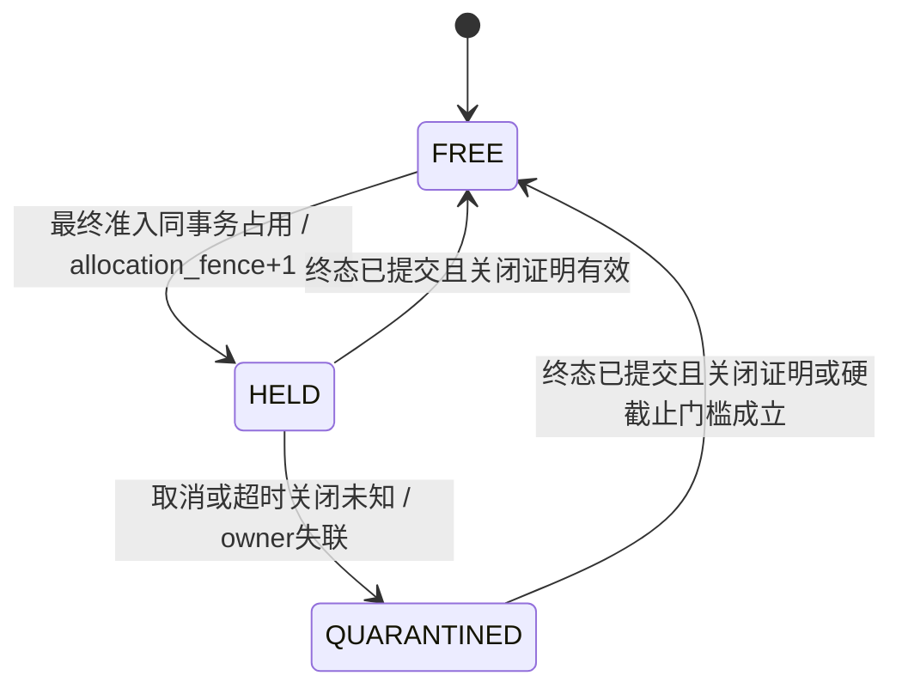

# MaaS 平台 MVP 架构与共享契约 v0.3

状态：依据成员新增决定修订，待 Mika 复核及成员验收。需求为 MAAS-1 v0.2、MAAS-2 成员确认及 `MAAS-1-requirements-delta-v0.3.md`；本稿覆盖 v0.2 中 PostgreSQL 候选和只按请求数限制的冲突内容。原 v0.1/v0.2 文件保留，不能混作本版实现默认。主责：MaaS 资深架构师；跨角色范围及交接由 Mika 协调。

交付包括正文、公开 OpenAPI、内部事件 Schema、私有授权 Schema/签名向量、预算合成算例、静态校验证据及复现脚本。本轮是文档与契约工作，未编写 Go/Vue 产品代码、未安装 WSL 运行栈、未连接数据库/Redis/模型、未部署；运行验收均待执行。

## 1. 成员决定与待确认项

| 已确认 | 本版执行口径 |
|---|---|
| Vue + TypeScript、Go、Higress、K8s + Helm | Go 是唯一业务准入/结算服务；Higress 实际路由和适配；固定来源、不跨来源回退 |
| 单管理员试点、MySQL、Redis 网关限流 | MySQL/InnoDB 保存全部业务预算和用量真源；Redis 只维护速率门禁，不扣第二份业务额度 |
| 请求数、Token数、Token换算金额限制 | 每 Key 可分别启用，组合启用必须全部满足；周期及限额须显式配置 |
| 仓库 https://github.com/jianzi123/maas | Mika 报告只读可访问但尚无公布 refs；首个代码任务核定初始化及隔离分支，不能据本稿假定 main 已存在 |
| DeepSeek 优先，同时支持 Codex | DeepSeek 文本优先；Codex 是官方模型/兼容代理/CLI 三种含义尚待澄清，分别设协议门槛，不阻塞其余方案 |
| 先用本机 WSL 验证，保留 Helm 私有化交付 | Mika 已见 WSL2 Ubuntu，但 Docker/K8s/Helm、端口、容量和模型连接均未验证；已有 WSL 不等于集群就绪 |

仍缺具体模型和能力、获准调用额度、Secret 引用/安全渠道、Codex用法、预算周期/数值/币种/价表、版本补丁及部署条件。历史100次/日、5并发、30s首响应/空闲、120s总时限、保留期均仍是建议。本稿保留5并发/120s等示例参数以延续安全推导，部署必须明确确认，不能从示例自动生成生产默认。

## 2. 组件与请求时序



公开生成只有 Go→私有 Higress 这一条链；Go 无供应商直连路径和模型出网权限。内部 listener、Go 授权/证据端口仅受认证工作负载可达；mTLS、Secret、CNI、响应剥头和出网隔离沿用附录 A。仅内网模式禁外部来源/公网依赖，混合模式只开放批准的来源及出口。来源/模型/revision/价表快照明确绑定，任何失败不触发跨来源回退。

1. Go 生成可信 request_id，验证平台 Key 原值、文本参数、模型/能力配置；构造将实际转发的 body、预算上界计划及签名票据。不因本步检查通过占业务预算。
2. 私有 Higress 以受信 route_name 调用 Go ext-auth。Go 验签、核对实例身份/路由和计划摘要；调用 Redis 获得该 request_id 的速率许可。Redis拒绝或不可用时不进入最终准入。
3. Go 在 MySQL 一个短事务中锁定共享状态，重新检查 Key/撤销/配置/锁后时间、Redis epoch及窗口、耐久速率上限、三维预算和全局slot；同时建请求、保存价格与能力快照、预留预算及占位。**只有事务 commit 确认后返回200，构成唯一业务准入点。**
4. Higress 实际选路、注入上游凭证、进行协议适配并转发；Go转发内容分片。生成不重试，不 hedge，不追随重定向，不将平台Key给上游。
5. Go 唯一终态事务去重、记录实际或缺失用量、结算预留、更新汇总并释放或隔离slot。正常DONE/完整非流式结果在该事务成功后交付；数据库故障时不假发成功终止。

数据库提交与网络发包不原子。已准入但是否提交不明，submission_state=unknown，按本版保守占用规则处理。重复票据一律409，不能幂等返回200重发生成；客户端重新发起获得新request_id，计新调用。

## 3. MySQL 事务与时间语义

候选 MySQL 8.4 LTS、InnoDB、READ COMMITTED；精确补丁和镜像digest在实施时锁定。所有预算、撤销、全局slot及rate见证读写主库，不用Redis或进程缓存放行。要求单写fencing、持久提交；候选 `innodb_flush_log_at_trx_commit=1`、有binlog时 `sync_binlog=1`，禁止将异步副本故障切换当作已证不丢账。HA及恢复点必须另验，单实例试点不承诺高可用。

授权/结算/回收锁顺序统一：全局容量保护行 → Key行 → 当前budget_window行 → rate_window见证行（按scope_id排序）→ request行 → slot行；只读登记/价表按统一顺序校验，不在锁内做Redis或上游网络I/O。采用唯一主键/索引的 `SELECT ... FOR UPDATE NOWAIT`；锁竞争503 admission_busy，无名额429 concurrency_exceeded，不排队等生成名额。不能用SKIP LOCKED跳过预算行后放行；死锁/锁失败显式整笔ROLLBACK，不复用半事务，commit结果未知不盲重试授权。[MySQL 锁定读](https://dev.mysql.com/doc/refman/8.4/en/innodb-locking-reads.html)

**替换 PostgreSQL clock_timestamp() 的具体规则：** 所有可能等待的锁定语句返回后，另发独立语句读取 `UTC_TIMESTAMP(6)`，得到锁后实际UTC时刻；提交前再发一次独立时钟语句复查有效期。MySQL 的 NOW/UTC_TIMESTAMP 固定于本条语句开始，不能把它写在可能等待的锁定SELECT中当作锁后时间，也不能在存储过程开头缓存整个授权过程的时间。会话time_zone设为+00:00，禁业务连接使用SET TIMESTAMP改时钟；按此新时刻检查票据 issued<=now<expires、hard_deadline、限流窗口及预算周期。跨日/月导致所锁窗口不同或票据过期，整笔回滚拒绝，不扣旧窗口，不重新签票据。[MySQL 时间函数](https://dev.mysql.com/doc/refman/8.4/en/date-and-time-functions.html)

周期建议支持UTC自然日或自然月，由管理员创建Key时显式指定；窗口为[start,end)，跨窗完成仍归准入窗口。现有Key的window_kind固定，需要换周期时创建新Key并处置旧Key；调低限额不重置已用/在途/未知占用，余额max(0,limit-used-reserved-held)。修改配额和撤销均锁同Key行，撤销commit后各副本及未最终准入票据拒绝；已准入请求照原快照结束。

## 4. Redis 速率门禁及部分失败

定义：速率限制控制每个固定短窗口内**最终获准提交上游的最大请求数**，不等于周期请求/Token/金额预算。Redis对已验证的授权尝试原子计数，可能因后续业务拒绝而更保守；不退款此短窗口许可。参数按global及per-Key策略显式配置，窗口宽度/限额未获确认，不以5并发推导每秒5次。

建议在Higress ext-auth调用的Go授权器中集中执行一次Redis Lua/Function，全副本共享，同步检查global/per-Key桶和request_id去重；不再串接另一份Higress业务配额/Token限额插件。脚本的多key必须同Redis实例、Cluster时同hash-tag（如`{maas-rate}`）；拒绝任何一桶时整次拒绝，不能局部增量后放另一桶。脚本原子性仅限Redis本身，不扩展到MySQL。[Redis 脚本](https://redis.io/docs/latest/develop/programmability/eval-intro/)

Redis许可包含 request_id、rate_policy_revision、rate_epoch、各scope/window_start/limit及permit_id；只从受认证Redis连接取得，由Go携带入主库事务，不能由客户端自报。MySQL在最终准入同事务更新 `rate_window_grants(scope_id,window_start,policy_id)`，确保本窗口grants+1<=limit，并保存该许可见证；窗口、epoch或策略不匹配即拒绝。rate见证是同一速率约束的耐久防丢门槛，**不是第二次业务预算扣减**。所以Redis丢状态、漏计甚至暂时双主，也不能增加同窗口内已提交MySQL准入数。该方案有一次额外MySQL热点写，试点优先正确性，MAAS-10后续测量，不以Redis当唯一耐久限额存储。

MySQL中登记rate_epoch及ready/blocked状态；Redis运行身份变化、epoch marker缺失、桶异常丢失/角色切换时关闭新准入，不能自动以空桶恢复。恢复由Go协调器在主库递增epoch并阻断旧epoch，将当前窗口的已提交见证作为Redis初始化下界，再标ready；旧epoch未提交授权在最终主库检查时失效。具体屏障为：协调器取得与授权相同的全局保护锁，在短MySQL事务中把epoch置blocked并增代；此前持锁授权必须先完成，之后授权锁后见blocked即拒绝。提交blocked后在锁外读取耐久见证并重建Redis，最后另取相同保护锁核对epoch/窗口/Redis身份未变再标ready。不能持MySQL锁做Redis网络调用，不能未阻断就边复制边开放。正在授权且已commit的许可已经进入耐久见证，不能回放。即便未及时识别Redis单桶丢失，主库窗口守卫仍保证上游准入<=limit；必须报警可观测不一致，不能宣称Redis限流所有尝试的历史都未丢。Redis普通复制存在异步语义，AOF/WAIT不等于与MySQL有分布式事务。[Redis 复制](https://redis.io/docs/latest/operate/oss_and_stack/management/replication/)

| 失败窗口 | 业务预算/上游处理 | Redis及恢复 |
|---|---|---|
| Redis拒绝/连接失败/ACK未知 | 无最终授权，不预留业务预算，不转发；429 rate_limited或503 rate_limiter_unavailable | 可能已消耗速率尝试，不自动退；未知时关闭准入 |
| Redis通过，MySQL明确ROLLBACK/额度不足/锁冲突 | 无预算占用、无slot、无上游 | 许可保守留至速率窗口结束，不为提高可用性重发生成 |
| Redis通过，MySQL commit ACK丢失 | 不返回授权200；恢复后按request_id查询；若已commit则保留预算与slot | 不重新消费或重放生成，主库见证决定是否已经准入 |
| MySQL通过后Redis宕机 | 已获准调用按原流程结算；新调用关闭 | 不撤销已有用量，不从Redis补扣业务预算 |
| MySQL不可用 | 新生成全部关闭；无法持久终态时不发正常DONE，恢复重建未知占用 | Redis许可不能替代主库许可，禁止降级放开 |
| Redis重启/丢桶/主从切换 | 主库grants守住当前窗口上限 | block→epoch重建→ready；同周期预算、Key撤销不重置 |

## 5. Token/金额上界与准入预留

Token预算统一口径为 prompt_tokens+completion_tokens；reasoning为completion子集、cached input为prompt子集，不能再次相加。建议v0.3按此总量控制，输入/输出独立限额不暗中新增；金额用价表分类区别权重。模型能力快照记录已验证的“所有可计费输入的上界来源”“max_tokens是否覆盖推理和可见输出”“缓存/推理子集定义”“会额外产生调用或工具费用的功能”。工具、搜索、多模态等额外收费路径首期不开放，不能以文本价表覆盖未知费用。

设 I_up 为全部可计费输入上界，O_up 为可见输出+推理合计上界，U_tok=I_up+O_up。可选依据为：经校验的精确provider分词/封装计算；或已确认涵盖全部计费输入的模型硬上下文上限作为保守I_up。字符数不能冒充Token；一个未经验证的max_tokens只限制可见答案时不能当完整O_up。没有可信上界则 capability.hard_budget_status=unverified/unsupported，启用Token或金额限制时503 budget_bound_unavailable，**不发请求**；只启请求数的Key可按其配置调用并显示不提供Token/金额硬保证。

调用前原子预留 `R_req=1`，启用Token限额时`R_tok=U_tok`，启用金额限额时`R_money=最坏价格分类计算的上界`。授权先判断任一启用维度limit=0就拒绝（即使免费价表的R_money=0），再检查全部启用维度都满足 known_used+inflight_reserved+uncertainty_held+R<=limit，才在同一MySQL事务提交。未启用维度不参与拒绝，用null表示关闭；不能以0表示关闭，限额0是明确阻断。reserved是当前占用，不是额外累计消费。

预算计划绑定 model/source/config_revision、capability_revision、budget_policy_revision、周期种类、三个预留量、输入/输出上界及价表快照摘要，经附录A的独立header送达并纳入票据签名摘要。授权器锁后核对主库策略，重算预留数学及价表有效性；不接受客户端指定价格、目标URL或绕过max_tokens。Higress实际转发的max_tokens、thinking模式与用于预留的能力配置必须一致，二者错配关闭路由。

这是基于已验证provider约束的**平台预算防超额**；上游可能违背自身限制、模型别名漂移或变更计费。响应后截流不保证外部供应商绝不超耗。若实际有效用量>预留，记录实际值及budget_bound_breached，冻结该Key的进一步预算准入及相关能力profile，保留差额审计/债务，余额显示0，不能剪裁实际用量以制造预算正确。上游独立账户预算仍须成员配置，平台预算不等于供应商账单。

## 6. 唯一结算、缺失用量与恢复

每个已准入request持有一组reservation和slot_binding。唯一终态 `request.finalized` 同事务写event去重、请求结果、预算账本/窗口汇总及slot处置。终态集合仍为succeeded/failed/cancelled/timed_out/interrupted；拒绝在准入外统计，分类之和等于admitted_total。event_id与(request_id,event_type)唯一；相同hash重投不重复扣量/退款，矛盾事件409。源日志及Redis计数不进业务用量累计。

| 终态观测 | 请求次数 | Token和金额维度 |
|---|---|---|
| 经核验no_upstream_attempt，终态尚未提交 | R_req全部释放、quota_consumed=0 | 所有预算预留释放；没有实际上游Token/成本 |
| 已提交或发送未知 | 转为known请求次数1；失败、取消、超时也计1 | 每个维度独立按下面规则结算，不因请求失败退全部预算 |
| Token完整有效 | 保持1 | Token转known_used=T，释放R_tok-T；报表usage保留上游原始字段，若用prompt+completion推得预算总数，标basis=component_sum，不把原total null改成上游报告值 |
| 金额所有必要类别可计算 | 保持1 | 用冻结价表计算C、转known_used=C，释放R_money-C；cache或reasoning分类缺失但两类价格相同也可精确计算 |
| Token缺失/不完整或金额类别无法定价 | 保持1 | 对未知的维度把完整预留从inflight转uncertainty_held，**不作为实际Token/金额**；另一维度已知则独立释放差额 |
| owner崩溃或usage未持久化 | 保留1 | 请求恢复为interrupted，未证实的Token/金额上界转未知占用；不能按0回收预算 |

真实0与未知null严格分开；Token数缺失、缓存细目缺失、金额未配置/不可计算分别带原因。预算余额为limit-known-inflight-held，disabled维度为null；UI同时显示已知实际、在途预留、未知占用和可用，不把上界占用当实际消费。未知占用没有TTL退款，跨日/月仍归原窗口，并保持相关账本及证据；保留期清理不能释放它。新窗口是独立额度，但不能重新归属旧请求。v0.3不提供无证据的手工退款或账单级对账；迟到证据只入审计/slot回收，修改已结算预算须另行定义追加更正契约，由Mika协调，不暗改原终态。

结算commit ACK未知时按event_id/hash查主库确认后再决定重投同一计量事件；不重新调用模型。主库故障中的内存usage不保证跨重启保存，恢复后用已持久预留保守补终态并显示计量缺口。正常依赖下终态5s内可查询；数据库故障期间503，不以旧快照宣称完整新用量。

slot独立回收规则保留于附录B：终态可先落但slot仍QUARANTINED；可信关闭或hard_deadline+5s且验证门槛满足才释放。**slot释放永远不释放Token/金额未知占用，也不写请求、额度、用量汇总。** 只有Go唯一终态结算器能把预算预留转known/held或退款；回收器不能再发request.finalized。

## 7. 价格快照、币种与精度

所有金额用同币种10^-9单位的非负整数，字段后缀`_atomic`；Go用checked整数/big.Int，MySQL用DECIMAL(38,0)，JSON用规范十进制字符串（0或不带前导0的数字，最多38位）。不能用float或JS Number承载金额/预算累计值。币种为已批准的三大写字母标识；不默认为USD/CNY，不换币。Key金额预算启用后绑定币种；停用不抹历史币种，重新启用需相同币种；换币种或周期创建新Key并明确处置旧Key。

每个不可变price_snapshot含来源/实际模型、version/id、currency、scale=9、effective_at、tokens_per_price_unit=1000000，以及以下每百万Token的atomic整数价格：input_uncached、input_cached、output_visible、output_reasoning。后两项是互斥子集：O包含R，visible=O-R；若推理并入同价输出，则两项价格相同。缓存输入是I的子集；不能以I+cached重复计费。独立非Token费用未覆盖则金额硬预算不可用。

`C = ceil((I_miss*p_miss + I_hit*p_hit + O_visible*p_visible + R*p_reason) / 1000000)`。

按**请求全部类别相加后一次向上舍入**到atomic单位，不能每chunk或每类别先舍入，不能给不同币种的金额直接求和。最坏预留用 `ceil((I_up*max(p_miss,p_hit)+O_up*max(p_visible,p_reason))/1000000)`；未知缓存是否命中用最大价，不猜最便宜。中间乘加须使用足够大整数，结果超DECIMAL(38,0)则在调用前拒绝pricing_unavailable，不截断/溢出。合计金额为逐请求已舍入结果之和。

价表受控登记，不允许前端写价格或调用者传价格；price_version更改只影响之后新准入。Go入口预备计划读到旧价，而授权时激活价已变更，返回policy_changed要求新请求；不在旧签名计划中偷换新价。准入后的请求冻结旧价（即便跨窗/价表更换），只表示平台预算成本，供应商账单可因折扣、税、汇率或其计费口径不同而不同。金额能力缺价格时返回pricing_unavailable，不能把null价格当0。

合成算例（币种TST、完全虚构，非DeepSeek/OpenAI实际价格或已选运行币种）：I_up=100、O_up=40；每百万Token input_miss=2000000000、input_hit=200000000、两类output=8000000000 atomic。预留Token140、金额520000。实际I=12（miss8/hit4）、O=7（reasoning3为子集）得到Token19、金额72800，分别释放121与447200；若usage全缺，实际保持null，未知占用140与520000。新价版本翻倍不改变该请求72800；后续新请求另算。合成向量另含一次舍入、部分usage、取消、上界违约和跨副本竞争的静态预期，不是运行证据。

## 8. 数据模型与MySQL迁移边界

| 实体/关键约束 | 内容与生命周期 |
|---|---|
| api_keys、admin_users/sessions | 原不可逆Key验证材料/epoch、单管理员HttpOnly会话及CSRF不变；新增budget_policy_revision、immutable window_kind/历史币种；原daily_limit不再作为新契约字段 |
| budget_windows PK(key_id,window_start,policy_id) | window_end、limits、known_used、inflight_reserved、uncertainty_held、revision；周期账本同Key共享，不按Go/Higress副本计数；策略改版不重置同窗口累计 |
| reservations PK(request_id) | 三维预留、原周期、价格/能力/策略快照、状态pending/settled_known/settled_held/released或混合维度；每维settlement唯一 |
| generation_requests / usage_events | 原request_id、Key/来源/别名/实际模型快照、结果/计时/usage/slot_binding/owner_fence；新增rate见证、reservation及cost/缺失原因；终态event_id和request_id+type唯一 |
| model_capabilities / price_snapshots | 不可变revision；价表分类、硬上界证明及有效性；未验证/过期不放行相关硬预算 |
| rate_epochs、rate_window_grants | epoch状态/Redis身份及当前短窗口已准入grants；政策ID+scope+window唯一，换revision不隐式归零 |
| concurrency_slots / slot_release_log | 固定全集、HELD/Q都占位，allocation_fence/row_version CAS；释放日志(slot_id,allocation_fence)唯一；FREE时request_id=NULL，MySQL唯一索引允许多个NULL，不套用PostgreSQL部分唯一索引 |
| evidence/key_registry/route_binding、安全profile | 沿用附录A/B鉴别与保留规则；占用未释放的记录不删除 |
| usage_daily / rejection_daily / audit | 按UTC准入日、Key、alias、source及currency/price_version分组；known与missing、held分列；拒绝与准入计数分离，不存正文或秘密 |

所有计数/预算整数至少checked64位，API预算统一字符串；上游原始Token字段保持安全整数/null，超JS安全范围拒绝解释为正常值并记异常。标识/签名kid/revision使用二进制/区分大小写排序，避免MySQL默认不区分大小写导致两个签名/别名混同。UUID可用BINARY(16)或规范ascii_bin，部署锁定一致编码；JSON字段不能代替主键、唯一约束和事务校验。检查DECIMAL符号/溢出和CHECK执行行为，不能依赖字符串字典序比较数值。

这是首次实现基线变更，不是已运行PostgreSQL→MySQL的数据迁移；无现网数据可声称已迁移。后续schema迁移采用expand/contract、单Job锁、备份恢复和应用前后版本兼容；Helm rollback不自动回滚MySQL/CRD。Redis可重建但MySQL账本/撤销不可丢；恢复历史MySQL备份不能未经核对重新开放预算。

## 9. API、错误及前端展示

公开API继续有14个操作：管理员session的POST/GET/DELETE，管理员models GET，keys POST/GET/PATCH，revoke POST，用量requests/summary GET，/v1/models GET，/v1/chat/completions POST，healthz/readyz。管理会话与平台Key分权、CSRF精确Origin、Key原值只在创建返回一次、试用Key仅页面内存、同源HTTPS/no-store、错误脱敏全部沿用。

v0.3的KeyCreate为 `{name,budget_policy:{window_kind,limits:{requests,tokens,money}}}`；requests/tokens是整数十进制字符串或null，money为{currency,limit_atomic}或null，各自null关闭，0阻断。所有配置必须显式提交，无历史100次默认。PATCH只改limits，带expected_revision作乐观保护；window_kind/币种不能借PATCH重置累计。响应Key含budget_policy和budget_state（known_used、inflight_reserved、uncertainty_held、available、周期边界及admission_blocked/block_reason）；上界违约的冻结标记在MySQL持久化，不能通过切换限额为null自动解冻。v0.2 daily_limit/used/remaining/reset_at由此替换，不能偷偷并存两套真源。接口路径版本保留v1，因为尚无产品实现/运行客户端；文档包0.3.0及实现交接须统一，实际已有客户端时由Mika协调兼容迁移。

Chat仍为文本model/messages/stream/max_tokens/temperature子集，默认不接受工具、搜索、图片、任意URL/headers。messages1–64项、每项8192码点/合计32768、body256KiB、服务端max_tokens上限建议4096，都是本版保留的待验证限制；省略max_tokens时服务端按已发布模型能力给有限默认（建议min(1024,verified上限)），绝不透传为上游无限或动态大默认。新增Model能力hard_budget_status、protocols、capability_revision和budget_unavailable_reason；不因为文档支持就展示已验证可用。Responses若尚未批准/实测，/v1/responses不挂载、不列为已支持操作。

usage字段保留input/output/total的真实值或null，增加input_cached_tokens和reasoning_tokens子集及缺失原因。RequestRecord增加budget_accounting：原预留、已知Token预算值及basis、token_unknown_held、cost状态/固定价表/currency/actual金额、money_unknown_held。Summary按Key/日/来源及币种/价表分组，显示已知Token/金额合计、缺失请求数和held；不能把null相加当0或跨币种求总额。current budget_state按完整周期读取，与保留窗口内的日明细分页不是同一张表。

JSON错误仍为 `{error:{code,message,request_id,retryable,reset_at,retry_after_seconds,param,...}}`；新增budget_dimension和policy_revision用于解释余额。请求数不足request_budget_exceeded、Token不足token_budget_exceeded、金额不足money_budget_exceeded、Redis速率拒绝rate_limited均429，分别展示周期reset_at或短窗口Retry-After；全局slot为concurrency_exceeded。上界/价表/限流器不可用分别503 budget_bound_unavailable/pricing_unavailable/rate_limiter_unavailable；策略变化409 policy_changed；币种不合403 currency_mismatch；上游越界502 budget_bound_breached并禁新准入。v0.2 quota_exceeded由request_budget_exceeded替代；其余invalid_api_key、鉴权/CSRF、参数、存储、流式错误等保留。retryable不授权自动重发生成。

日期筛选UTC [from,to)、最大31天，page_size20默认/100上限；游标签名绑定过滤条件；不存储假分页快照。generation后端失败前返回JSON；首个合法SSE后错误发event:error并关闭，不发DONE。正常只发一个DONE，raw EOF不是成功；接收上游usage的最终分片后再完成终态。取消2s目标、本地有界缓冲、排空125s/容器150s的旧建议及上游可能继续计算/计费边界不变。

## 10. DeepSeek与Codex的协议边界

DeepSeek官方当前提供Chat Completions文本/SSE契约，usage含prompt/completion及缓存细目；最终usage可与最后内容分片一同出现，不能只等一个空choices的usage-only分片。适配需验证max_tokens、thinking配置和缓存/推理子集口径；本版首个文本profile建议服务端固定 `thinking={"type":"disabled"}`，避免使用上游默认推理模式扩大预留边界。若所选Higress不能保持输出cap和此模式，不能开放相应硬预算profile。具体模型尚未选定，不能沿用记忆中的旧模型名或把文档条目当账户访问权。[DeepSeek Chat API](https://api-docs.deepseek.com/api/create-chat-completion/)

价表需从成员批准的来源登记并版本化；官方价格页是核验入口，不把当前网页数字写成平台运行默认。[DeepSeek 价格口径](https://api-docs.deepseek.com/quick_start/pricing/)

| “Codex”含义 | 本版设计与后续门槛 |
|---|---|
| 调用官方Codex相关模型 | 先明确准确model及获准API账户；按该模型实际支持的Responses/其他协议建立Higress适配、价格/上界和usage profile；不默认它支持Chat |
| 已有兼容代理 | 登记实际base URL、支持协议、收费/上界、密钥渠道及信任边界，仍经同一准入/固定来源；“compatible”标签不能代替工具/推理/usage/错误测试 |
| Codex CLI调用本MaaS | 需实现并验收Responses请求/typed SSE、工具调用及结果回传、reasoning和上下文语义；CLI provider指向MaaS，使用平台Key；原纯文本Chat接口不构成完整CLI兼容 |

OpenAI Docs允许自定义provider设置base_url、认证及wire_api；CLI用法须对照Responses契约，而其流式完成事件是typed response.completed等，不是简单的Chat DONE。本版没有把完整Responses API伪装成已实现端点。[OpenAI Docs provider配置](https://developers.openai.com/codex/config-advanced/)、[Responses流事件](https://developers.openai.com/api/docs/guides/streaming-responses)

DeepSeek也有Responses API及Codex集成文档，其Responses为stateless；这提供候选路径，仍需所选Higress插件能处理该路径及CLI实际使用字段，且MaaS实现非文本子集所需状态/工具/usage规则后才能验收。不能因供应商存在Responses端点就绕过Go直接让CLI访问上游。[DeepSeek Responses](https://api-docs.deepseek.com/api/create-response/)、[DeepSeek Codex集成](https://api-docs.deepseek.com/quick_start/agent_integrations/codex/)

待用户澄清前标为pending，不替其选择官方模型、代理或CLI；A24中DeepSeek文本路径可先设计/验证，Codex另列待验，不以Chat模拟成功充当Codex通过。

## 11. WSL本地路径与Helm私有化

先计划L0只读清单：确认具体WSL发行版/版本/可用CPU内存磁盘、Docker daemon及Linux容器、kind/k3d/kubectl/Helm、端口占用、DNS/代理/CA/Secret引用。不读出真实凭证，不把docker-desktop运行中当daemon可用。L1在获准安装/写入条件下，优先WSL Linux文件系统中的隔离仓库工作树，使用容器化MySQL/Redis和私有Higress，外层入口只绑定本地loopback；是否用Compose或直接kind取决于现有依赖，不在本轮安装任何一种。

L2受控上游核对预算/拒绝/SSE/取消/Redis丢状态/MySQL恢复及所有原私有授权/slot门槛。L3获准DeepSeek真实模型闭环并保留request_id/版本/usage/价格证据；付费或批量压测另需额度授权。L4若获准创建本地kind集群，用同一Chart完成安装/升级/回滚和数据保持，才形成Helm运行证据；仅Compose闭环不能替代A17。Codex具体用法确定后另做真实兼容验证。Microsoft的WSL容器说明提供部署方向参考，本机是否具备相应工具需实际只读清单确认。[WSL容器文档](https://learn.microsoft.com/en-us/windows/wsl/tutorials/wsl-containers)

Helm保留独立平台Chart、Higress安装/复用、internal-only/hybrid两套显式配置、已有Secret引用、镜像/Chart/CRD/Wasm锁清单、域名/TLS/存储/观测、备份/升级/回滚/卸载保留策略。Redis引入服务/ACL/TLS/epoch恢复参数，MySQL替换旧数据库参数；不能自动覆盖已有Higress或删除CRD/PVC/外部Secret。全离线安装包需单独确认介质范围并镜像全部依赖，运行私有化不等于已全离线。

## 12. 候选兼容矩阵与验证门槛

| 组件 | 候选/已知 | 核验要求；均未实测 |
|---|---|---|
| WSL2 | Mika报告Ubuntu-22.04/ubuntu/docker-desktop运行 | 发行版/内核、CPU架构、daemon、端口、磁盘/内存、网络实查；不擅自调整系统配置 |
| MySQL | 8.4 LTS、InnoDB、READ COMMITTED建议 | 精确补丁/digest、NOWAIT、UTC新语句时钟、DECIMAL(38,0)、collation、唯一约束、持久化/单写fencing、备份恢复 |
| Redis | 可维护的Redis 7.2+系列候选，实际发行版/补丁/digest及分发条款由运维确认 | Lua/Function多key原子、ACL/TLS/运行身份、noeviction建议、epoch/故障重建、异步复制丢状态；不能以RDB/AOF代替耐久见证 |
| Higress | 原Chart/app/core/console 2.2.5同版候选 | Wasm digest与实际Envoy/CRD匹配；DeepSeek现用协议/usage和Responses能力不能从旧tag假定 |
| Helm/K8s | Helm3>=3.10候选；获准K8s minor/Ingress v1待锁定 | 私有listener、CNI真正执行网络策略、SSE排空、CRD owner、迁移/备份、安装升级回滚；不默认Helm4兼容 |
| Go/Vue/TS/Node | 技术栈确认，工具链版本待仓库初始化 | lockfile、构建镜像、HTTPS/CSRF、整数金额解析；无现成项目不能声称build通过 |

V01–V08继续保留：V01授权/顺序及可信路由、V02故障关闭、V03取消/硬截止/实例暂停恢复、V04禁重试、V05跨副本事务/slot、V06真实计量及缺失、V07Secret与来源隔离、V08私有化升级回滚。V05具体改为MySQL，增加Redis部分故障。新V09核验Token硬上界/推理与缓存类别；V10核验rate_epoch/耐久见证/重建；V11核验定点价表/上界/结算；V12为WSL真实闭环与按渠道的Codex协议。未经验证的能力profile、传输observer和安全profile都不能由本稿标记verified。

监控增加budget_reserved/unknown_held、各维度拒绝、bound_breached、Redis epoch/重建、rate见证差异、MySQL账本/结算延迟；日志不含Key/上游秘密/正文，指标标签不用request_id或Key原值。request/slot恢复和未知预算占用分别告警，避免容量恢复被误认为预算可安全退款。

## 13. ADR修订

| ADR | v0.3结论与取舍 |
|---|---|
| 01 | Go代理+私有Higress/ext-auth唯一业务准入，保留原身份/路由/签名边界 |
| 02 | 用MySQL/InnoDB替换PostgreSQL候选；显式重做锁后时钟与索引/持久化，不机械换名称 |
| 03 | 三维预算原子上界预留/一次终态结算；未知维度保留uncertainty_hold，牺牲部分可用额度换不超放 |
| 04 | Redis速率门禁+MySQL同窗口耐久见证；无两存储原子承诺，允许保守浪费Redis许可，不允许预算降级放开 |
| 05 | 价表不可变快照、统一10^-9单位整数、一次请求一次向上舍入、不换币、不冒充供应商账单 |
| 06 | 固定来源、不重试/不回退；真实Token/null及其子集不重复计，不能用生成重放弥补计量故障 |
| 07 | slot与预算占用分离；终态后独立CAS只释放并发，不修改预算或终态 |
| 08 | DeepSeek文本优先；Codex明确渠道后按实际Responses/代理契约验收，能力未知不直接启用 |
| 09 | 单管理员会话/CSRF与平台Key分权；Key预算周期固定，避免策略改版借机重置旧占用 |
| 10 | WSL先验证，Helm交付保留；本地可运行、集群安装及真实付费模型证据分开记录 |

## 14. A01–A24验收映射

全部为待执行设计。每项证据至少包含环境/版本锁、真实或受控来源、样本数、request_id/预算/price revision、上游命中及通过/失败结论。以下不表示本轮运行通过。

| 编号 | v0.3核对点 | 对应部分/责任 |
|---|---|---|
| A01 | 获准DeepSeek真实模型、Go→Higress证据及固定来源，不能直连 | §2/10；MAAS-3/7，MAAS-9协作 |
| A02 | 单管理员登录/退出、Key只返回一次、调用Key不能管理、无秘密泄漏 | §9；MAAS-4/5/7 |
| A03 | 真实非流式/SSE；受控3片×200ms；唯一DONE且含完整计量 | §2/6/9；MAAS-3/5/7 |
| A04 | 缺失/伪造/撤销拒绝；锁后过期/可信route与签名；无上游/预算占用 | 附录A/P01–P08；MAAS-3/4/7 |
| A05 | 两Go副本、请求预算2先用1再10并发，最终准入<=2 | §3/5；MAAS-4/7 |
| A06 | UTC跨窗、降额低于已知+在途+未知，不能负余额或重置旧占用 | §3/6；MAAS-4/6/7 |
| A07 | 首段前JSON/后段error无DONE；no-send才退款，unknown保留预算 | §6/9；MAAS-3/4/6/7 |
| A08 | 停止/断连2s目标到上游；终态后slot回收不释放未知Token/金额 | 附录B/S01–S04/S10；MAAS-3/5/6/7 |
| A09 | 实际Token、缓存/推理子集、部分/null/合法0；已知合计及缺失数 | §6/10；MAAS-6/7/9 |
| A10 | 正常依赖下5s查询；重复/矛盾终态，预算/Token/金额只结一次 | §6；MAAS-6/7 |
| A11 | 全服务slot上限不随副本增加；slot隔离/复用不扩容；长流硬限 | 附录B；MAAS-3/4/7 |
| A12 | MySQL故障关闭；恢复孤儿为interrupted，保留未知预算；独立回收slot | §3/6及附录B/S05/S08/S09；MAAS-4/6/7 |
| A13 | 获准WSL或集群新环境、就绪真实、保留期不清预算、日志脱敏 | §8/11/12；MAAS-8/7 |
| A14 | Vue TS完整流程及三维余额/在途/未知占用/币种/来源反馈 | §9；MAAS-5/6/7 |
| A15 | 外部/内网alias固定路由、签名绑定预算计划、凭证隔离、来源计量一次 | §2及附录A；MAAS-2设计，3/4/6/7执行 |
| A16 | 仅内网阻公网、混合真实外部单列，无静默回退；受控不能代替真实 | §2/11；MAAS-3/7/8 |
| A17 | 获准K8s Helm安装/升级/回滚、MySQL数据保持/Redis安全重建 | §8/11；MAAS-8/7，本地Compose不能替代 |
| A18 | 多副本撤销、全局slot及滚动流；迟到owner/重复回收不改预算/终态 | §3及附录B/S06–S12；MAAS-3/4/6/7/8 |
| A19 | 请求/Token/金额分别及组合限额，两副本并发R可覆盖才获准，拒绝原因可解释 | §3–7；MAAS-4/6/7 |
| A20 | 流式上界预留→实际/部分/null/取消/重启/重复事件；无可信上界在转发前拒绝 | §5/6；MAAS-3/4/6/7/9 |
| A21 | 多Higress/Go Redis门禁；宕机、重启、丢桶、主从切换不扩大上游窗口准入 | §4/V10；MAAS-3/4/7/8/10 |
| A22 | MySQL锁、撤销、UTC、slot；Redis成功/MySQL失败/ACK未知/恢复各窗口 | §3/4/6及附录B；MAAS-4/6/7 |
| A23 | 多模型/分类价、冻结价表、币种、38位精度/一次舍入、未知成本和越界处理 | §7/V11；MAAS-4/6/7/9 |
| A24 | 获准WSL路径单管理员→Key→Higress→DeepSeek→用量预算→撤销；Codex渠道另列证据 | §10/11/V12；MAAS-3/5/6/7/8/9 |

基础压测仍用受控上游，并发1/5/10各60s，区分Redis速率拒绝/业务预算拒绝/slot拒绝，记录p50/p95和MySQL/Redis资源，不据此承诺真实模型吞吐。MAAS-9/10仍由Mika按阶段交接；本任务不启动MAAS-3至MAAS-10。下一步重点确认具体模型/安全凭证渠道/额度、Codex用法、预算参数及WSL运行依赖，不在评论发送任何秘密。

## 附录A 私有授权与传输证据

### A.1 私有授权协议版本 2

本节锁定项目私有线协议；候选 Higress 的字段支持依据仅限官方 tag 文档和源码静态阅读，部署/插件顺序仍受 V01–V08 约束。本版公开API预算字段已修订，私有边界保持并明确升级票据版本；新增 `MAAS-2-private-protocol-v0.3.schema.json` 为私有契约目录，按 `$defs` 校验票据、可信路由登记、证据与 slot，不能挂到公开入口。

| 边界 | 精确字段及来源 | 接收规则 |
|---|---|---|
| Go→私有 Higress | `X-Request-ID`；`X-Maas-Admission-Ticket`；`X-Maas-Reservation-Plan`；受控 Host；规范化 JSON body | 三个头各出现一次；去掉所有客户端 X-Maas/X-Envoy/代理信任头、Authorization、Cookie，再由 Go 构造；内部票据不放 URL |
| Higress→授权回调 | `POST /internal/v1/authorize`，空 body；上述两个头；`X-Maas-Auth-Route-Name` | route-name 只取 filter property `route_name` 的映射值；Go 不发送该头，allowed_headers 不允许转发该头；缺失/空/多值一律拒绝 |
| forward_auth 自动元数据 | `X-Forwarded-Method: POST`、`X-Forwarded-Uri: /v1/chat/completions`、`X-Forwarded-Host: <登记的内部 Host>`、`X-Forwarded-Proto: https` | 必须与票据/登记匹配，拒绝 query、编码路径和未登记 Host；兼容生成的 X-Original-* 不用于放行 |
| 双向服务身份 | Go→Higress 的 Go 工作负载身份；回调的 Higress instance 身份 | 取自 mTLS/受限认证适配器，不从调用者自报 header 取身份；回调身份映射出 gateway_binding_id、gateway_instance_id、gateway_epoch |
| 最终上游边界 | 只保留路由适配需要的业务字段和脱敏关联 ID | 票据、鉴权 marker、Auth-Route-Name、原始内部 Host、所有 X-Maas 及内部身份材料剥除；上游 Authorization 仅由 AI Proxy 注入供应商凭证；平台 Key 从未进入 Higress |

header 名大小写不敏感，但禁止同名不同大小写的重复、多值、逗号合并、CR/LF 或空值。HTTP parser/身份适配器须在字段被合并前拒绝重复敏感头；仅在 handler 中读取一个值不够。拒绝 Cookie/Authorization 出现在私有推理和授权回调；官方插件会额外转发 Authorization，allowed_headers 并不能阻止它，因此必须由前置边界移除并在 Go 回调再次拒绝。[ext-auth 字段及自动头说明](https://raw.githubusercontent.com/higress-group/higress/v2.2.5/plugins/wasm-go/extensions/ext-auth/README.md)

#### A.1.1 确定的编码、签名和密钥选择

票据为 JWS Compact 格式 `B64URL(H).B64URL(P).B64URL(S)`，三段无 `=` padding；只允许 HS256，签名输入为这前两段的 ASCII 字节加中间的单个 `.`，`S=HMAC-SHA256(K,signing_input)`。解码后不能先改写 JSON 再验签；先对原始两段验签，再校验规范编码。Compact 形式参考 [RFC 7515](https://www.rfc-editor.org/rfc/rfc7515)，本项目的窄化 JSON 编码和时间约束如下。

H 必须且只能含 `alg="HS256",kid,typ="maas-admission+jws",v=2`。P 必须且只能含：

```text
aud="maas-infer-admission-v2"
ticket_version=2
request_id, key_id, owner_instance_id                 小写 UUID
key_epoch                                            正整数
model_alias, route_id, config_revision, gateway_binding_id
upstream_host                                        登记的私有主机名
method="POST", path="/v1/chat/completions"
body_sha256                                          规范化转发body的SHA256小写十六进制
budget_plan_sha256                                   原始预算计划规范JSON字节的SHA256小写十六进制
received_at_ms, issued_at_ms, expires_at_ms, hard_deadline_ms
```

所有键和字符串值限本版 Schema 的 ASCII 字符域；数字为 0..9007199254740991 的 JSON 整数，不接受浮点、指数、布尔代整数或负数。JSON Schema 的 integer 本身按数值判定，不能保证拒绝1.0或1e0，故 H/P 解码器还须在词法层拒绝小数/指数/NaN/Infinity。H/P 用 UTF-8、按 ASCII 键字典序、无空格/换行/BOM、标准 JSON 双引号序列化；不允许未知键、重复键、null 或转义后的等价替代字符。验签后重序列化必须逐字节相同；B64URL 解码再编码也必须相同，拒绝带 padding、非规范尾位或多余段。规范化 body 使用相同排序/无空白规则、允许 UTF-8 消息字符串；body 本身由唯一受信 Go 构造，普通无 body 的 ext-auth 并不重新核对摘要。这与 v0.1 的工作负载信任边界一致。

时间单位统一 Unix 毫秒：`received<=issued<expires<=received+2000`，`expires=min(issued+2000,received+2000)`，`hard_deadline=received+120000`。这里沿用尚待成员确认的 2s 提交窗口和 120s 总时限建议；确认后按同一契约参数发布，不可由调用者任意指定。服务端读取实际 DB 时钟；请求入站检查一次，**取得全局/Key/日期/slot 所需锁后，再用 `锁语句返回后独立新发 SELECT UTC_TIMESTAMP(6)` 检查 `issued<=now<expires` 和 hard_deadline**，并复查签名 key 仍可验证、Key epoch/状态及配置 revision。不能用可能等待锁的同一语句开始时的NOW/UTC_TIMESTAMP代替锁后时钟；须执行正文§3的新语句规则，不能给过期票据正向宽限，也不能因锁竞争重新签发原请求。quota_date 必须等于最终锁后时钟的 UTC 日；若所锁日额度行已因跨日不匹配，整笔回滚并拒绝本次准入，不能扣旧日行或持锁重排。临提交前再检查一次，过期则整笔回滚；commit ACK 不确定仍不重试、不重发生成。

`kid` 是非秘密版本标签，按 `(purpose=admission,kid)` 精确查受控 key registry，再读取已有 Secret 引用；不接收 JWK、jku、算法协商或回退到默认 key。K 为至少 32 随机字节，与平台 Key pepper、会话材料、传输证据签名密钥不同。registry 记录 sign_enabled、verify_enabled、not_before_ms、not_after_ms；签发只用当前版本，旧版本按最长票据窗口和在途授权事务排空后退役；验证时同时检查票据签发时间和当前时间处于该版本有效期。紧急禁用可提前拒绝未准入票据，已准入请求不据此重放。所有副本先同步可验证的新版本再切签发版本；registry 不一致则关闭新准入。

`MAAS-2-v0.3-vectors.json` 给出完整规范 H/P、base64url 段、signing_input、签名和 HTTP 例子。测试 key 明确为公开固定字节，仅作静态互操作向量，不是环境凭证；不得复制为运行密钥。

#### A.1.2 可信路由登记及最小占位配置

登记表键为 `(gateway_binding_id,config_revision,route_name)`，值为 `route_id,model_alias,source_id,upstream_model,upstream_host,method,path,safety_profile_id`。route_name 必须来自**所选实例实际渲染的 xDS route name**，不是假设它等于 Kubernetes Ingress 名；重复/空值或多个候选时不开路由。占位映射例如：

```yaml
# 仅契约占位；不是已存在的资源或可直接部署的完整 CRD
gateway_binding_id: infer-example
config_revision: rev-example-17
route_name: route-name-from-reviewed-xds-example-17
route_id: model-a-route-17
model_alias: model-a
source_id: 00000000-0000-4000-8000-000000000004
upstream_model: provider-model-example
upstream_host: model-a-r17.maas-infer.internal
method: POST
path: /v1/chat/completions
safety_profile_id: safety-example-unverified
```

Go 公网入口只能根据已登记别名构造 Host/票据，Higress 回调用受信 route_name 和已认证 gateway_binding 精确查表，再将所有绑定值与票据及主库允许 revision 逐项比较。缺失 property、错 Host、错 revision、跨来源 route 均拒绝；授权响应不得修改路由选择字段。认证后禁止 reroute。候选源码有 property 映射、响应头替换及 DisableReroute 逻辑，这只是静态依据，实际实例的顺序、覆盖和路由冻结仍归 V01。[固定 tag 源码](https://raw.githubusercontent.com/higress-group/higress/v2.2.5/plugins/wasm-go/extensions/ext-auth/main.go)

以下是**插件配置体片段**，不含未经确认的 Wasm digest、CRD selector 或 mTLS 资源；须绑定到全部私有推理路由。`authorization_request.allowed_headers` 只允许显式三个头；`allowed_properties` 输出名称不得加入 allowed_headers，防 property 读取失败时保留伪造值。

```yaml
match_type: whitelist
match_list: []
failure_mode_allow: false
failure_mode_allow_header_add: false
status_on_error: 503
http_service:
  endpoint_mode: forward_auth
  endpoint:
    service_name: maas-auth-channel.example.svc.cluster.local
    service_port: 18090
    service_host: maas-auth.internal
    path: /internal/v1/authorize
    request_method: POST
  timeout: 1000
  authorization_request:
    with_request_body: false
    allowed_headers:
      - exact: x-request-id
      - exact: x-maas-admission-ticket
      - exact: x-maas-reservation-plan
    allowed_properties:
      - path: [route_name]
        header: x-maas-auth-route-name
  authorization_response:
    allowed_upstream_headers:
      - exact: x-maas-admission-id
    allowed_client_headers:
      - exact: x-request-id
      - exact: x-maas-error-code
      - exact: x-maas-reset-at
      - exact: retry-after
      - exact: x-maas-budget-dimension
      - exact: x-maas-policy-revision
```

占位 auth-channel 是同工作负载内受限通道示意，不能部署成任意 Pod 可调用的明文授权服务。若该候选插件调用链不支持所需 mTLS，须由已验证的本地适配器建立到 Go 的 mTLS，并可靠保留 gateway_instance_id/epoch；不能用任意自报身份头替代。最小片段**不等于身份、安全剥头、传输证据或硬截止已经实现**；这些机制缺失时不开放真实模型，V01–V08 保持未执行。

#### A.1.3 请求与响应

完整可复算请求见向量附件，线形如下（尖括号为占位）：

```http
POST /internal/v1/authorize HTTP/1.1
Host: maas-auth.internal
X-Request-ID: 00000000-0000-4000-8000-000000000001
X-Maas-Admission-Ticket: <vectors.admission.compact>
X-Maas-Reservation-Plan: <vectors.reservation_plan_base64url>
X-Maas-Auth-Route-Name: route-name-from-reviewed-xds-example-17
X-Forwarded-Method: POST
X-Forwarded-Uri: /v1/chat/completions
X-Forwarded-Host: model-a-r17.maas-infer.internal
X-Forwarded-Proto: https
Content-Length: 0

```

成功仅在 DB commit 确认后返回，200 空 body。`X-Maas-Admission-Id` 必须等于本次 request_id，仅用于内部关联，不是可重放许可：

```http
HTTP/1.1 200 OK
X-Request-ID: 00000000-0000-4000-8000-000000000001
X-Maas-Admission-Id: 00000000-0000-4000-8000-000000000001
Cache-Control: no-store
Content-Length: 0

```

拒绝例子（时刻仅为示意）：

```http
HTTP/1.1 429 Too Many Requests
X-Request-ID: 00000000-0000-4000-8000-000000000001
X-Maas-Error-Code: request_budget_exceeded
X-Maas-Budget-Dimension: requests
X-Maas-Policy-Revision: budget-example-v3
X-Maas-Reset-At: 2026-11-05T00:00:00Z
Retry-After: 60
Cache-Control: no-store
Content-Length: 0

```

业务响应字段白名单：成功仅 `X-Request-ID,X-Maas-Admission-Id`；拒绝仅 `X-Request-ID,X-Maas-Error-Code,X-Maas-Budget-Dimension,X-Maas-Policy-Revision`，request_budget_exceeded 另加 `X-Maas-Reset-At,Retry-After`，concurrency_exceeded/admission_busy 等暂态可加 Retry-After。Cache-Control/Content-Length 以及 HTTP 栈 Date 是传输元数据，不参与业务决策。不得返回票据、签名 key、平台或供应商凭证、Set-Cookie、路由/Secret 信息、任意 headers-to-add。401 用 invalid_api_key，票据/路由不可信403 forbidden，超期503 admission_busy，重放409 state_conflict，主库/签名 registry 不可用503 dependency_unavailable；不扩大公开错误码集合。

只有上述响应头进入插件响应白名单；非白名单头不能转发。Go 收到私有拒绝后以主库记录/已认证通道和白名单映射为公开 JSON，重新写服务端 request_id；不直接代理网关错误 body。插件自动生成的 timeout/5xx 可能没有业务头，统一按依赖故障处理，绝不据缺头推断未发包。200 只放行当前流；重复 request_id 即使签名仍有效也409，不重放原成功响应。

### A.2 未提交和关闭证据

“未收到响应”“Go 取消了 context”“普通 5xx”“ext-auth 超时/409”“日志中没搜到命中”均不是退款证明。授权 commit 前的 Go 本地失败无已准入记录，不产生扣量；**一旦交给 Higress，Go 本身不能再证明从未发送。**

已准入请求只有 Higress 传输边界的受信 reporter 可以产生 `no_upstream_attempt`：同一 request_id/票据摘要对应的发送状态机已永久 sealed，所有排队发送已撤销且不能恢复，历史 attempt_count=0，active_streams=0。普通 access log/插件返回码不能充当此 reporter。候选内置 ext-auth 不提供该证明；需要后续实现和验证的受限传输观测机制。机制不可用则保守 unknown、quota=1，不开放推断退款的替代路径。

证据 claims 见私有 Schema：`evidence_id,kind,request_id,ticket_sha256,gateway_binding_id,gateway_instance_id,gateway_epoch,config_revision,route_name,attempt_count,active_streams,sealed,observed_at_ms`。kind 仅 `no_upstream_attempt` 或 `upstream_transport_closed`；前者 attempt_count=0，后者=1；都要求 sealed=true、active_streams=0。证据不自报 slot_id，接收端从该唯一 request_id 和准入票据摘要解析原始 allocation，防错配或跨 slot 复用。closed 只证明网关不再占有上游传输，不证明供应商已经停止计算，也不证明应该退额度。

证据同样用上述窄化 JSON/JWS Compact 编码，但 H 的 `typ="maas-transport-evidence+jws"`、P 的 `aud="maas-transport-evidence-v1",evidence_version=1`。密钥目的为 transport-evidence，按 `(kid,gateway_instance_id,gateway_epoch)` 登记，仅该实例 reporter 可签；不得复用 admission key。签名 key 及已准入实例登记保留至其所有绑定 slot 释放、证据审计期结束；签名撤销或身份不明时不接受新证据，走硬截止门槛。签名仅证明来源，接收端还须验证该 reporter 机制版本已通过 V03/V05/V07，不能相信任意有合法 key 的通用日志进程。

传送协议为 `POST /internal/v1/transport-evidence`、Content-Type `application/jose`、body 为单个 compact JWS（无换行）；仅授权 reporter 的 mTLS 通道可调用，公开入口不可达。Go 先校验大小<=8192B、格式/签名/目的/角色/实例 epoch，再比对主库已准入 request 的票据摘要、路由 revision、真实授权回调实例、原 allocation。`received_at_ms<=observed_at_ms<=DB now`；时钟超差拒绝并关闭不安全自动回收。接收成功只原子持久化证据与 hash，201 空 body；同 evidence_id 同 bytes 重投204，不同 bytes409；未识别/错绑定/超出权限403、结构错误400、主库不可用503。不因重投回收两次，不直接改 request/额度/汇总。发送结果未知时只可重投相同证据，不能重发生成。

在唯一终态事务提交**之前**，Go 结算器从主库 evidence registry 取经核验的 no_upstream_attempt，与申请的 evidence_id 比较后，按正文§6释放三维预留，才允许 `submission_state=not_submitted,quota_consumed=0`；终态事件 `not_submitted_evidence_ref` 在 v0.2 限为该证据 UUID。仅有非空字符串或签名通过均不够。已提交终态后迟到的 no-send 证据可供 slot 回收/审计，但不再退额度或改写终态；更正要另行变更契约。upstream_transport_closed 可供独立 slot 回收，永远不单独导致退款。

证据持久化包括 `verified_by,verified_at,proof_mechanism_version,payload_hash,resolved_slot_id,resolved_allocation_fence`；这些由 Go 写，不能由 reporter 传入以自证。slot 或待决结算仍引用的证据/key registry 不得被保留期清理。若真实 gateway instance 身份无法贯穿 mTLS 适配链，则不能用该证据提前回收，继续使用经过验证的硬截止/隔离流程。


### A.3 预算计划的线协议及版本升级

v0.3票据升级到v2，只增加budget_plan_sha256并更新H.v/P.ticket_version/aud；其余JWS窄化编码、kid、身份、路由、锁后及提交前有效期、禁止重放/错误剥头规则保留。v1票据在本版基线下拒绝，不自动降级。传输证据仍为独立purpose的v1，其ticket_sha256绑定本次完整v2票据。

X-Maas-Reservation-Plan是私有ReservationPlan对象规范JSON的无padding base64url；递归键排序、UTF-8、无空白/重复键，允许Schema明确的null（仅预算计划，H/P仍不允许null），金额/预算量必须规范整数字符串。计算原始计划JSON字节SHA256，与票据budget_plan_sha256精确比较，再重算主库策略/价表/上界。票据<=4096B、计划header<=4096B、全部内部header总量建议<=16KiB，超限不转发；不在URL或日志保存完整计划/票据。公开来访的计划头全部剥除。上游发送前和证据回调中不泄露该计划。

授权器先验证计划摘要和不含来源覆盖字段，再执行正文§4的Redis许可；在MySQL锁后按策略revision/价表/能力重新计算和原子预留。这个回调仍只有一次200准入，不另启预算回调、Token插件或Redis业务账本。响应允许新增budget dimension/policy revision两个非秘密字段，业务余额从MySQL管理API取得，不相信私有错误响应自报余额。

终态事件基线升为2.0：保留slot_binding、owner_fence、no-send证据UUID及原终态去重，增加reservation_plan、budget_accounting、rate_witness，按正文§6在同一MySQL事务结算。事件草案1.0/1.1与票据v1保留为历史，不能在同一实现中混用；没有现网数据迁移已执行的声明。

### A.4 原私有协议及预算扩展的待执行检查

| 编号 | 核验 | 拒绝/保持规则 |
|---|---|---|
| P01 | 签名段、kid、typ、aud、算法篡改 | 不放行、不预留预算 |
| P02 | 重复敏感头/JSON键/padding/非规范数字编码 | 在信任边界拒绝，不仅取首值 |
| P03 | 等锁后到期、跨UTC窗口 | 新发时钟语句复查；整笔回滚 |
| P04 | route_name/Host/revision缺失或伪造 | 精确登记匹配，禁止reroute |
| P05 | 同request_id重放/授权ACK未知后重试 | 二次409，不能重放200或再次生成 |
| P06 | 签名key轮换/禁用/registry不同步 | 未准入票据失效；不重放已准入请求 |
| P07 | 注入响应头/普通5xx/伪造no-send字符串 | 不泄密、不退款、不提前释放slot |
| P08 | 证据实例epoch/票据摘要/机制版本不匹配 | 拒绝；合法迟到证据不重写终态或预算 |
| P09 | 计划header/hash/策略价表/能力revision篡改或旧版本混用 | 锁后重新核对和计算，不能绕过三维预算 |


## 附录B 独立slot状态机及回收

### B.1 请求恢复与独立 slot 回收

**请求终态与名额状态相互独立。** 请求可以已经 cancelled/timed_out/failed/interrupted，但其 slot 仍 quarantined；不能仅扫描 in_progress 请求来恢复容量。Go 唯一终态结算规则不变，slot release 不是第二次结算。

#### B.1.1 字段、状态及安全证据

固定 slot 行包含 `slot_id,state,allocation_fence,row_version,request_id,owner_instance_id,gateway_binding_id,gateway_instance_id,gateway_epoch,config_revision,ticket_sha256,hard_deadline_at,release_not_before_at,safety_profile_id,quarantined_at,quarantine_reason`。FREE 的活动绑定字段为空，fence/version 保留；HELD/QUARANTINED 的绑定不可更换。release_not_before_at 固定为 hard_deadline_at+5s。request 表在保留期及尚有待回收 slot 期间保存不可变的原 slot_binding；固定 slot 重新分配不能改旧请求的绑定。



HELD 和 QUARANTINED 都占全局容量。没有 QUARANTINED→HELD、没有本次 allocation 的续租扩 deadline、没有因取消/超时/TTL 到期就 FREE 的路径。`allocation_fence` 只在 FREE→HELD 增1；`row_version` 每次状态变更增1；owner 不能通过心跳自行增加名额或解除隔离。Go 终态事务若当时已有安全关闭证据可一并释放，否则将 slot 隔离并保留原占用，之后由独立回收器处理。

释放必须先有已持久化终态，且至少满足下面一项；任何一种都不能更改已终态的请求或其计量：

| release_reason | 证据/前提 | 对额度的含义 |
|---|---|---|
| response_complete | 当前 Go owner 实际收到并验证正常上游完成证明，终态为 succeeded；对应网关禁重试/回退且完成语义已通过 V03/V04，证明在终态事务写入 | 沿用该成功请求 quota=1；普通网关5xx或 EOF 不属此证据 |
| transport_closed | 附录A.2 已验证并持久化的 upstream_transport_closed，或同样 sealed 的 no_upstream_attempt | 本次操作只释放 slot；不做退款，not_submitted 是否计0只由尚未终态时的唯一结算决定 |
| deadline_verified | DB实际时钟>=release_not_before_at，精确匹配的 safety_profile 已通过 V03/V05、时钟差<=1s、未降级/撤销，旧实例在暂停恢复后也不能晚发包 | 保留原 quota 和结果；profile 未验证时禁止执行 |
| operator_isolation_verified | 已获准的运维隔离记录证明旧 gateway instance/epoch 及其待发/在途传输全部不可恢复；Go核验不可篡改记录后回收 | 不隐含本轮对隔离/终止环境的授权；仅停Pod/撤证/改Service而既有连接仍活跃不够 |

safety_profile 绑定网关/插件 digest、硬截止和发送窗口参数、时钟界限及验证证据引用；它是部署评审记录，不是请求自报的布尔值。当前所有 profile 都 unverified，因此本轮不能宣称 deadline_verified 自动回收已具备。没有可信关闭证据时至少等待原 hard_deadline+5s，且所有既有硬截止门槛仍成立；心跳过期、主库已恢复、Pod UID 改变或“请求已终态”本身都不是释放依据。

#### B.1.2 CAS、幂等及写集

回收器是 Go 中独立的 slot recovery worker，可多副本运行；建议每5s扫描主库中**所有** HELD/QUARANTINED 行并联查 request 终态，不按 owner 是否存活或请求是否 in_progress 排除。扫描结果只作候选，证据和时间门槛必须在写事务中重读。

占位、终态、释放统一锁顺序：全局容量保护行 →（需改额度才取 Key/日额度锁）→ request 行 → slot 行；短事务且不在锁内发网络请求。释放事务只读锁 request/证据/安全 profile，检查 terminal_event_id 已存在、原 slot_binding 及当前 slot request_id 均匹配，使用 DB `锁语句返回后新发SELECT UTC_TIMESTAMP(6)` 重验截止、profile/证据未撤销，再 CAS：

```text
WHERE slot_id=:id
  AND allocation_fence=:generation
  AND request_id=:request
  AND state IN ('HELD','QUARANTINED')
  AND row_version=:version
```

成功时更新 slot→FREE、清活动绑定、row_version+1，插入 `slot_release_log` 唯一键 `(slot_id,allocation_fence)`，记录 request_id、release_reason、证据或 profile 引用、actor、实际回收时间及原 deadline。同一事务完成二者；不维护第二份会漂移的全局 used 计数，容量由固定 slot 集合计算。释放的写集只含 concurrency_slots/slot_release_log，**禁止更新 generation_requests、usage_events、usage_daily、quota_daily、Key**。正常终态事务中附带释放时，计量写集仍属于唯一终态部分，slot 释放部分用相同幂等键。

CAS 0行时重新读：日志已有相同 binding 则视为已完成，既不增容量也不重记日志；slot 已被新请求以更大 allocation_fence 占用则判 stale，旧 owner/旧 evidence 不得操作新 allocation；只是 row_version 改变则重新评估新状态，不能强写。slot generation 不回绕，达到整数上界必须停用该 slot 并评审，不能归零。request 的 owner_fence 只用于阻止旧结算者写终态，slot 的 allocation_fence/row_version 防止 ABA；**slot 回收不再修改 request.owner_fence**。

主库 commit ACK 丢失时不作内存“加回名额”；恢复连接后以 slot binding/释放日志查结果。事务已提交但 slot 被重新分配也能从唯一 release_log 确认旧回收已完成。主库不可用期间无新准入、无回收写；恢复后从持久化 deadline、allocation、终态和证据继续判断，不从恢复时间重新起 TTL，不抹掉隔离状态。

#### B.1.3 与孤儿终态恢复的衔接

request recovery 与 slot recovery 可以在同一 Go 服务中运行，但职责分开。未终态孤儿仍由请求恢复器在原硬截止后、主库/服务可工作时的30s窗口内 CAS 为 interrupted，保留原 quota=1 和未知 Token，增加 request owner_fence 使原 owner 迟到写失效；如安全关闭未证实，slot 仍为 QUARANTINED，随后交 slot worker。可证明从未发包的请求只允许在此唯一终态事务中按 附录A.2 计0；不能由释放 worker 补退。

对于**已经终态**的请求，恢复器仅触发 slot worker，绝不改为 interrupted、不另发终态、不改变原错误、Token、quota_date 或 quota_consumed。只要关闭证据有效，可在终态提交后立即释放；否则保持隔离，最早 hard_deadline+5s 且通过既有门槛后回收。依赖健康、安全门槛已验证时，worker 周期5s，加 DB处理建议上界5s，目标在可释放时刻后10s内完成（因此常规不晚于hard_deadline+30s）；这仍是待验证建议，不是现有运行成绩。若主库晚恢复，则从主库恢复且满足安全门槛起10s目标收敛，不能谎称断库期间已回收。

若硬截止、时钟、网关暂停恢复防晚发或单写 fencing 不能证明，保持 QUARANTINED 并关闭不安全准入，告警后需获准隔离旧传输实例才能回收。此条件与 v0.1 相同，不因请求先记 cancelled/timed_out 而放宽。原 owner 复活不得重用旧票据、改 deadline 或重新生成；迟到关闭证据可归原 allocation 的释放审计，迟到终态或 Token 更正仍按旧规则拒绝并审计。

#### B.1.4 必须执行的恢复用例

以下是设计用例，不是本轮数据库/网关实测。附带静态决策表仅验证契约预期列及其结构，不证明并发 CAS 或真实关闭行为。

| 用例 | 触发与证据 | slot 预期 | 请求/计量/额度必须保持 |
|---|---|---|---|
| S01 关闭确认 | cancelled 已提交，可信 closed 证据匹配原 allocation | 隔离slot立即进入可回收；只释放一次 | cancelled、原 Token/额度不变 |
| S02 发送未知 | timed_out 已提交，只有Go断连/5xx/心跳失联 | hard_deadline+5s 前不回收 | timed_out、quota=1，不改 interrupted |
| S03 达安全截止 | S02 达截止且精确profile已验证、时钟合格 | worker CAS释放 | 终态及所有计量不变 |
| S04 未验或降级 | 达截止但profile未验/时钟超差/旧网关可能晚发 | 继续隔离，关闭不安全准入 | 不伪造正常完成/退款 |
| S05 主库恢复 | cancelled+隔离已持久化，断库后恢复，原截止已过且门槛合格 | 按原deadline回收，不重新起120s | 不重投终态，不再次扣减/返还 |
| S06 迟到owner | 原slot已释放再被新请求以更大fence占用，旧owner回收/续租 | CAS失败，新请求slot不变 | 两个请求/额度均不变 |
| S07 重复回收 | 两worker读到同generation/version，或回收ACK丢失重试 | 至多1个FREE转换/1条释放日志，另一方确认已完成 | 不二次改统计/额度 |
| S08 已终态重启 | Go重启后没有本地cancel记录，只剩terminal+QUARANTINED主库行 | 独立扫描仍能发现并按证据/截止回收 | 不将既有终态重写interrupted |
| S09 孤儿未终态 | owner崩溃，原请求仍in_progress | 先唯一interrupted结算，关闭未知则隔离，再安全回收 | 只结算1次，quota保留1 |
| S10 迟到no-send | cancelled quota=1已提交后才来可信no_upstream_attempt | 可释放原slot或确认已释放 | 不自动退款/改终态 |
| S11 未终态请求 | closed证明已到但request尚in_progress | 独立回收器先不释放，交唯一结算器 | 不允许仍可发生成的未终态请求失去占位 |
| S12 仅隔离声明 | operator只改Service或仅注销证书、旧连接仍可活跃 | 不回收；需完整不可恢复的隔离证据 | 无环境操作被本稿自动授权 |

A08/A11/A12/A18 验证上述状态、时间边界、跨副本重复竞争和计量不变；V03/V05 继续是运行前置门槛。

### B.2 v0.3预算补充

本附录所有“额度不变”同时指请求、Token、金额的已知量/预留/未知占用；deadline/关闭证明只允许回收并发slot，不能解开未知预算。孤儿唯一终态恢复按正文§6从原MySQL预留形成held，不改用Redis估算；no-send只有在终态前经鉴别才释放三维预算。主库时间一律遵守正文§3的新语句时钟规则，不使用PostgreSQL函数。MySQL中释放审计唯一键、allocation_fence/row_version和请求owner_fence含义与旧稿一致。

