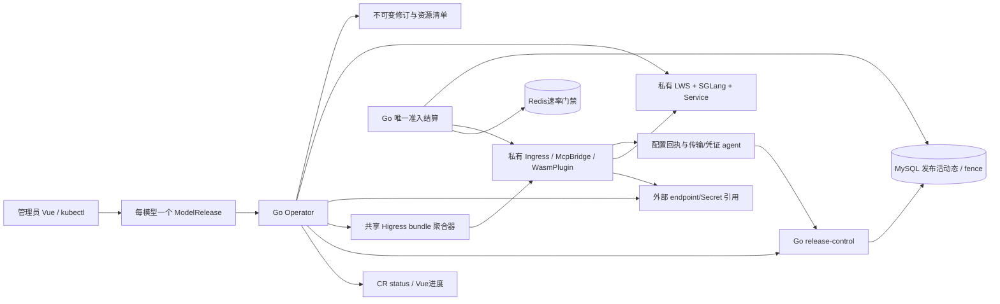

# MaaS 模型发布与共享契约 v0.4

状态：带假设设计，待 Mika 复核及成员验收。依据 MAAS-1 成员本次要求、需求增量 v0.4，以及已完成设计复核的架构 v0.3。v0.4 与包内保留的 v0.3 调用/预算正文共同构成完整基线：本版覆盖“不部署私有引擎/只登记已有端点”的旧范围，并替换明确列出的票据、事件及模型发布接口；其余预算、计量、错误、取消和安全门槛继续有效。

本轮只交文档、声明式契约及静态验证材料，不含 Go Operator/插件产品实现、集群写入、权重下载、GPU或付费调用。基础设施、模型/GPU及真实能力仍待输入。每模型一个 CR 不代表每模型安装一套 Higress、LWS controller 或数据库。

## 1. 选型与职责

首期设计选择 **ModelRelease + Go Operator、SelfHosted 使用 LWS + SGLang** 这一条候选实现路径；ExternalAPI 使用相同发布控制器协调外部来源，不生成推理工作负载。vLLM及Deployment/StatefulSet只作ADR对照，不同时建设第二套生产后端。模型/GPU/版本若不支持，由算法提供证据、架构更新ADR、Mika协调替代，不能静默切换。

LWS本轮文档核验可见v1.0.0 release及 `leaderworkerset.x-k8s.io/v1` API，可作为候选锁定点；其size包含leader、replicas是完整组数。官方示例包含SGLang分布式启动，但不能代替目标模型/设备兼容验证。SGLang精确镜像digest/CUDA/依赖由目标GPU与MAAS-9矩阵锁定，不能将latest填成兼容结论。[LWS release](https://github.com/kubernetes-sigs/lws/releases/tag/v1.0.0)、[固定tag API](https://raw.githubusercontent.com/kubernetes-sigs/lws/v1.0.0/api/leaderworkerset/v1/leaderworkerset_types.go)、[部署示例](https://lws.sigs.k8s.io/stable/docs/examples/leaderworkerset/basic/)

| 真源/角色 | 唯一责任 | 禁止的第二套状态 |
|---|---|---|
| Kubernetes ModelRelease.spec | 用户模型发布期望态；Go API/Vue与kubectl使用同一CR | 不把MySQL的另一个desired-spec循环反写CR |
| Go Operator | 解析期望、编译修订、协调专属资源和发布生命周期 | 不结算业务预算，不单模型覆盖共享对象 |
| Go release-control模块 + MySQL | 活动发布、别名唯一性、fence、资源清单及发布操作审计 | 不声称与K8s有跨系统原子事务 |
| Go调用内核 + MySQL | Key、三维预算、全局slot、请求建档、唯一终态结算 | CR/Redis/Operator不复制实时账本或退款 |
| Redis | v0.3共享速率门禁，MySQL耐久窗口见证兜底 | 不能因发布、回滚或重建归零业务预算 |
| Higress | 私有listener实际选路、AI Proxy适配、凭证注入和传输观测 | 不增加业务扣量点，不允许Go直接绕到模型 |

首次真实验证请求前必须交付最小耐久调用内核：Key/预算预留/slot/request/终态去重及必要汇总同事务到位。不能把它推迟到用量界面；模型发布控制器不提供旁路“临时测试入口”。MAAS-3/4/6由Mika协调这一里程碑。

## 2. 控制关系与发布时序

1. 校验CR结构、来源互斥、namespace/gateway授权、profile和Secret引用范围；持久化finalizer，**确认finalizer已在主库API对象上存在后**才创建资源。先在MySQL写可恢复inventory意图，后创建K8s对象；崩溃后按确定名称、UID及标签核对并接续。
2. 将规范化spec和批准的profile/endpoint/能力/价格/Secret元数据版本编译为desiredRevision。创建或复用不可变runtime实例；准备独立publication_id及单调activation_epoch、内部route和插件。此时业务门禁仍关闭。
3. 校验工作负载/来源准备、所有可服务Higress实例实际配置回执、凭证agent及调用内核就绪。配置对象存在或controller接受不等于网关已应用。
4. 使用**获准的专用验证Key/额度**通过同一Go/Higress链路做最小端到端验证。validation用途只能访问指定候选publication，仍创建正常预算/slot/request及结算。没有授权/Secret/额度则状态ValidationPending，不擅自调用付费API。
5. Go release-control在MySQL单事务检查最新publish intent/fence、修订、配置回执和验证receipt，CAS活动publication。之后普通调用只能使用这个活动快照。旧publication关闭新准入，原有流按旧绑定继续；status再投影活动结果。
6. 新修订稳定后按资源引用与旧在途/slot状态排空、撤路由和清理旧专属对象；失败以条件和operation记录暴露，按幂等协调重试，绝不重复生成验证请求。

验证意图 `(publication_id,validation_policy_revision)` 在MySQL唯一，先持久化request_id再发一次；超时/ACK未知时不由reconcile重放付费生成。新的验证尝试须显式产生新intent并有获准额度，旧请求仍照原语义结算。

验证授权来自安装/管理员批准的intakePolicy条目，绑定专用Key ID、安全Key引用、目标publication范围、到期时间和最大验证次数/预算；没有此条目就ValidationAuthorizationMissing。Operator仅发送RequestValidation命令，Go从受控安全引用取得专用平台Key，在同一代理/准入内核完成一次请求，最终授权仍检查该Key有效/未撤销及完整预算，不因Operator身份免扣。验证输入由批准policy固定，不接受命令任意选择其他Key或来源；CR和Operator不保存平台Key原值。公开Chat来访不能自行指定validation用途。
## 3. ModelRelease CR 契约

本版提议API group `serving.maas.example`、version `v1alpha1`、kind `ModelRelease`、plural `modelreleases`、Namespaced，shortName `mr`；`.example`是设计占位，安装前由项目确认最终group并统一包内schema/客户端，不视为已有CRD。模型别名在同一gateway_binding下跨namespace唯一；namespace仅是管理/资源边界，不能让两个namespace夺取相同公开alias。

| 字段 | 本版定义 |
|---|---|
| spec.modelAlias | 不可变，ASCII别名；删除重建以CR UID区分旧对象 |
| spec.source.type | SelfHosted或ExternalAPI，互斥且不可变；迁移来源类型须新CR/别名及显式业务切换，不自动回退 |
| source.selfHosted | weights:既有PVC+相对路径+权重摘要；engine=SGLang、workload=LeaderWorkerSet；批准runtimeProfileRef；digest镜像；groups/podsPerGroup/gpusPerPod及CPU/内存；TP/PP；placementProfileRef；startupTimeoutSeconds |
| source.externalAPI | provider、endpointRef、upstreamModel、protocol=OpenAIChatCompletions、同namespace credentialSecretRef；无GPU/Pod/LWS字段 |
| spec.gatewayRef | 平台已批准gateway binding逻辑引用，解析到受控namespace/listener，不由CR任意写Host/URL |
| spec.businessRefs | capabilityProfileRef、pricePolicyRef、intakePolicyRef的名称+不可变revision；只是批准规则引用，不复制Key余额，不能削弱实际Key策略 |
| spec.lifecycle | desiredState Published/Paused，strategy BlueGreen/Recreate，drainTimeoutSeconds、progressDeadlineSeconds、保留旧修订数；所有操作默认保留用户Secret/PVC/权重/历史账本 |

完整字段/范围见JSON Schema和CRD草案，两个来源示例独立附YAML。样例中的镜像、权重、PVC、profile、endpoint和Secret均为占位，不存在即拒绝或DependencyMissing，不下载权重来“自动补齐”。不开放raw PodTemplate、command、任意env/hostPath、内联Key或任意URL；runtime profile是安装阶段登记的受控模板，不是用户随意写的ConfigMap。

SelfHosted首期统一每Pod相同GPU资源，GPU总需求=`groups * podsPerGroup * gpusPerPod`；每组总设备数=`podsPerGroup*gpusPerPod`，批准profile下TP×PP等于该数。组数是外层副本，不当作engine内部DP；leader计入size，不能按“worker数量”少算GPU。多Pod组不保证落不同节点，placement profile显式限制拓扑；没有gang scheduling支持就显示Pending/进度超时，不假称资源整组已预留。PP/量化/设备类型仍需profile支持，Schema合法不意味着目标引擎支持。

结构使用JSON Schema做离线严格校验；CRD草案将字段内联为structural OpenAPI、status subresource、conditions list-map及CEL互斥/不可变检查。Go写API采用严格字段校验；kubectl路径要求服务端strict fieldValidation，K8s可能prune未知字段不能被描述为“所有客户端一定报错”。外部引用/RBAC/镜像白名单/TP拓扑/超时关系由fail-closed admission webhook及Operator二次校验；本轮未运行API server/CEL/webhook。

## 4. 状态与可调用语义

phase为Pending/Preparing/Validating/Ready/Updating/Paused/Draining/Deleting/Degraded/Failed。phase是摘要，不是准入依据。status包含observedGeneration、desiredRevision、activeRevision、publication_id、activation_epoch、activeGeneration、availableGroups、资源引用、operation及conditions。条件按type唯一，均含status(True/False/Unknown)、reason、message、observedGeneration、lastTransitionTime。

条件集合：Accepted、DependenciesReady、RuntimeReady、GatewayApplied、AccountingReady、ValidationPassed、Callable、Progressing、Degraded、AdmissionClosed、Drained、CleanupComplete。**Ready需当前generation被观测、目标修订与活动修订一致，且必要就绪条件/真实验证receipt为真；status永远不是Go授权真源。** 更新期间可以old active继续可调用而新generation未Ready，界面同时显示目标与当前活动，不把旧成功当作新成功。ExternalAPI的RuntimeReady仅表达来源/凭证准备，不声称已启动GPU或真实推理；ValidationPassed补足端到端证据。

典型reason含AliasConflict、InvalidSpec、ProfileUnapproved、DependencyMissing、CredentialsUnavailable、ResourcesPending、ModelLoadFailed、GatewayNotApplied、ValidationAuthorizationMissing、ValidationUnknown、AccountingUnavailable、RevisionConflict、DrainTimeout、CleanupBlocked。message只含脱敏诊断，不能包含secret值、原始供应商body或完整提示词。

CR写入是“期望已提交”，不是“已停服/已发布”。Go管理操作返回202；真正Paused/AdmissionClosed要等MySQL门禁关闭回执。直接kubectl修改/删除是最终协调语义，不承诺该API写入时刻立即撤销所有模型准入；Key撤销仍保留v0.3的MySQL线性化保证。控制面观察/回执超过批准新鲜度窗口即故障关闭新准入，该时间窗口须实施验证，不能从本稿假定监视零延迟。

## 5. K8s与MySQL协作、修订及恢复

CR spec唯一期望源；Go管理API仅写CR和操作审计，不维护另一个部署desired循环。Operator是发布资源协调者；所有active/gate/alias/fence变更统一经受认证的Go release-control模块写MySQL。内部端点POST /internal/v1/releases/{cr_uid}/commands仅接受Operator的mTLS发布身份，使用ControlCommand的command_id/fence/expected-active与证据引用；同ID同hash幂等、冲突409，存储不可用503，普通Key和浏览器不可达。它无权改变预算、usage或Key状态。Operator只持发布模块权限，不获得修改预算/Key/usage的数据库权限。

MySQL新增 `release_links(cluster_id,cr_uid,namespace,name,last_observed_generation,tombstone)`、`publish_intents`、`release_revisions`、`publications`、`active_model_bindings`、`resource_inventory`、`runtime_instances/runtime_refs`、`gateway_bundle_revisions/receipts`、`validation_intents` 和 `release_operations`。唯一约束控制同gateway+alias所有权、同CR+resolvedRevision/operation的幂等编译、同publication只激活一次。desiredRevision摘要包括规范spec和全部解析依赖版本，**不包含secret原值/正文**；Secret resourceVersion变化、price/capability引用解析变化可在CR generation不变时产生新resolvedRevision，状态必须显示两者。

publication_id不可复用；activation_epoch单调增，与lease holder无关。leader election只减重复工作，不是K8s/MySQL分布式fencing。专属资源采用publication/runtime-instance级不可变名称和UID precondition；K8s写入用resourceVersion/SSA冲突处理，活动切换用MySQL compare-and-swap。旧controller可能留下候选/漂移，不能再激活低epoch；Go不接受与MySQL活动绑定不匹配的路由。**不声称旧进程在两个系统间永远不能写任何字节**；漂移或不一致使新准入关闭，重协调修复，不能虚假Ready。

runtimeRevision只覆盖引擎/权重/资源/启动profile，publicationRevision另覆盖网关/来源/业务引用。仅价格/凭证或网关变化可复用仍活跃的不可变runtime实例，避免重启GPU；复用必须先在MySQL锁定inventory并附加publication引用。清理只有ref=0且相关请求/slot安全结束才能CAS为Retiring；Retiring不可再附加引用。后来回滚相同runtimeRevision也必须分配新runtime-instance UID，不能复活旧删除目标。这样旧worker的UID条件删除不能删除新活动实例。

| 崩溃/部分失败点 | 恢复判定 |
|---|---|
| inventory意图已写，K8s未创建/ACK未知 | 按确定名称GET，校验UID标签/spec摘要；不存在才创建，冲突报OwnershipConflict，不盲adopt |
| 候选资源已创建，MySQL未激活 | 业务门禁保持关闭；补核验/回执后CAS或清理孤儿，不把资源存在当活动 |
| MySQL激活commit ACK未知，status未更新 | 读publication/epoch确认，投影status；不再次激活/重复验证调用 |
| CR更新事件乱序/旧reconcile恢复 | 重新GET当前UID/generation；删除tombstone不可逆；旧intent/fence不能开启门禁 |
| K8s不可用或MySQL不可用 | 停发布推进；调用按v0.3及回执新鲜度故障关闭；不降级为CR.status授权 |
| 活动路由漂移/新Higress副本未应用 | 未获相符配置回执的实例不具准入资格；发现差异关闭该绑定，不借旧Ready放行 |

两个系统没有原子事务，raw CR变更到观测有传播窗口。明确安全顺序是先准备不可调用候选→网关及内核核验→MySQL活动CAS→状态投影；删除/暂停在被协调后先关MySQL门禁再排空。对于spec刚变化但尚未被协调的旧活动修订，可继续按已提交活动快照服务，不能宣称新spec已经生效。删除tombstone一旦在MySQL提交，同UID任何迟到intent都不得重新激活；同名新CR是新UID，旧alias在清理前仍占用。

## 6. 资源映射与Higress共享所有权

命名使用`mr-<crUID短摘要>-<runtime/publication摘要>`并受K8s长度限制，标签记录完整UID、runtime实例、publication及管理者。名称冲突时校验全部UID/摘要，哈希短名不能代替唯一性。Go资源清单保存实际namespace/kind/name/uid及字段管理者，不把标签匹配当删除授权。

| 资源 | SelfHosted | ExternalAPI | 所有权及删除 |
|---|---|---|---|
| LeaderWorkerSet `leaderworkerset.x-k8s.io/v1` | 每不可变runtime实例一个；replicas=groups、size=podsPerGroup；leader/worker受控模板 | 不创建 | 用户CR无直接ownerRef，Operator显式inventory管理 |
| Service/NetworkPolicy/参数ConfigMap | Service仅选同runtime实例的就绪leader，worker/分布式端口不对外；模型/namespace隔离 | 无推理Service/Pod/GPU | 仅删除本实例实际UID；PVC/权重始终用户所有 |
| Higress Ingress `networking.k8s.io/v1` | 内部revision Host及chat路径，目标为leader Service的批准DNS注册 | 内部revision Host，目标为批准endpoint | 位于gateway受控namespace，跨namespace不用CR ownerRef |
| McpBridge `networking.higress.io/v1` | 注册leader Service FQDN/port | 注册批准外部DNS/TLS/port | 使用共享default时由唯一bundle聚合器合并registry，不归任何单模型GC |
| WasmPlugin `extensions.higress.io/v1alpha1` | 每publication限定Ingress作用域的AI Proxy映射与auth policy；无供应商密钥 | AI Proxy/provider/credential-handle | 插件镜像digest锁定；配置无明文Key；不能覆盖全局auth |
| revision/发布ConfigMap及receipt | 不可变脱敏manifest | 同左 | inventory跟踪；共享listener/CRD/controller不随模型删除 |

Higress固定tag示例提供Ingress+McpBridge+WasmPlugin这一映射起点，本设计不复制其中apiTokens内联示例；实际route_name必须由选定controller渲染产物取得，按v0.3可信属性绑定。[Higress AI Proxy固定tag](https://raw.githubusercontent.com/higress-group/higress/v2.2.5/plugins/wasm-go/extensions/ai-proxy/README_EN.md)

共享McpBridge/default由**gateway bundle聚合器这一个角色**写：从主库所有仍被candidate/active/draining publication引用的受管registry编译union，同时保留人工/其他系统条目。registry条目名含CR UID及publication摘要；删除仅移除inventory认可且无引用的条目。采用最新resourceVersion CAS重读合并，不假定当前CRD把registries声明为list-map，也不做单模型整对象替换/force SSA。bundle epoch单调、过期编译结果不得覆盖已应用更高epoch；同对象并发冲突重新读全量。共享聚合lease不当作跨系统原子保证，实际生效由实例receipt和Go准入绑定兜底。[SSA字段冲突语义](https://kubernetes.io/docs/reference/using-api/server-side-apply/)

## 7. 必要Higress最小改动

新CR并不会被Higress原生识别。本轮建议用外部Operator编译既有Higress资源，保持其控制器主流程；将以下明确缺口纳入MAAS-11，不用“装了插件”代替验证。

| 编号 | 最小改动/模块 | 运行门槛 |
|---|---|---|
| H1 | AI Proxy增加受限credential-provider lookup：配置只存publication/credential handle，网关本地agent在内存取已批准Secret，通过受限本地通道返回给插件；实际LLM转发仍是Higress | 不可把SecretRef当stock字段；需插件/agent小范围实现、异步调用及故障关闭验证，禁止凭证落CRD/ConfigMap/Helm release/日志 |
| H2 | 在真实router/transport边界提供attempt计数、sealed无待发和upstream-close观测，产生原协议JWS证据；必要时修改Envoy扩展而不是仅靠普通Wasm流结束回调 | OnStreamDone/5xx/Go断连不足以证明no-send或已关上游；若做不到维持隔离且对应恢复验收受阻 |
| H3 | gateway实例agent核对有效xDS/route/plugin digest、credential版本及listener范围，向Go报告带实例身份的配置应用receipt | receipt包含publication/epoch/route digest；控制器status或“资源已创建”不能替代实例生效证据 |
| H4 | auth/路由编译适配票据v3、候选验证用途、revision级Host、cap/price绑定、内部头剥离；禁重试/回退/hedge；配置真实硬流时限 | ext-auth仍只回调Go一次业务准入；不再加一份Higress预算/扣量插件 |

agent不代理模型数据。其Secret访问由安装前已批准的namespaced RBAC限定；引用Secret只允许ModelRelease同namespace，跨namespace gateway agent读权限须预置，不由模型CR自动增权。Higress同Pod本地通道须绑定实例身份/loopback或等效隔离，其他Pod不可借handle取密钥。agent按publication固定Secret UID/resourceVersion的内存快照；轮换产生新版本和新publication，旧连接不被计到新来源。旧版本在agent重启后无法重建时故障关闭，不能静默换最新Key；未完成的旧请求按错误/未知计量。

任何公开日志/status都只见opaque credential generation，不输出Secret内容或其低熵内容哈希。共享Secret属于用户，不被模型删除；Secret缺失/撤销触发门禁关闭和CredentialsUnavailable，不能用其他供应商Key回退。原v0.3硬截止、mTLS、签名/可信route、Token上界及金额精度要求不放宽。

## 8. 更新、回滚、暂停与删除

BlueGreen：先候选后切换，准备阶段可保留旧活动；需要同时容纳新旧GPU，资源不足显示ResourcesPending/ProgressDeadlineExceeded，不自动退化为停机。Recreate：用户显式选择可停机策略，先关闭旧新准入、排空旧流、回收安全旧runtime，再准备新修订；失败可无可用活动，界面清楚报告，不承诺零停机。runtime内容变更不用原地修改旧活动LWS模板；在不可变runtime实例之间切换，避免LWS内部滚动把旧流导向新权重。

回滚通过管理API选已保留、同source.type的历史spec快照，重验当前profile/endpoint/Secret/价格规则后写回**同一个CR的spec**，产生新generation/新publication/更高epoch；不能把epoch倒退、复活已Retiring的旧UID或回滚MySQL预算/数据库schema。旧价表若已不批准则回滚受阻；已在途仍用其原价快照。自动失败只关闭不安全新准入/保留切换前旧活动，不擅自回退供应商或未经声明重试生成；切换后失败由明确回滚意图处理。

暂停/删除顺序：观测意图→MySQL持久关闭该CR新准入/删除tombstone→停止该publication接新授权→保留旧revision路由与backend直到全部in_progress及相关HELD/QUARANTINED slot安全结束→撤专属路由/credential handle→引用归零runtime置Retiring→按UID删专属对象/共享注册条目→确认inventory无待清理→移除本finalizer。未知预算占用可继续保存在账本，不阻止已经证实传输关闭的物理清理，也绝不因清理退款。

**防GC提前删除的具体选择：** 安全关键LWS/Service/Ingress/WasmPlugin不设置指向ModelRelease的ownerReference，跨namespace和共享对象更不设置。只有LWS自身内部Pod/StatefulSet遵循LWS控制器的owner链；本Operator在排空前不删除LWS。这样用户对ModelRelease使用Background/Foreground删除都不能仅因CR进入terminating就GC掉安全关键子资源；代价是依赖inventory/finalizer显式清理。finalizer不是GC暂停万能开关。[Kubernetes owner限制](https://kubernetes.io/docs/concepts/overview/working-with-objects/owners-dependents/)、[finalizer语义](https://kubernetes.io/docs/concepts/overview/working-with-objects/finalizers/)

删除中断/依赖不可用时保留finalizer、AdmissionClosed及CleanupBlocked，恢复后续做相同步骤。超时进入DrainTimeout，不自动去finalizer、不把“安全隔离”记容量恢复验收通过。强制清理仅在目标操作另获授权后，先证明旧实例及待发/在途不可恢复、Go一次结算、slot安全回收，再清对象；不能用force删除掩盖未知传输。用户Secret/PVC/权重、共享listener/McpBridge本体、CRD/controller、Key/预算/usage历史全部保留。

该保证针对ModelRelease正常删除。模型操作者RBAC不允许删除namespace或直接删除安全关键子资源；集群管理员删除namespace/底层LWS等带外动作仍可能直接终止Pod，不能由本finalizer阻止。此类故障按异常中断/隔离和恢复记录，不能标为正常排空或A31通过；namespace终止被观测后关闭新准入并保留跨namespace发布清理记录。
## 9. API、票据和事件兼容

新增管理接口：model-releases集合POST/GET；单资源GET/PUT/DELETE；单资源rollback POST；release-operations/{id} GET，共7个操作。操作查询保留删除后的最终结果。创建/更新使用同一CR spec；更新/删除/回滚带If-Match资源版本，冲突409，不force接管。查询返回CR/status、ETag及可解释进度。所有写操作管理员会话+CSRF+Origin，平台Key不能部署。创建/更新/回滚/删除返回202及操作ID，不能据此展示Callable。kubectl直写受同CRD/webhook/RBAC约束；Go接口不创建第二个部署对象。

本版机器契约为21个公开操作，新增Release/Operation/InvocationBinding等Schema；原14操作的预算语义保持，模型响应增加release绑定和Callable状态。旧已有端点也须经ExternalAPI CR纳入release registry后才开放，不能保留一个绕过CR的旧来源写入口。接口版本路径沿用v1（尚无产品运行客户端）；实际客户端若已存在由Mika协调升级。

票据升级到v3，H.v/P.ticket_version/aud区分旧版，新增release UID/generation、release_revision、publication_id、activation_epoch、route_binding_sha256、admission_purpose。用途serving仅当前活动；validation仅批准验证Key和候选publication。预算计划不复制账本，原price/capability/策略摘要仍必须与该publication核对。旧票据v2在新实现中拒绝，不能降级路径；传输证据仍v1，以完整票据SHA绑定请求和新的publication上下文。

终态事件升3.0，新增必需invocation_binding；RequestRecord、日志/审计携带同一可信绑定。预算算法/price snapshot/slot_binding不变；旧在途记录保留原publication和价格，不能在结算时按当前CR.status查询新价/新模型。发布审计事件release.activated/draining/deleted与request.finalized分开，不修改预算。原v0.3/schema2.0记录以历史只读保留，实际切换必须先排空旧流程并统一版本，本轮未执行任何数据迁移。

错误增加release_not_callable、release_revision_mismatch、release_dependency_unavailable、release_alias_conflict、resource_version_conflict、release_validation_pending；Go最终授权拒绝不命中上游、不预留业务预算，Redis可能保守消耗一次速率许可，沿用v0.3规则。模型无有效活动绑定即503，不从旧缓存放行。

## 10. 版本/依赖与选型ADR

| ADR | 本版选择及取舍 |
|---|---|
| R01 | 一逻辑模型一Namespaced ModelRelease；批准gateway下alias跨namespace唯一，避免来源争抢 |
| R02 | LWS+SGLang单一路径候选；size=1覆盖单Pod，size>1覆盖分布式；Deployment简单但另增多节点编排分支，vLLM只对照 |
| R03 | 不可变runtime/publication+MySQL活动CAS；增加资源/清单复杂度换可追溯和旧流稳定；不宣称K8s/MySQL原子 |
| R04 | 单模型资源与共享bundle聚合分责；不用单CR ownerRef删除共享McpBridge |
| R05 | 不给安全关键对象挂CR ownerRef，inventory+finalizer显式排空清理，接受控制器故障时可能残留资源 |
| R06 | 凭证agent/AI Proxy lookup、配置receipt、真实传输observer是必要最小扩展；缺机制不得冒充功能完整 |
| R07 | BlueGreen默认设计方向需明确资源；Recreate是显式可停机选择；回滚是新publication，不回滚预算 |
| R08 | 最小调用内核先于任何真实验证，专用validation用途仍完整计量；不因先发布功能跳过安全 |

候选矩阵：ModelRelease/v1alpha1（本项目草案）、LWS v1.0.0/API v1（官方字段已读，安装未验）、SGLang镜像/CUDA/torch/NCCL/注意力实现（目标GPU后锁digest）、Higress 2.2.5及实际Envoy/Wasm扩展（原候选、需实现H1–H4）、MySQL8.4/Redis/Go/Vue/Helm（沿用v0.3）。K8s minor、GPU device plugin、CNI/RDMA、共享内存、拓扑及存储未提供；LWS native gang能力不能不核版本直接打开。每模型CR只能检查这些基础设施，不安装/升级/卸载它们。

WSL只适合受控控制面/CPU mock路径验证；Mika已报告Docker/kubectl/Helm工具证据，但不代表LWS、NVIDIA设备、GPU显存或互联就绪。本版CR样例、CRD草案和资源编译计划不执行kubectl安装；静态Schema不能替代server dry-run/CEL及真实GPU试验。

## 11. 算法/性能输入与观测

# MAAS-9/10 integration record
MAAS-9的阶段一附件已读取：selection-ADR-v0.1、minimal-validation-v0.1及runtime-input-template（任务评论01a1a61e-3dc8-71ab-bb26-6dfe3162b38c）。本版采纳SGLang+LWS、先size=1/TP1再同构多Pod TP的单一基线；首个批准profile建议BF16、DP/PP/EP=1、远程代码默认关闭、只读预置权重。模型/GPU/镜像版本仍pending，Schema中的PP固定1只是首期主动约束，不是SGLang普遍不支持PP。

算法提出的准确权重/tokenizer/template摘要、profile修订、组内rank/nnodes、缓存/推理Token子集和取消退出/后继容量证据，已映射到runtime profile、publication绑定、条件/receipt和V13–V16。其KV显存示例属于特定7B GQA候选的推导，不能套到完整DeepSeek MoE/MLA，本稿不选定该候选为成员真实模型。

存在一处方法与公开接口差异：算法runbook样例的stream_options.include_usage超出当前平台Chat文本子集。本版保留公开拒绝未知字段，usage选项由批准adapter服务端固定；执行算法用例时去掉该客户端额外字段，或由Mika另行评审API扩展。算法文中的V01–V20属于其局部测试编号，不替换本架构V01–V16。20项协议方法、8项效果题及质量阈值只是阶段方案，不作为本轮实测通过。

MAAS-10已补交阶段一方法（评论01a1a629-e973-7a29-b5ab-d4248b3d9643），本轮已读方法、实验JSON和19项埋点CSV；Mika方法复核见01a1a630-5c65-74b2-9781-e259dae43cc5。采纳24核心条件、6非流式条件、12异常、P0–P7证据顺序与分层观测；这些是待批准方法，execution_enabled=false、审批值未填、baseline/optimization_delta为空，不作为GPU、SLO或性能通过。

### 独立观测envelope 1.0

本版新增独立ObservationEnvelope/RuntimeMetadata机器契约，关联request/trace → 唯一准入时的invocation_binding → 实际runtime/权重/tokenizer/template/引擎/effective-config及rank映射。desired/observed/active分别记录；未准入拒绝可以有request_id但invocation_binding为null，不伪造request.finalized。高基数request/trace/CR UID、digest、Key ID和GPU映射只入受控关联/trace，不做每请求metrics label。实验run/cell/replicate与19项OBS清单通过受控run registry、request_id和采样配置关联，不塞入预算账本。

观测事件固定为request.observation、release.reconcile、workload.ready、gateway.applied、admission.enabled、release.drain、release.rollback、release.cleanup；记录actor/producer、CR与目标/活动修订、资源引用、结果、采样和时间。RuntimeMetadata记录实际采集到的不可变artifact/config摘要和rank_mapping_ref；ExternalAPI用not_applicable，未知用null而不是复制desired假称observed。

first_chunk_ms业务字段保持v0.3语义：Go入口接收到首个内容delta的服务器时长，不等于客户端实际发出到首个非空可见文本的client_visible_ttft_ms。role/心跳/usage-only不算可见内容；非流式客户端可见TTFT不可获取，不能用整段完成时间填充。server/client/model时钟scope分开，单进程单调时钟计算duration，跨机UTC仅关联或在已校准证据下分析。

TPOT仅当有相应token时刻/数量且N>=2才计算；visible_proxy必须用冻结tokenizer的完整可见输出计数并标代理，SSE chunk不是token，只有chunk时只报chunk_gap。隐藏推理与可见输出分层，缺失或N<=1为null。Go/Higress span是嵌套inclusive时长，不能逐项相加或用p95相减归因；Redis RTT不伪称服务执行时间，未覆盖项标unattributed。

发布事件对应本稿准备/工作负载Ready/网关实例receipt/准入CAS/排空/回滚/清理。**观测envelope不参与授权、结算、退款或slot释放证明**；其中transport_evidence_ref只是已核验JWS证据的引用。原终态2.0不直接加trace字段，本稿3.0仅因必要业务发布绑定升版，诊断字段仍独立；旧在途保留原业务快照。观测丢样按missing与采样率记录，生产trace故障不能自行改预算/终态；性能实验按批准停止规则停新请求，不把诊断trace当真实配置应用receipt。

脱敏禁止Key原值、供应商秘密、票据、正文、任意URL查询或完整带凭证命令。聚合labels仅bounded service/stage/result/error_class/source_type/profile；envelope必须引用批准retention policy，本稿不新增未经确认的保留天数。后续实现由MAAS-11/调用内核/运维按OBS01–OBS19分工交付；MAAS-7独立复验，本轮无性能数值。

每个运行实验绑定CR UID/generation、resolved/runtime/publication修订、权重/分词器/模板摘要、引擎与gateway镜像/插件digest、GPU/拓扑、价表/预算策略和样本集。埋点分离Go入口、Redis permit、MySQL授权commit、Higress授权/转发、模型排队/prefill/首token、最后token、取消/reset、终态commit及slot回收；不能把Go看到的首内容时长称为纯引擎TTFT。

固定条件矩阵覆盖并发、短/长输入输出、共享/非共享前缀、冷热启动、取消/超额/速率拒绝。优化顺序先模型兼容与基线，再并行、KV/前缀缓存、prefill/批处理、CUDA graph；算子/内核补丁须有profile及质量回归，不空报收益。SGLang调优和vLLM并行文档只作实验依据。[SGLang调优](https://docs.sglang.io/docs/advanced_features/hyperparameter_tuning)、[vLLM对照](https://docs.vllm.ai/en/latest/serving/parallelism_scaling/)

## 12. A01–A34映射与交接

A01–A24保留v0.3完整映射；其中附录A/B指包内v0.3调用基线，本版5/9节补发布绑定。

| 编号 | 核对点 | 对应部分/责任 |
|---|---|---|
| A01 | 获准DeepSeek真实模型、Go→Higress证据及固定来源，不能直连 | §2/10；MAAS-3/7，MAAS-9协作 |
| A02 | 单管理员登录/退出、Key只返回一次、调用Key不能管理、无秘密泄漏 | §9；MAAS-4/5/7 |
| A03 | 真实非流式/SSE；受控3片×200ms；唯一DONE且含完整计量 | §2/6/9；MAAS-3/5/7 |
| A04 | 缺失/伪造/撤销拒绝；锁后过期/可信route与签名；无上游/预算占用 | 附录A/P01–P08；MAAS-3/4/7 |
| A05 | 两Go副本、请求预算2先用1再10并发，最终准入<=2 | §3/5；MAAS-4/7 |
| A06 | UTC跨窗、降额低于已知+在途+未知，不能负余额或重置旧占用 | §3/6；MAAS-4/6/7 |
| A07 | 首段前JSON/后段error无DONE；no-send才退款，unknown保留预算 | §6/9；MAAS-3/4/6/7 |
| A08 | 停止/断连2s目标到上游；终态后slot回收不释放未知Token/金额 | 附录B/S01–S04/S10；MAAS-3/5/6/7 |
| A09 | 实际Token、缓存/推理子集、部分/null/合法0；已知合计及缺失数 | §6/10；MAAS-6/7/9 |
| A10 | 正常依赖下5s查询；重复/矛盾终态，预算/Token/金额只结一次 | §6；MAAS-6/7 |
| A11 | 全服务slot上限不随副本增加；slot隔离/复用不扩容；长流硬限 | 附录B；MAAS-3/4/7 |
| A12 | MySQL故障关闭；恢复孤儿为interrupted，保留未知预算；独立回收slot | §3/6及附录B/S05/S08/S09；MAAS-4/6/7 |
| A13 | 获准WSL或集群新环境、就绪真实、保留期不清预算、日志脱敏 | §8/11/12；MAAS-8/7 |
| A14 | Vue TS完整流程及三维余额/在途/未知占用/币种/来源反馈 | §9；MAAS-5/6/7 |
| A15 | 外部/内网alias固定路由、签名绑定预算计划、凭证隔离、来源计量一次 | §2及附录A；MAAS-2设计，3/4/6/7执行 |
| A16 | 仅内网阻公网、混合真实外部单列，无静默回退；受控不能代替真实 | §2/11；MAAS-3/7/8 |
| A17 | 获准K8s Helm安装/升级/回滚、MySQL数据保持/Redis安全重建 | §8/11；MAAS-8/7，本地Compose不能替代 |
| A18 | 多副本撤销、全局slot及滚动流；迟到owner/重复回收不改预算/终态 | §3及附录B/S06–S12；MAAS-3/4/6/7/8 |
| A19 | 请求/Token/金额分别及组合限额，两副本并发R可覆盖才获准，拒绝原因可解释 | §3–7；MAAS-4/6/7 |
| A20 | 流式上界预留→实际/部分/null/取消/重启/重复事件；无可信上界在转发前拒绝 | §5/6；MAAS-3/4/6/7/9 |
| A21 | 多Higress/Go Redis门禁；宕机、重启、丢桶、主从切换不扩大上游窗口准入 | §4/V10；MAAS-3/4/7/8/10 |
| A22 | MySQL锁、撤销、UTC、slot；Redis成功/MySQL失败/ACK未知/恢复各窗口 | §3/4/6及附录B；MAAS-4/6/7 |
| A23 | 多模型/分类价、冻结价表、币种、38位精度/一次舍入、未知成本和越界处理 | §7/V11；MAAS-4/6/7/9 |
| A24 | 获准WSL路径单管理员→Key→Higress→DeepSeek→用量预算→撤销；Codex渠道另列证据 | §10/11/V12；MAAS-3/5/6/7/8/9 |
| A25 | 两类CR互斥、非法参数/alias冲突/未批准引用、无秘密；Schema/webhook分别记录 | §3/4；MAAS-11/7 |
| A26 | 私有CR→LWS/SGLang/Service/Higress；重复幂等，真实验证后Ready | §2/6；MAAS-11/9/7 |
| A27 | 外部CR无LWS/Pod/GPU，同Go/Redis/MySQL内核 | §1/2/6；MAAS-11/3/4/7 |
| A28 | 依赖/网关/账本任一未就绪不放新修订；generation/活动态准确 | §4/5；MAAS-11/7 |
| A29 | 乱序/重启/漂移/冲突后收敛，不重复或接管他人对象 | §5/6；MAAS-11/7/8 |
| A30 | 在途流更新/新epoch回滚；原价格/权重/路由；资源不足明确取舍 | §5/8/9；MAAS-11/3/6/7 |
| A31 | 关准入、排空、撤路由、按UID清理；共享/用户/历史保留 | §8；MAAS-11/7/8 |
| A32 | 双模型并发合并及Secret轮换不串来源、不绕预算 | §6/7；MAAS-11/7/8 |
| A33 | CRD/Operator/LWS/GPU/Higress依赖与升级回滚；缺依赖不擅自安装 | §10；MAAS-8/11/7 |
| A34 | SGLang基线+证据优化/质量/取消/预算对照；缺GPU只记方案 | §11；MAAS-9/10/7 |

所有运行项待执行；CR/Schema样例、资源清单或决策表通过不等于A26真实推理、A30无中断更新、A33安装回滚或A34优化实测通过。V01–V12保留；新增V13=CRD/webhook与reconcile恢复、V14=活动CAS/网关receipt/票据绑定、V15=共享合并/GC/Secret轮换、V16=LWS/SGLang/GPU与profile兼容。验收报告区分设计问题、待输入与运行未通过，隔离正确不代替容量按期收敛。

Mika复核后按依赖交接MAAS-11与调用内核里程碑；本轮不启动MAAS-3至MAAS-8/11，不接管MAAS-9/10。仍需模型/权重渠道、GPU/显存/数量/互联、性能目标、批准运行版本/Secret/额度和预算参数；这些不阻止本稿评审，但明确阻止相应真实运行结论。
