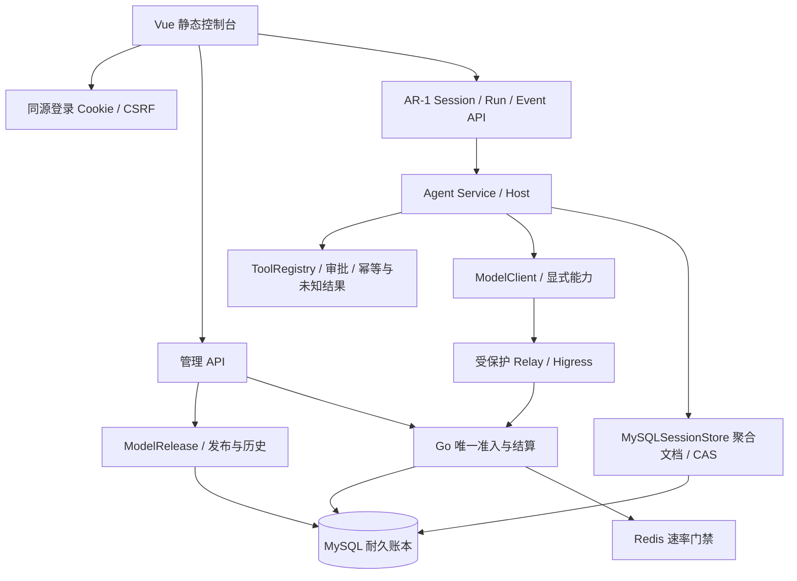

# MAAS-21 集成审查记录

本记录属于可部署版本的集成证据。最终部署运行、独立 QA 与真实供应商调用分别记录；历史作者测试不能替代本轮组合测试。

## 版本与依赖截点

2026-11-23 UTC，GitHub API 读回默认分支 `agent/MAAS-10-offline-metrics`，基线 `8dbf99ef59c847da775b83d0eeb7dc8f8bf48a9a`。Multica 的 MAAS-21/20/8/5 PR 关联表均为空，属于平台关联缺口。以下 PR 的 open/unmerged 状态来自本轮 GitHub API，提交包含关系来自本地 Git，二者证据分别保留。

| PR | 实际 head（本轮初始截点） | 依赖/用途 | 初始组合处理 |
| --- | --- | --- | --- |
| [#10](https://github.com/jianzi123/maas/pull/10) | `5481ac0fddbf02cb5e22e3145d5a3dc69c76acd9` | 管理 UI、单模型准备 | 已由 #17 包含 |
| [#13](https://github.com/jianzi123/maas/pull/13) | `35a0b8bf349e5dba631a0bfb018ff7212d002b4b` | INT-13-S1 快照预检修复 | 独立保留祖先 |
| [#14](https://github.com/jianzi123/maas/pull/14) | `00a3e62c539b726113fa21686e29096be88820e2` | 固定 Higress mTLS Relay 工厂 | 先于 #15 |
| [#15](https://github.com/jianzi123/maas/pull/15) | `ca1a173574d4ef2d20dfdc732e10476e2e035f25` | Installation 组合、真实身份验证选择器 | 包含 #14 祖先 |
| [#16](https://github.com/jianzi123/maas/pull/16) | `d1a571f28bbf81d8de482ceb2bb9034b751420e8` | 旧 AR-1 受控装配/事件探针 | 含旧 #18 `19e43ba`，另保留新修复 |
| [#17](https://github.com/jianzi123/maas/pull/17) | `f939f3b5e7eda20938c367f9a9ee3e34c43a81a4` | 现有 Chat/Agent UI 与 410 只读重建 | 保留原 #10 祖先 |
| [#18](https://github.com/jianzi123/maas/pull/18) | `a4c1347b6e01ed6fdf9925cf9ee26cb82251c405` | AR-1 draft.2，AR-R01/R02 作者修复 | 在新组合重新验证 |

初始隔离组合代码 `b38084153f796f3d6ee53179f1441341d3c4fb45`，标准四锁 `54dfb14acd3dbfd7ab788bf66a5822f78ebaa8f9`。本任务分支 `agent/maas/a281f8c79dd1`。所有原提交通过 Merge commit 保留，未改远端默认分支。`scripts/test-mysql.sh` 冲突采用合并选择器，保留 Agent SQL 与 `TestLocalRuntimeIdentities|TestInstallationComposition`，没有整文件覆盖。

最终新增实现的 head、四锁和包摘要应以交付清单及 `scripts/verify-delivery.py` 的输出为准；本表固定记录初始审查截点，不冒充后续 head。

### 正常产品与新控制台组合截点

后端最小产品源码为 `7b0230e01d145484cf1b966af6feffa5e54ef2bc`，原 PR18 四锁 head `c96e598ba245aeb02b418a6d601e036e892717d1`；前端正式配置源码为 `7f1b638eda55c67947fa411ed5a3d568ae413dd8`，原 PR17 四锁 head `7d7e6586724615821c169052291c58d010df6aab`。集成代码 `0afe74a9c68655955a7a4b1439c6b1070f7c07ab`，四锁 `fa81e175c0c6be832ba90c89310147b32f8c17ca`，仍在同一 [草稿 PR19](https://github.com/jianzi123/maas/pull/19)。该截点不是最终部署发布版。

`cmd/maas-service` / `internal/app/` 提供无开发标签的 `migrate|serve --config FILE`，正常业务仅 MySQL。`internal/app/migrations/001_product.sql` 增加管理员、登录 session、登录节流；原 Agent `001_sessions.sql`、kernel/release 迁移继续复用。迁移与运行 DSN 文件独立，正常 Go 与 Vue 使用同一 Cookie/CSRF 和稳定 principal。

本轮实测结果按范围分别保留：

| 范围 | 实际结果 | 明确限制 |
| --- | --- | --- |
| 初始组合部署预检 | 72 通过 | 未运行 Compose 或集群 |
| AR1 定向回归 | 14 顶层 / 26 test pass 事件，0 fail | `TestAR1` 不包含下列审查回归 |
| AR-R01/R02 专门回归 | 4 顶层、19 子测试，Windows/Linux 均过 | 集成运行，不替代原 QA 独立签收 |
| MySQLSessionStore | `TestMySQLAR1CommandsRestartAndTwoReplicaClaim` 通过 | 存储重开/命令幂等/双副本 claim；不是完整产品消息重启验收 |
| 原唯一账本 | `TestMySQLAgentChildrenUseOneLedger` 通过 | 两 child/两 usage/父聚合/known/unknown/held，仍限原受控测试 |
| 原身份/安装 | `TestLocalRuntimeIdentities`、`TestInstallationComposition` 通过 | 独立账户/默认角色、原工厂与 TLS 构造；registry/SecretReader/peer 是测试适配 |
| 新正式控制台 | 217 通过、11 条件 skip，build 成功 | 不累计旧 207/196/148；fork 启动失败原件保留 |
| 正常产品基础组件 | Linux 正式入口真实迁移、正常 DML 账户启动/登录；应用和 MySQL 重启后原 Cookie/CSRF/admin_id 恢复 | MySQL8.0.44，独立本地库；没有运行模型或工具 |
| 运行身份拒绝 DDL | runtime 调用原 migrate 返回 exit1 `kernel_migration_failed` | 仅本轮自有最小 DML 账户，不证明新安装生成器账户隔离 |
| 真实站点浏览器 | 3 检查过，pageerror0、Run POST0 | 真实 Go/MySQL 同源登录/配置/capabilities、只读刷新、退出；无旧会话内容或模型调用 |

MySQL重启后正常服务因连接/调度所有权失效退出，实测进程 exit0；应使用 `Always` / `unless-stopped` 恢复，不能只依赖 `on-failure`。首轮重启探测早于 readyz 的连接关闭原件保留，等待真实 readyz 后同一 Cookie 恢复通过。

组件原始证据 ZIP `MAAS-21-component-evidence.zip` 已上传主任务，SHA256 `06a3ea0e938a3966394bd9233809ba3a4b00b74c26aa17cfffdaebe9044ee69e`，27 个文件逐个回读核 hash。它不包含 Secret、Cookie、数据库或运行配置，不是 Compose/K8s 安装包。

### 该截点的具体未闭合项

| 级别 / 置信度 | 触发与证据 | 最小修复 / 原负责人 / 关闭条件 |
| --- | --- | --- |
| P1 / 高：正常入口管理发布和历史未装配 | `internal/app/runtime.go:127` 构造 Handler 未提供 `Releases/Revisions`。`internal/controlapi/http.go:226,244,251` 对应故障关闭。真实登录后 GET 发布列表、修订历史、发布操作均 503 `dependency_unavailable` | MAAS-20 复用原管理/历史工厂及独立 DSN；不能用 core 冒充 Reader。正常产品入口同一身份的列表/历史/操作和权限正反例通过后关闭 |
| P1 / 高：正常 MySQL 下没有可运行的无 Secret 工具演示 | 正式样例 models 为空，实际新建 Session 422 `model_not_configured`；真实适配目前 text-v1、Agent 准确拒绝。旧 agentcontrolled 文件入口不能补成正式演示 | MAAS-20 在同一产品服务提供显式启用的受控模型 profile，走原 MySQL/唯一子账本及两个真实工具；验证审批/停止/重启/原 ID 消费，不宣称真实模型已验 |
| P1 / 高：新安装草稿合并身份 | 只读审查 MAAS-8 尚未提交的 `deploy/release/migrate.sh:27–28`，当时 SHA256 `dba50994c4c892aab368cd0721352eae6a260abd563ca804cb09454ae546e97b`，history/payload/Operations 与 core 授同一 runtime、DEFAULT ROLE ALL；违反 `deploy/docs/database-identities.md:9–15,39` 与 sharedPrincipal 门禁 | MAAS-8 收窄当前未消费角色，启用管理时与 MAAS-20 恢复独立 DSN/账户/Secret。旧账户有效继承/默认角色必须核对，不能只删新增 GRANT 便视为已收紧。最终提交及真实角色允许/拒绝检查后关闭 |
| P2 / 高：SQL脚本集成损坏与选择器漏测，已修 | 本任务早期 PowerShell regex replacement 误解释了替换字符串中的 `$'`，损坏脚本末段；另外 `TestAR1` 未选择 `TestARReview` | 集成代码 `07b00d85796da273567c377c9d232f8bf08c3373` 恢复原作者干净脚本，保留 Agent/Installation 选择器，补 TestARReview；`bash -n scripts/test-mysql.sh` 通过，专门回归实际执行。旧失败截点保留，不把修前脚本称可运行 |

部署草稿 Secret 权限曾为 0700 子目录配非 root UID65532，纯 fixture 卷已复现不可遍历；只读回看原作者当前草稿已调整为外层 `.secrets`0700、挂载子目录0755、文件0444，同一 fixture 正例可读。该项记录为作者草稿修复，最终仍以提交及实际 Linux 安装结果为准。

MAAS-7 已收到固定 `879a7aa` 的有界独立验收；新 `fa81e17` 相对它的 `internal/` / `cmd/` 字节无变化，新增 UI 及部署范围另验。正式两包、同 MySQL 的消息/工具/消费重启、真实供应商和 K8s 实装尚未完成；上述组件结果不扩大为全项发布通过。

## 模块与调用关系

| 模块 | 实际源码 | 审查边界 |
| --- | --- | --- |
| 账本与预算/slot/终态 | `internal/kernel/` | 唯一消费，unknown/held 与 slot 分离；Redis 不作第二账本 |
| Relay 与 Installation | `internal/kernel/relay_runtime.go`, `internal/installation/runtime.go` | 配置存在不等于真实 Higress/Secret/validation 已接通 |
| 管理与历史 | `internal/controlapi/`, `internal/release/` | 读身份、操作写集与 publisher 权限分开 |
| Agent 核心 | `internal/agentruntime/service.go`, `host.go`, `ar_http.go`, `ar_commands.go` | 单 Session 活动 Run、持久事件、只读恢复、审批与未知结果屏障 |
| Agent SQL | `internal/agentruntime/store.go`, `migrations/001_sessions.sql` | 一个 CAS 聚合文档原子保存消息、Run/Step/ToolCall/Event/Checkpoint/审批；并非每个对象一张表 |
| 模型适配 | `internal/agentruntime/kernelmodel/relay_model.go` | 初始适配仅 text-v1；拒绝 tools-v1 和携带工具的请求，不绕过账本 |
| 两个真实工具 | `internal/agentruntime/tools.go` | 有界整数运算、当前主体可见模型；执行结果不是供应商模型真实性证据 |
| 控制台 | `console/src/pages/ChatWorkspace.vue`, `console/src/chat/http.ts` | 共用身份、GET 恢复、原 Run/child 用量，开发替身独立 |
| 旧受控入口 | `cmd/agent-headless/` | `agentcontrolled` 构建标签、loopback/受控模型；不能直接变成正式容器入口 |
| 旧本地管理入口 | `cmd/workbench/`, `internal/workbench/` | `localworkbench` 与测试适配；正式服务接线另验 |
| 部署与来源 | `deploy/`, `scripts/lock-unified-source.py` | 代码先提交，四锁单独生成；包内源码可复现，不引用个人运行目录 |
| 性能与研究 | 原性能分支及 `tools/perf`（有相应分支时） | 独立研究成果；不为部署装配丢弃，不借其测试数扩大平台结论 |

## 组合验收与已知问题

初始组合部署预检实际执行 `python -m unittest discover -s deploy/checks -p 'test_*.py'`，72 项通过（116.564 秒）。事件断开反例产生 Windows `ConnectionAbortedError` 服务端线程日志，测试进程返回 0；该噪声不作为新的产品断言失败。

初始前端默认并发首轮 196 通过、11 条件跳过，另有 3 个 fork worker 启动超时，退出 1。它不是完整通过，也不是 3 项产品断言失败。降低 worker 并发后结果与后续正式组合结果分开记录。Go 工具链、SQL、正式 Compose 与 K8s 实测结果在交付清单中列出，不填入未经执行的数字。

| 优先级 | 关闭条件 / 责任 |
| --- | --- |
| P1 交付入口 | 原 MAAS-20 补正式非 loopback HTTP、共享身份、MySQL 默认且无文件回退、明确迁移/失败/退出；MAAS-8 以真实构建启动及服务/MySQL重启证据关闭 |
| P1 供应商能力 | 真实 text-v1 / tools-v1 严格按实际适配和批准能力区分；缺真实端点/Secret 时保留未验；不能以受控模型调用结果关闭 |
| P2 AR-R01/R02 | 最终组合定向复验 100 消息分页失效/重建、tool attempt/总时限/取消/unknown，原 QA 独立签收 |
| P2 数据与计量 | 原 MySQLSessionStore、两 child/两 usage/父聚合、重复命令不新增消费，且服务/MySQL 重启后原 ID 可查；独立 QA 不由作者 SQL 数替代 |
| P2 包一致性 | 两份 ZIP 均含完整同一源码/四锁/部署文件，校验器对准确交付 ref 通过，摘要随附件交付 |
| P3 遗留元数据 | 旧来源锁生成器仍保留历史 `upstreamPRs`/分支说明；其历史字段不得代替本表的本轮真实 GitHub 状态与最终源码锁 |

## 集成及回滚路线

1. 原角色单流补正式后端、静态配置、Compose/原生 YAML 和演示；只合入准确提交，保留本表祖先与两个 SQL 选择器。收益是把已有实现接成可启动产品，避免重复内核。负责人 MAAS-20/5/8，集成 MAAS-21。
2. 对同一组合构建并实际启动 Compose，运行健康/身份/Chat/工具/取消/恢复/SQL用量 smoke，独立 QA 沿受影响矩阵验收。真实模型与受控 profile 分列。K8s 仅在独立获准本地集群实装，否则明确静态检查范围。
3. 固定代码提交后运行标准锁脚本、单独提交四锁，再从该 ref 生成两份包并执行 `python scripts/verify-delivery.py COMPOSE.zip KUBERNETES.zip --ref REF --output artifacts/maas21/archive-integrity.json`。默认分支合入仍等待具体批准，采用 Merge commit。
4. 升级前备份 MySQL 并记录 schema/镜像/配置/源码 SHA。回退应用时保留数据卷、账本、tombstone、unknown/held 和全部会话事件；不以删库、重放不确定 Run 或重复扣量“恢复”。破坏性迁移另走批准与备份验证。
5. 部署闭环稳定后再清理历史锁说明、测试脚本重复和未接适配。每个整理为独立可回退 PR，不改变共享契约或原故障关闭语义；架构师审共享语义、原作者实施、QA独立复验、Mika协调成员验收。
