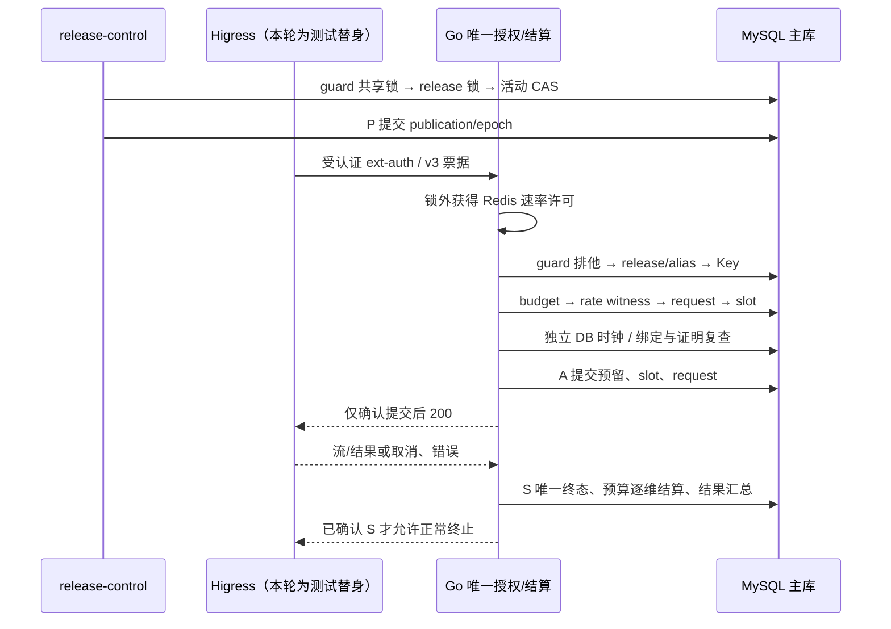

# MAAS-3 联合耐久调用内核：受控增量

本分支依赖 MAAS-11 PR #1 的 `630225697b8fcdd5e4d2f3ccd2a232e4d6b5259a`，新 PR 以 `agent/MAAS-11-integrate-controlled-release` 为 base，只评审调用内核增量。原 PR #1 的 base 为 `agent/MAAS-10-offline-metrics`；本次没有改写原发布分支、复制发布存储或建立新的远程仓库。

本增量交付可运行的 Go/MySQL 内核和受控装配。**Operator 与生产调用路径继续未装配、不可调用**。真实 Higress H1–H4、受保护 validation、Secret 通道和共享接点评审仍是后续门槛；MySQL/Redis 实跑不能代替这些事实。MAAS-3 保持 in_progress，MAAS-4/6 完整管理、统计页继续 backlog。

## 输入及协议

依据 MAAS-3 2026-11-05 交接、MAAS-12 v1.1 §10、仓库 v0.3/v0.4 正文，以及 MAAS-2 评审补充附件 `01a1aa90-a53d-734e-aa71-386bfb70b78f`。原冻结附件 `01a1a637-5727-730d-9662-60ec324daa42` 中的私有协议及终态 Schema 原字节保存在 `internal/protocol/contracts`，来源与 SHA256 见同目录 provenance.json。

票据仍是 **v3**、终态仍是 **3.0**；ObservationEnvelope 1.0 不参与授权、退款或关闭证明。D1 3.1 未切换。3.0 不允许 incomplete+succeeded，因此完整响应缺失可获取 usage 时，relay 不发送正常成功终止，持久化 failed/incomplete 并保留未知占用；不伪造 Token=0。原 total 为 null 时，即使由 input+output 计算预算总量，也保留原 null 并标记 component_sum/partial。

## 代码与数据归属

| 内容 | 位置及行为 |
| --- | --- |
| Key | `internal/kernel/store.go`：随机 256-bit 原值，只在创建确认时返回；DB 保存 HMAC-SHA256 verifier，pepper 由外部安全注入；主库同 Key 锁检查 epoch/撤销 |
| 预算、金额 | `money.go`、`admit.go`：三维组合原子预留；DECIMAL(38,0)/big.Int，分类总和后一次舍入；关闭维度为 null，限额 0 为拒绝 |
| 请求与快照 | `generation_requests`：不可变来源、活动 publication/epoch、route digest、能力、价表、预算计划、Redis 见证、原 deadline 和 slot binding |
| 全局容量 | `concurrency_slots` 固定集合，HELD/QUARANTINED 均占用；只有 FREE→HELD 增 allocation_fence，状态变化增 row_version |
| 唯一终态 | `finalize.go`：event_id 和 request/type 双重唯一；同输入重投不重复扣量，矛盾/乱序及旧 owner 拒绝；预算窗口和结果汇总同事务 |
| 物理回收 | `Release` 仅写 slots/release_log，终态、原 allocation 和经核验关闭证明均匹配才能回收；不写 Key/预算/事件/汇总 |
| 发布侧 | 沿用 `internal/release/mysqlstore` 的原迁移及存储；通过同一 Tx 的 Kernel 接口读取真实 guard、请求和 slots |
| Redis | `redis.go`：仅 AUTH/TIME/EVAL，无重试/后台连接/业务扣量；全局+Key 窗口及 request 去重一次 Lua 原子检查，MySQL 保留耐久同窗上限 |
| 请求 relay | `relay.go`：单一安装配置的私有 HTTPS Higress 目标；禁重定向、重放与跨来源回退；完整 JSON/正常 SSE DONE 等终态提交后才交付 |

业务 DDL 是 `internal/kernel/schema/0001_kernel.sql`，发布 DDL 保持原归属。显式执行 kernel.Migrate 和 mysqlstore.Migrate，各自有独立版本/hash/Applying 记录；不在启动时迁移，不提供删除历史的 down migration。两份迁移必须在低权限运行进程启动前由安装身份完成。

`kernel_guard` 的单行配置限定本次单安装/单 cluster 数据库；所有副本共用该固定容量集合。不提供跨数据库分片或多个独立 guard 的总额度保证。首版采用容量 guard 串行化以优先保证正确性，热点吞吐未评测。

## 三个提交点与锁序



发布侧先取共享 guard；准入先取排他 guard，再沿用 LockActive 持有 release/alias 锁。后续核心锁的相对顺序仍为 Key→budget→rate→request→slot。锁内无 Redis/K8s/RPC/供应商网络调用。锁后及提交前用独立 `SELECT UTC_TIMESTAMP(6)`；票据过期、跨预算/速率窗口、活动态或证明不匹配，整笔回滚。

此具体共享接点是本次受控装配实现，**尚未收到 MAAS-2 本轮代码级差异复核结论，不将其写成新冻结契约**。待复核点包括 publisher/核心 guard 权限、实体 DDL 及实际 H1–H4 证据读取适配。准入/暂停竞争及真实低权限 publisher 已在临时 MySQL 中验证；这不外推为生产线性化、HA 或任意跨系统时序保证。

## 失败与恢复

| 情况 | 实现行为 |
| --- | --- |
| 缺 Redis、epoch marker、活动证据、能力上界或价表 | 拒绝准入，无业务预留/slot/request；没有真实配置默认预算 |
| Redis 丢桶、许可低估 | MySQL 同窗见证仍阻止最终准入超上限；不把 Redis 尝试历史宣称完整 |
| Redis 重建 | BlockRate 阻断并增 epoch；InitializeEpoch/ReadyRate 仅供获准协调器显式使用；**完整重建下界、运行身份核验和编排适配尚未装配，禁止自动调用这些原语来空桶恢复生产** |
| 准入 commit ACK 丢失 | 返回 ErrCommitUnknown，不返回 200；按原 request_id 查询；重复票据拒绝，不重发模型 |
| 终态 ACK 丢失 | 按原 event_id/输入 hash 重投计量事件，只保留一个终态与汇总；不重新生成 |
| 取消、EOF、Go 重启 | 未知 Token/金额完整转 held；slot 保持 QUARANTINED；不把传输关闭等同生成停止、容量恢复或 usage 已知 |
| 原 owner 失联 | 达原 deadline 后 Recover 增 owner_fence；新 Store 读耐久状态补 interrupted；旧 owner 不可结算，不从恢复时重新计 TTL |
| 迟到关闭/no-send 证明 | 仅可释放已终态且原绑定匹配的 slot；不改终态、不退款；旧释放日志不操作更高 fence 的新占位 |
| 真实使用超过预留 | 记录真实值/overrun，冻结 Key 和相关能力修订；保留占用及审计，不裁剪数字 |
| 缺真实 H2/安全 profile | 不开放 deadline 自动回收；正常 DONE 本身也不作为关闭证明 |
| 格式错误/矛盾 usage | 接入 parser 拒绝，保守失败/未知；未实现 D1 3.1 原始异常审计扩展 |

slot 回收和资源清理只依赖已终态请求/安全传输与 slot 状态，held 金额可继续保留。只要仍有相关 QUARANTINED slot，发布侧 Drain/Retire 就不能假称排空。

## H1–H4：本仓库代码与外部改动边界

核验候选为 Higress **v2.2.5**，不是把 latest 功能当作所选版本。读取固定 tag 的 [AI Proxy main.go](https://github.com/higress-group/higress/blob/v2.2.5/plugins/wasm-go/extensions/ai-proxy/main.go) 和 [ext-auth main.go](https://github.com/higress-group/higress/blob/v2.2.5/plugins/wasm-go/extensions/ext-auth/main.go)；这里只能确认 hook/禁 reroute 等局部实现，不能证明项目安全机制已具备。

| 接点 | 本次仓库内交付 | 仍需外部实现/评审 |
| --- | --- | --- |
| H1 | `gateway/secret.go`：批准 handle/publication/实例/epoch、Secret UID/resourceVersion 精确绑定；内存快照、防跨来源、撤销；重启拿不到旧版本则拒绝 | Higress `plugins/wasm-go/extensions/ai-proxy` credential-provider 异步 lookup；受身份保护的同 Pod 本地通道、实际 Kubernetes SecretReader/RBAC/轮换；不支持 stock SecretRef 直连 |
| H2 | 核心 Proofs/Closure 接收 port 和原请求/票据摘要/实例/epoch/allocation 校验；无证明时隔离 | 真实 Envoy/router/transport 边界的 attempt、sealed、无待发、upstream-close reporter，独立目的签名、耐久接收/机制 registry；不能用 Wasm 流回调或 5xx 推断 |
| H3 | `gateway/receipt.go`：独立 key、对端身份、配置/route/plugin/credential/listener、publication/epoch 及时效校验库 | 真实有效 xDS 观察 producer、全服务副本覆盖、签名/撤销 registry、耐久 receipt 存储；当前 envelope 是待评审内部适配草案 |
| H4 | `protocol` v3 严格编码/Schema/HMAC 检查；`gateway/authorize.go` serving 消费器、重复头/路由/实例绑定、确认提交才 200 | Higress route metadata 可信注入、body/上界/实际 provider 参数一致性、内部头剥离、无 retry/hedge/fallback、真实硬时限和 signer 轮换；validation purpose 当前明确拒绝，待批准 validation intent/身份/预算链 |

H1 的库不会自行开监听端口或读取任意 Secret；H3 校验器不会自行产生真实配置生效事实。gateway Authorizer 的 Peer/signer 接点和核心 Proofs 仍需安装适配，未装配的进程继续拒绝。**未写另一个 Higress 仓库、未编译或部署 Higress 补丁**；相应仓库/交付由 Mika 协调。

## 迁移、调用与复现

本仓库所有新增方法是内部 Go API，不是开放管理或调试入口。受控装配结构如下，缺少真实 Proofs 时保持 nil 并拒绝：

```go
// 仅在获准安装/临时测试中，以独立 migration 身份显式执行。
if err := kernel.Migrate(ctx, migrationDB); err != nil { return err }
if err := mysqlstore.Migrate(ctx, migrationDB); err != nil { return err }
core, err := kernel.New(runtimeDB, approvedCluster, protectedPepper, approvedRateGate, approvedProofs)
if err != nil { return err }
gate, err := mysqlstore.New(runtimeDB, approvedCluster, core)
if err != nil { return err }
// gateway 认证/v3 验证后，唯一回调调用 core.Admit(ctx, gate, verifiedInput)。
// Confirmed commit 前不得发送上游，未知提交不得重放生成。
```

Configure、Key 策略、限流参数和 profile 均须显式批准。完整构造及终态/独立回收示例见 `internal/kernel/mysql_test.go`；其中 TST 价格、模型名、预算、实例及证据均为合成测试输入，不能进入真实配置。

`config/mysql/kernel-permissions.sql` 补充核心运行、publisher 窄读和独立 slot worker 权限。publisher 真实 SQL 测试证明不能改核心 Key/预算/request/slot/终态或执行 DDL；迁移与 slot 初始化不授予运行身份。证据 adapter 的最终表及窄读权限尚待装配评审。

```powershell
./scripts/test.ps1
```

```bash
# 在本任务缓存准备 Go 1.26.0、MySQL 8.4.7 与便携 Redis/共享库后：
bash scripts/test-controlled.sh
```

脚本启动私有 Unix socket 临时 MySQL/Redis，随机 schema，测试结束按记录 PID/实际 executable/父进程核对后停止并清除自有数据。Redis 会重写 argv，因此不能靠可变进程标题识别清理对象。不会安装服务或留下长期监听。进程与数据的实际检查结果见验证报告。

MAAS-4 复用此 Key/预留；MAAS-6 复用 usage_events、budget_windows 和同事务结果汇总；MAAS-11 复用真实 Kernel/Drain 接点与原发布存储，不另开账本。完整管理 API/Vue、统计聚合口径扩展、受保护 validation、真实外部/内网模型、DB 崩溃/HA、目标 Helm/K8s 和 A01–A34 均未由本增量验收。
