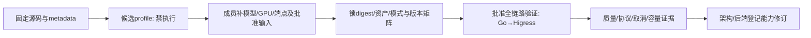

# 模型/引擎能力输入 v0.3（MAAS-9）

本轮交付可供MAAS-3/8/10和独立QA读取的三份机器profile、固定源码证据及离线验证入口。建议继续采用SGLang＋LWS单一路径；当前只有资料/源码/元数据和合成检查，没有模型加载、Token上界、GPU兼容或性能通过结论。

本版保持票据v3、终态3.0、ObservationEnvelope1.0。D1异常usage决策正文0.4.1/终态3.1已收到，但当前架构要求消费者协调后再切换；本目录将它作为proposal快照单列，严格3.0读端应拒绝，不开启新写入。v0.4.2-draft.1查询草案未改变本版公共Chat输入。

## 固定证据与版本身份

| 对象 | 本轮准确身份 | 已核对 | 不能外推 |
|---|---|---|---|
| SGLang | v0.5.18，commit `71de97b264b04dcd514cf904003028aefe9775c8` | Chat协议、UsageProcessor、取消路径、输出cap转max_new_tokens、Qwen2实现存在 | 不是本机已安装版本；镜像tag存在性/digest、CUDA/PyTorch/NCCL及GPU未验证 |
| LWS | v1.0.0，commit `588881cada4fcc145e83eced00b88af920892ec6`，API v1 | leader计入size、完整组replicas、组rank相关字段 | 未安装controller/CRD，未验证gang调度/网络/故障恢复 |
| 私有候选 | deepseek-ai/DeepSeek-R1-Distill-Qwen-7B，revision `916b56a44061fd5cd7d6a8fb632557ed4f724f60` | Qwen2ForCausalLM、BF16、config/tokenizer-config/generation-config；不是全量MoE | 没有下载权重、tokenizer词表或加载模型；不能视为成员已选择此模型 |
| 外部DeepSeek | 官方Chat文档当次快照；账户准确model/部署版本未提供 | prompt/completion/total和cache/reasoning字段的文档语义 | 文档不是账户访问权、不可变服务版本或真实输出上界 |
| Codex | 渠道待定，单独codex-pending.json | 区分官方模型API/已有代理/CLI三种含义 | 不选模型/账户/协议，不以Chat成功替代CLI兼容 |

每份下载源码的固定URL、完整SHA256、字节数及定位行见 `tools/model_capabilities/evidence/upstream-sources.json`。只读小型公开配置和源码，不执行/导入SGLang。本轮源码缓存逐文件摘要已核验，固定URL可用于复取比对；源码缓存不是离线包复现的前置，仓库不复制整份第三方引擎代码。tag只是源码核查起点，镜像digest和运行依赖须另锁。

## 本轮关键发现与对应动作

1. **模型位置声明与tokenizer限制不一致。** config的max_position_embeddings为131072，tokenizer_config的model_max_length为16384；config的BOS=151643，generation_config的BOS=151646。不能直接取最大值或把较小值视为已验证上限。下一阶段须用批准的完整tokenizer资产、模板、引擎配置验证有效context、BOS/EOS与截断行为，再建立可信I_up/O_up。当前profile的verified字段保持null。[固定config](https://huggingface.co/deepseek-ai/DeepSeek-R1-Distill-Qwen-7B/blob/916b56a44061fd5cd7d6a8fb632557ed4f724f60/config.json)、[tokenizer配置](https://huggingface.co/deepseek-ai/DeepSeek-R1-Distill-Qwen-7B/blob/916b56a44061fd5cd7d6a8fb632557ed4f724f60/tokenizer_config.json)、[generation配置](https://huggingface.co/deepseek-ai/DeepSeek-R1-Distill-Qwen-7B/blob/916b56a44061fd5cd7d6a8fb632557ed4f724f60/generation_config.json)
2. **模板含推理前缀。** add_generation_prompt会加入think标记，不能将外部DeepSeek的thinking=disabled设置照搬到该私有权重。已记录模板文本摘要，但effective_template_sha256和完整tokenizer摘要待实际加载采集。model metadata中的temperature=0.6/top_p=0.95只是来源声明；公共API仍不接受top_p，实际模式/采样须通过批准adapter profile固定。
3. **SGLang与外部DeepSeek的usage字段不同。** 此固定版本SGLang把reasoning_tokens放usage顶层，cache在prompt_tokens_details.cached_tokens；DeepSeek文档使用completion_tokens_details.reasoning_tokens及prompt_cache_hit_tokens。两者需不同映射，不能共用字段路径。SGLang源码可省略cache details，缺字段不能自动当0；即使源码内部用了默认0，也不证明平台获得真实计数。Token总量为父计数之和，子集不再次相加。[SGLang协议](https://github.com/sgl-project/sglang/blob/71de97b264b04dcd514cf904003028aefe9775c8/python/sglang/srt/entrypoints/openai/protocol.py#L202)、[usage计算](https://github.com/sgl-project/sglang/blob/71de97b264b04dcd514cf904003028aefe9775c8/python/sglang/srt/entrypoints/openai/usage_processor.py#L108)、[DeepSeek Chat文档](https://api-docs.deepseek.com/api/create-chat-completion/)
4. **上游SSE不能直通公开终止语义。** 此版本可在finish之后生成独立usage chunk；同一函数的ValueError流内处理路径可yield错误数据后继续yield DONE。平台须识别错误、核验usage并完成唯一耐久终态，再决定公开event:error/no-DONE或正常结束，不能把上游DONE原样当成功。[固定Chat实现](https://github.com/sgl-project/sglang/blob/71de97b264b04dcd514cf904003028aefe9775c8/python/sglang/srt/entrypoints/openai/serving_chat.py#L1691)
5. **取消调用存在不等于A08满足。** create_abort_task含两秒sleep；断连轮询还有不同分支。这里只确认路径存在，没有证明客户端停止后2秒内动作、GPU退出或后继容量恢复。Go→Higress→引擎rid和真实传输证据必须另验；trace或EOF不能退款/释放slot。[固定取消路径](https://github.com/sgl-project/sglang/blob/71de97b264b04dcd514cf904003028aefe9775c8/python/sglang/srt/managers/tokenizer_manager.py#L2160)

这些是固定源的事实及由此提出的验证条件，不是运行缺陷复现或兼容通过声明。

## profile读取与锁定条件

目录 `tools/model_capabilities/profiles` 中：SelfHosted候选、ExternalAPI候选、仅合成fixture各一份。全部 `execution_enabled=false`、approval=pending、hard_budget.status=unverified。工具Schema是算法输入清单，**不是ModelRelease、公共API或新的业务准入服务**；准确共享字段由MAAS-2维护。ControlledFixture是本工具分类，不能写入共享source.type。

SelfHosted明确架构/模型revision和源码版本；建议BF16、无新增量化、groups/size/GPU=1/1/1、TP=1、PP/DP/EP=1。多Pod时TP×PP必须等于每组Pod×每Pod GPU；groups是外层副本，不乘入TP。量化须锁checkpoint quantization_config、scale/group、内核后端/SM，并作质量回归；不能自动将BF16换成FP8/AWQ/GPTQ或使用任意同为4-bit的权重。

GPU型号/SM/显存/数量、NVLink/PCIe/P2P、跨节点网络/NCCL、驱动/容器栈、/dev/shm、内存和权重存储吞吐都未提供。KV形状推导仍为2×28×4×128×2=57344字节/token，非显存测量；不套MLA、不假定按TP平均平分，更不据此采购GPU。镜像hint是待核查输入，不能用tag替代digest或安装验证。

ExternalAPI不创建LWS/GPU；准确model/端点/Secret安全渠道、限额、thinking/cap语义、所有计费类别和价表仍待输入。能力证据必须与具体adapter/来源/模型/价格快照绑定，不因供应商文档有字段就将hard_budget标verified。来源失败不跨来源回退；未知用量与并发slot分离。



本工具只完成A/B及C的缺项检查，不能绕过D–G，也不会输出可直接授权调用的verified profile。

## 给各角色的可直接复用输入

| 消费者 | 文件/入口 | 必须另提供的运行证据 |
|---|---|---|
| MAAS-3 | profiles + vectors/adapter.json；公开Chat Schema正反例；current-3.0终态 | 正确adapter映射、输出cap、usage语义、error/DONE过滤、无重试及唯一结算 |
| MAAS-8 | SelfHosted engine/locks/source manifest；groups/size/TP算术 | 镜像digest、K8s/Higress/LWS/driver/CUDA矩阵、真实权限/Secret注入/共享存储、资源与排空 |
| MAAS-10 | evidence/perf-plan-v0.4.json，源提交b4461d5；perf_shape_assessment | 复用E1–E3、S/M/L及U/H，不另造指标体系；J02固定长短混合序列由性能主责收敛 |
| MAAS-7 | vectors/quality.json、vectors/acceptance-map.json和本工具回归 | A07/08/09/19/20/23/25/26/33/34独立复验，真实与受控分别记录 |

原性能计划S/M/L的input+output为384/2304/8704；建议4096服务context只在算术上覆盖S/M，**不能覆盖L**。必须经批准提高有效context并验证，或由MAAS-10显式重定义实验格；不能静默缩短L后比较收益。实际输入用完整模板和冻结tokenizer计数，不按字符换Token。J02要求同资源/精度/预算下的固定长短混合顺序，复用统一client clock和全sent分母；Worker/Go/客户端TTFT不能互换。没有真实profile不启用E2/E3。

8道质量题仍为合成冒烟，三次/题及21/24阈值未批准，model_scores=null；本轮只校验请求形状，不生成答案或评分。`project_usage`是合成投影oracle，不是产品adapter或账本实现。D1五组3.1异常样例与3.0严格读端分开验证；不能向tools/perf或内核偷偷升级版本。

## 复现及下一步输入

仓库根目录运行：

```powershell
python -m unittest discover -s tools/model_capabilities -p "test_*.py" -v
python tools/model_capabilities/check.py --output ../deliverables/v0.3/capability-report.json
# 可选：用本轮公开源码缓存重核原始文件哈希，不访问网络
python tools/model_capabilities/check.py --source-root ../inputs/capability-evidence --output ../deliverables/v0.3/capability-source-report.json
# 预期退出2：真实锁定输入未齐；不产生/覆盖报告
python tools/model_capabilities/check.py --require-locked
```

依赖与既有tools/perf一致：已有Python3.13.9/jsonschema4.25.0；本轮未安装引擎/运行栈。默认只读仓库内输入；--source-root只读取给定缓存，不自动联网。输出拒绝覆盖工具输入；无原始数据回显。通过的Schema、样本和算术检查不等于MySQL/Higress/取消恢复/效果/性能通过。

成员优先补充：①准确私有模型/checkpoint与许可/权重渠道或外部具体模型；②GPU型号/显存/卡数/节点与互联；③获准目标环境和版本/存储；④端点/Secret安全渠道及额度、预算/币种/价表；⑤上下文、输出、质量与延迟吞吐目标。真实生成前还需现有耐久Key/预算/slot/request/唯一结算内核及真实网关适配到位。只提供引用/渠道，不在评论提交秘密。