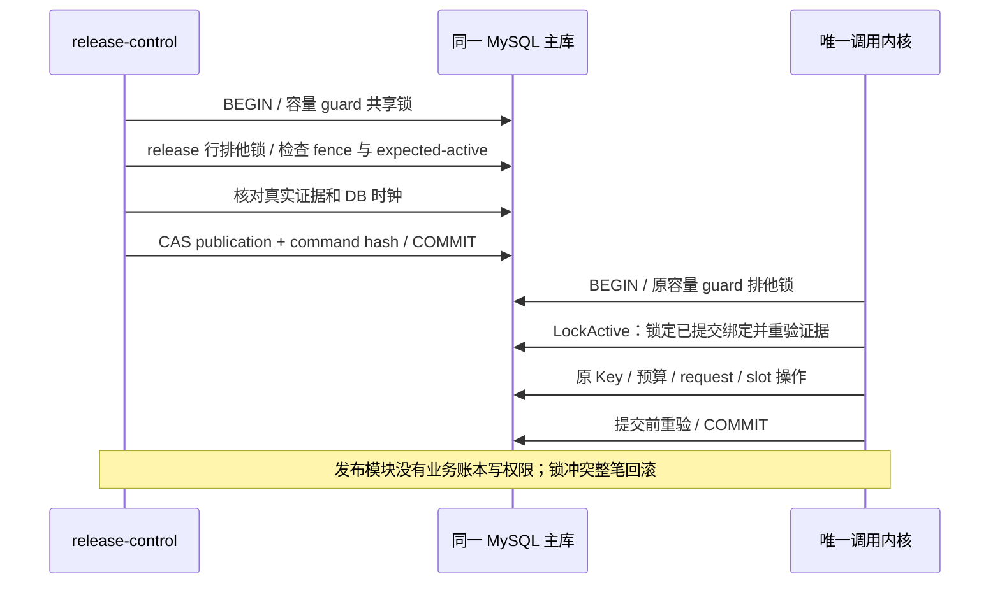
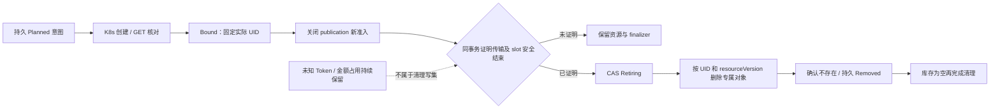

# MySQL 发布屏障与耐久 inventory：受控增量

本增量从集成提交 `9744fc4` 继续 PR #1。实现 `internal/release/mysqlstore`，默认 Operator **仍未装配生产依赖并保持不可调用**。数据库存储实现不代表 H1–H4/Secret agent、validation、最小调用内核或真实模型链路已完成。

## 契约核对与待确认接点

已核对仓库内架构 v0.4 §2/5/8/9 及 v0.3 §3/6/附录 B，并读取 MAAS-2 最新讨论。架构明确了表名、安全不变量及事务次序，但当前仓库和附件没有可沿用的实体核心 DDL。本增量只建立发布侧表，不臆造生产 `generation_requests`、`concurrency_slots`、Key、预算或终态表。

交付前还核对了 MAAS-2 新增评审补充（附件 `01a1aa90-a53d-734e-aa71-386bfb70b78f`）：三个提交边界、不可变绑定及 slot/预算分离与本实现一致。补充中的 D1 终态 3.1 与 v0.4 基线 3.0 仍分开管理；本增量不读写终态事件，不执行版本切换。

| 原契约 | 实现及边界 |
| --- | --- |
| 同 gateway+alias 跨 namespace 唯一 | `active_model_bindings` 主键含 cluster/gateway/alias，ASCII 二进制比较，持有者为不可变 CR UID；清理前保留 claim |
| publication 不复用，epoch 不回绕 | 每次新意图/回滚/关闭后的恢复分配新 UUID 和更高 epoch；unique `(cluster,cr_uid,epoch)`；到计数上界拒绝 |
| generation/fence/CAS | 主库 READ COMMITTED，release 行锁；命令精确比较 generation、fence、revision、expected-active；成功 command ID+hash 与切换同事务提交 |
| tombstone 不可逆 | 删除意图 Observe 就持久关闭准入并写 tombstone；后续同 UID 发布意图拒绝；清理后保留历史、拒绝复活 |
| 真实证据先于放行 | Activate 和 LockActive 都在同事务调用 Kernel，核对完整绑定/证据 ID/新鲜度；DB 独立 `UTC_TIMESTAMP(6)`，激活写集后再检查一次；缺接点、过期或不匹配均拒绝 |
| inventory 先意图、后资源 | Planned→Bound→Retiring→Removed；资源完整 tuple/hash 和实际 UID 不可替换；部分创建 ACK 丢失后可补绑同一 UID |
| 先关准入再排空清理 | Drain/Retire/Removed/RecordCleanup 在主库重读对应 publication 集合与同事务核心证明；in_progress、HELD、QUARANTINED 任一未结束均拒绝 |
| slot 与未知预算分离 | 发布 SQL 无任何业务账本写入；Kernel 只交回传输/slot 的证据，接口无金额、Token 或退款字段 |

**待共享契约复核的接点**：`Kernel.LockCapacity/PublicationEvidence/DrainEvidence` 和 `LockActive` 是实现侧 Go 内部接口，不是新公开 HTTP API。细化锁序为现有全局容量保护行 → release 行/别名绑定 → 原 Key/budget/rate/request/slot 顺序，保留原核心锁之间的相对次序。由架构师及 Mika 确认实际核心 DDL、guard/evidence 读取权限和接入点后，才能装配真实内核；本增量不宣称这一跨角色接点已经获生产验证。

Kernel 的所有操作必须使用传入的同一 `*sql.Tx`，只读主库证据并持有必要锁，不得在锁内调用 K8s、Redis、RPC 或供应商。候选证据还必须验证最新可信期望/依赖版本，不能因为旧 resolver 为旧摘要分配了较高 fence 就接受旧候选。旧 active 在 BlueGreen 准备期仍可按其原快照服务，但也需独立验证有效且新鲜的证据。



Go 唯一准入事务在原容量锁之后调用 `LockActive(ctx, tx, crUID)`，再执行原有 Key/预算预留/request/slot 操作；临提交前在已持有的锁内重验票据、活动绑定与新鲜度，最后只由调用内核提交。`LockActive` 不独立授权、不占用/释放 slot、不发送上游、不提交调用者事务。独立 slot worker 不需反向获取 release 锁，不能新增相反锁序。

发布事务通过 `Kernel.LockCapacity` 对核心 guard 取 `FOR SHARE NOWAIT`，只需窄 SELECT 权限；它与核心分配/回收的排他锁互斥。核心调用 `LockActive` 前必须已经取得其原有容量排他锁，不能把共享读锁当作预算/slot 写入许可。发布侧不为锁定读索取核心 UPDATE/DELETE 权限。

MySQL 的锁定读和 NOWAIT 行为依据[官方锁定读说明](https://dev.mysql.com/doc/refman/8.4/en/innodb-locking-reads.html)。唯一键插入遇并发时仍可能等待，调用方必须设有界 context 和驱动超时；不把所有 DML 都描述为 NOWAIT。死锁、锁冲突、唯一冲突回滚整笔事务，不在适配内部自动重试未知提交。

## 模式与恢复

新增七张发布表：`release_links`、`release_revisions`、`publish_intents`、`publications`、`active_model_bindings`、`resource_inventory`、`release_operations`，另有迁移记录表。CR spec 仍是唯一 desired source；本库只记意图摘要及不可变发布身份，不建立另一个 spec 同步循环。

`CloseAdmission` 可针对旧 active（Recreate）或整个 CR；`RecordCleanup` 必须再次验证关闭、排空与 inventory 全部 Removed 后才释放删除 CR 的 alias。旧 CR 的终止/重试不能重新占用已分给新 UID 的 alias。暂停保留 claim，恢复/回滚产生新 publication/epoch。

同 command ID+hash 重试读取成功审计结果，不重放旧切换，即使现在 fence 已更高。驱动 commit 错误一律返回 `ErrCommitUnknown`；不在内存标记失败、不重试生成新的意图 ID。恢复时先 Read/Observe 或以原 command/entry 身份查主库：Observe 复用已提交候选，Apply 复用提交记录，Bind 复用已提交实际 UID。

resource key 包含 cluster/API/kind/namespace/name，并核对完整字段，不能只依赖短名或标签。当前资源是 **publication 专属对象**；跨 publication 的同 key 复用被拒绝。SelfHosted runtime_instances/runtime_refs 的引用归零/Retiring CAS 尚待实现，不能用此 inventory 假称支持共享 runtime 安全回收。用户 Secret/PVC、共享 McpBridge 与安装资源不在允许写入/清理的对象集合内。



RequestValidation/RecordGatewayReceipt/RetireRuntime 未在这个适配中实现为假成功；缺相应真实适配返回 DependencyMissing。诊断 ObservationEnvelope 不被当作发布/关闭证明。

## 迁移与权限

DDL 为 `internal/release/mysqlstore/schema/0001_release.sql`，显式管理员操作调用 `mysqlstore.Migrate(ctx, migrationDB)`。New 和 Operator 启动不迁移。迁移使用独立连接和 MySQL advisory lock、SQL 文件 SHA256，以及 Applying/Applied 记录；中断可接续相同文件的 IF-NOT-EXISTS 步骤，checksum 不符或发现无版本归属的同名旧表则拒绝接管。

DDL 各语句独立提交，不能声称整份迁移可事务回滚，见[MySQL atomic DDL 说明](https://dev.mysql.com/doc/refman/8.4/en/atomic-ddl.html)。禁止通过 down migration 删除 tombstone、publication、命令或 inventory 历史；应用回滚保持向前兼容 schema，后续变化使用新迁移。实际环境应用及恢复演练需另行授权。

`config/mysql/release-permissions.sql` 是待替换数据库名的权限模板，不含用户密码或自动授权：publisher 只写发布表；reader 只读 gate 所需发布表；迁移身份与运行身份分离。Operator 不持数据库连接。真实内核 guard/证据所需的窄读权限由核心 DDL 主责补齐，本模板不授予业务 Key/budget/request/usage/terminal/slot 的写权限。MySQL DSN 从受控渠道取得，设置 ParseTime、UTC location、连接和读写超时，绝不打印 DSN/原始 SQL 错误。

## 测试复现及结论

默认 `go test ./...` 验证纯单元边界，缺少 `MAAS_MYSQL_TEST_SOCKET` 时显式跳过真实数据库组。禁止用 SQLite/fake-client 结果代替 MySQL 锁和提交证据。

本轮在已批准 WSL 中使用官方便携 MySQL **8.4.7**：仅下载/解包到任务缓存，不安装服务，不连接已有数据库。包来源及 MD5：

`https://cdn.mysql.com/archives/mysql-8.4/mysql-8.4.7-linux-glibc2.28-x86_64-minimal.tar.xz`

`4316ed2db397c3ba50ca29bb614d65fd`，已与官方同名 `.md5` 经 HTTPS 取得的校验值一致。测试依赖 libaio 仅从 Ubuntu 包解到缓存；这是本轮测试版本，不等于批准目标部署版本。

本地归档 SHA256：`543ec7d310c4f0786344d243663e5db9e985b03e741ee935370ab08b3274f05a`。

```bash
export MAAS_TEST_MYSQL_BASEDIR="$PWD/.cache/mysql-test/mysql-8.4.7-linux-glibc2.28-x86_64-minimal"
export MAAS_TEST_GO_ROOT="<已批准的 Linux Go 1.26.0 工具链目录>"
bash scripts/test-mysql.sh
```

脚本在随机 `/tmp/maas11-mysql.*` 目录初始化独占数据，禁 TCP/MySQL X，只用私有 Unix socket；显式测试标记防止误用目标数据库。测试创建并清理随机 schema，前台收齐结果，EXIT 停止记录的 MySQL PID；测试日志保留在 artifacts。内核 guard、request/slot/未知占用表和证据源均只在 `_test.go`，真实 MySQL 引擎运行的是发布侧 SQL 事务；这不证明真实 H1–H4、生产 slot 安全机制或完整账本已经实现。

验证结果和未执行项收于 `docs/mysql-verification.md`。MAAS-11 继续 in_progress，沿用同一草稿 PR，不自动推进 MAAS-3/4/6 backlog 或将整体标为验收完成。
