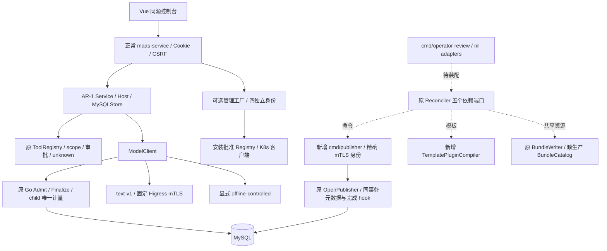

# 下一版集成审查与验证路线

本轮从统一默认分支 `agent/MAAS-10-offline-metrics` 的 `4402c456a155646ee4111e5f4a1f285621c11273` 接续。2026-11-26 11:50 UTC GitHub API 确认 PR19 已于 11-24 08:36:29 UTC Merge；双亲为 8dbf99e 与 d27d893，Git tree 均为 `b46995a1460c231bd43be92f7c12601aab7a8ba0`。不重复执行该合并。旧 d27 包和独立 QA 是已交里程碑，下一版结果单列。

Multica 的本单、MAAS-8、MAAS-3 PR 关联表本轮仍为空；以下状态由真实 GitHub API 和 Git 对象复证，不用祖先包含关系代替远端合并事实。

## 本轮准确 PR 截点与组合决定

| PR / 原责任 | 本轮远端 head / 状态 | 实际独有增量与组合决定 |
| --- | --- | --- |
| #11 / MAAS-8 | `8032b395a1564e7829794a7d61a285ad5b758967`，open/draft | 来源卡 12 组/62 字段、只读检查器和历史接线文档。纳入本地候选；卡仍明确是 8db 截点的审查材料，pending/null 不是目标批准或 runtime 配置。 |
| #12 / MAAS-3/20 | `532b1547b1bcef959c7caa9cc159b21eb8162a61`，open/draft | 独立 `cmd/publisher`、TLS1.3 mTLS/精确 Operator URI、同一 MySQL OpenPublisher 与原完成 hook。纳入可构建候选；不是当前 app 管理工厂的重复描述，也不是生产发布证明已齐。 |
| #20 / MAAS-3/11 | `1dcd9c713b217e9ded778e19e0c1ae09fb2b4744`，open/draft | 相对已纳 ca1 祖先仅新增固定摘要模板编译器、测试及 WSL review 清单/记录。纳入候选；`cmd/operator` 仍为 nil 适配器 review binary，不能称生产 Operator 完成。 |
| #9 / MAAS-10 | `4bed4b4be2ca294b9305cfb28fe1ab03f6164ec0`，open/draft | 独立研究线，AA-CPU-01 已由原 QA 确认且本轮原作者正在修。保留原 PR，未纳入此产品候选；不重开 GPU 资格窗口，不用未验内容更新产品安装包。 |

四个 head 均未包含于 4402；#11/#12/#9 的 merge-base 为 8db，#20 为 ca1。#20 相对 GitHub 原 base 的 20 文件含已纳祖先，相对实际组合的独有文件为 10，避免重复实现。

本任务独立分支 `agent/maas/cd9359fccf3e` 本地按 #12→#20→#11 以 Merge commit 保留祖先，初始组合为 `7a26cee07c0e23bd9f80a4de3d2bdb5af68f2f02`。三个 PR 的 identities/dependencies/runtime-interface 经结构化比较，除生成来源/库存/历史 QA 差异外语义相同；冲突仅四份生成元数据，保留当前语义，最终代码提交后再跑标准锁脚本并独立提交四锁。没有远端合并这些 PR。

## 后续实测截点（2026-11-26）

- 已继续保留祖先纳入原运维 PR22 `7cc6b06eb9c93e0a1cf17554d81a51743c80f6c4`；组合代码 `1380c4921d72cde058d6693653429697a46a8b9b`，四锁 `999b3e63f414699d76d33a291b1c624a47685f32`。它新增自有 kind/kubeconfig/namespace 的验证/保留数据升级脚本及低并发构建参数；19项安装器/编排回归通过，其中11项为新夹具，不是K8s实装。
- 原生运行实际门禁仍未通过：原运维最终实测可用1029MiB低于4096MiB测试预设，创建前拒绝。没有创建节点、拉节点镜像或写K8s资源；不接管无法证明本任务归属的既有集群。WSL Docker在Desktop恢复后已实际可用，启动前的不可用结论不再作为当前SQL阻断。
- publisher配置/mTLS与模板测试实际3顶层、26测试及子测试通过，0失败/跳过；Go1.26 Windows publisher构建成功。安装器8项和来源锁6项原回归也通过，分别记录。
- 新增真实 MySQL8.4.7＋TLS＋独立publisher进程用例 `TestPublisherMySQLService` 整体通过。使用独立无网络容器、Unix socket、专属卷；客户端及publisher为UID65532，DB使用独立publisher角色。实际覆盖关闭候选、缺生产证明拒绝Activate、同ID命令幂等/冲突、5条1142/1143拒绝、完成hook权限失败回滚、重开原状态、真正CLI存活204/就绪503与优雅退出，原业务表保持未写入。该结果是集成实测，不是独立QA或生产发布成功。
- 首次Go准备失败（继承错误GOROOT）与两次SQL环境失败保留。SQL最初误连Docker初始化临时mysqld，日志显示临时实例关停导致1053/CLI不可用；另一次/proc exe读取权限导致就绪探测超时。最终使用PID1命令名＋认证ping排除临时实例，再运行未改的原oracle；诊断测试改动已恢复，未通过放宽产品或用例断言取得通过。所有自有容器及卷清理完成。
- FC-1已经裁定迁移政策：002 Applying即使表完整也不可serve/ready；kernel1–3、release1–3、product1–2须Applied/摘要/结构权限，agent001无journal不能伪造状态。运行漂移须阻止新dispatch。原后端实现/同SHA独立复验仍待交接，不能把规范当代码已修。
- R-P01已有原前端独立站点实证：旧试用目录可进入，但合成无效Key的POST返回405/Allow GET,HEAD，无请求ID，request/usage增量0。它不是供应商失败；原前端正以可选playground能力开关和Chat引导处理，并修登录bootstrap晚到401竞态。
- 独立QA在4402/d27真实Chrome站点新增10项唯一断言，9过1失败。开放 `QA-CHAT-RACE-001/P2`：实际已准入取消后后端cancelled，界面仍running并假报协议异常；停止/批准与旧poll尾部read的两种迟到顺序须由原前端修复，再交原QA定向复验。不得把补抓正常当关闭；畸形关联仍须拒绝、原ID不重放/不重计。102条历史/真实410、工具批准、双重启及只读业务hash的已通过范围保留在4402，不外推新UI。
- PR9后续作者修复为 `0cea087d21cac94d41f2f93443a48c3a7eaef00f` → `82284e8fae1c8c11f437e2506aa125694b1f7f99`，已读回新远端head，独立CPU复验仍待完成。研究线继续分离，不将整个PR9或CPU通过写成产品/GPU加速。

以下初始审查表保留发现时点；本节和最终主单验证矩阵覆盖其后续“待定/验证中”状态。最后组合的完整SHA、四锁、两包与仍未验项以最终VERSION和交付记录为准。

## 入口与依赖图

## 实质审查与必须收口项

| 级别 / 置信度 | 触发、源码与影响 | 最小动作、责任与关闭条件 |
| --- | --- | --- |
| P1 / 高：必需迁移状态门禁 | `internal/app/database.go:150,176`：migrate 校验 Applied/hash，serve 仅核001；原 QA 的002 Applying但表完整仍ready观察保留，缺表确实失败关闭。 | MAAS-2 定必需版本/checksum与恢复政策，MAAS-20实施，MAAS-8升级顺序，MAAS-7复验。至少覆盖正常Applied、002 Applying/缺标记/错hash/缺表、显式恢复、runtime无DDL以及原数据/ID/held保持。不能在serve自动改状态。 |
| P1 / 高：正式 tools-v1 桥 | `internal/app/models.go` 与 `internal/agentruntime/kernelmodel/relay_model.go` 仍限正式text-v1；离线循环不是正式供应商能力。 | MAAS-20沿原ModelClient/唯一账本消费MAAS-9 v0.8向量；MAAS-2收口版本/上下文/输出界限。参数分片、先校验整批、回填、usage/EOF/取消/错误及不重放定向验证；真实调用另需批准来源输入。 |
| P1 / 高：独立命令服务不等于完整 Control | `internal/release/http.go` 明确 CommandClient 仅 Send；`ports.go` 的 Control 另需耐久Observe/Read/Drain；`cmd/operator/main.go` 构造空 Reconciler。#12只提供命令POST。 | MAAS-2/原后端决定这些内部端口的进程/身份边界，复用原mysqlstore，不发明公开读接口或第二账本。先给配置与可构建组合，缺生产事实保持DependencyMissing。未知commit按原command/operation查回，禁止自动重发。 |
| P1 / 高：共享目录与真实发布证明 | `internal/release/bundle.go` 需要持久 BundleCatalog 的 Snapshot/CheckCurrent；`internal/kernel/publisher_port.go` 仍无真实proof adapters。#20模板只消费已批准公开元数据，不批准插件语义。 | 原MAAS-20/3/11复用Inventory/BundleWriter及原票据/receipt/validation端口；安装方给批准Registry、模板/插件digest、实例/boot集合、Secret UID/RV、issuer/时效/撤销和Higress信任。无这些事实不能Activate或用四bool填就绪。 |
| P2 / 中：旧在线试用挂载观察 R-P01 | MAAS-12在4402指出旧试用POST /v1/chat/completions；正常app路由只挂AR-1/admin，其余交静态Handler，后者对POST为405。该项仍是源码推断，空models可先阻止发送，尚无本轮正常站点HTTP失败结论。 | MAAS-5/20在当前正式站点定向确认；按服务端真实能力接原受保护公共处理器或明确不可用/引导现有Chat，禁止前端直连供应商、绕平台Key/原准入与计量。 |
| P2 / 高：K8s实装与同SHA浏览器缺口 | 旧d27 K8s只有14资源schema；独立QA旧段未做浏览器。 | 原MAAS-8已在本轮独立环境推进，原MAAS-7已在本轮补独立浏览器。新候选冻结后只补受影响差异，保持实际SHA/入口/配置和原ID。资源或节点失败保留原件，不能以schema替安装。 |
| P2 / 高：PR9 AA-CPU-01 | 原QA在4bed研究线确认：lease soft529/hard589时job soft550仍被接受。该研究实现未进入本产品候选。 | 原MAAS-10本轮CPU限定修复，原MAAS-7沿原反例/正控复验；在准确新SHA关闭前保留缺陷。GPU/模型执行0、旧missing/null及性能结论不变。 |
| P3 / 高：历史来源说明 | 标准锁脚本保留历史PR/分支说明；PR11输入卡保留明确8db历史截点。 | 不用历史字段当实时状态。当前版本采用本文GitHub/Git实读及最终VERSION；稳定后独立整理，不为文档变更重跑业务全矩阵。 |

#12 输入边界已检查：命令体最大16KiB，原canonical拒绝重复键/未知字段，CR UID必须与路径匹配；TLS要求验证客户端链及唯一精确SPIFFE URI；HTTP不自动重试；PublisherKernel不接core DSN/pepper或第二推理入口。SQL/process健康不等于可发布，当前readyz固定503。私有MySQL TLS信任材料和真实批准部署仍需安装方提供，不从示例路径推定存在。

#20 已检查：安装侧按规范64位digest查模板，整体hash与Resolver版本绑定，禁止任意selector覆盖和常见内联凭证，输出仅匹配原Ingress、FAIL_CLOSE/defaultConfigDisable；JSON深拷贝避免修改模板。该检查不证明Wasm二进制语义或生产者身份。review清单的ready失败是明确限制，不能删探针制造Ready。本轮没有对历史maas-wsl等集群执行写入。

## 验证台账与关键路径

本轮实际命令、stdout/stderr和ref在主单补充证据中记录。旧MANIFEST 52/52＋8守卫/8 CLI、879 AR-R01/R02、旧Compose/SQL/浏览器分别保留原截点，不累计为本轮成绩。

| 范围 | 本轮状态 |
| --- | --- |
| PR19合并双亲/树、最新4PR准确head、平台关联缺口 | 已只读复证 |
| #11来源卡检查 | 当前组合命令已退出0；62字段/8篡改负例均拒绝；不产生批准或目标配置 |
| #12 mTLS/配置及#20模板正反例、publisher构建 | 单编译进程验证中，最终结果按主单准确记录 |
| 新迁移/tools代码 | 原后端活动运行中，未把未交付代码写成已合入 |
| 新同版Compose升级/恢复、K8s实装、独立浏览器 | 原角色已续办；候选冻结后按真实差异归并 |
| 真实供应商/正式发布/真实管理目标 | 未验；输入缺口见下表 |

关键路径：架构门禁/能力决定→原后端可审代码→本组合按准确head接合→受影响回归→代码提交→标准四锁独立提交→固定同一ref→同版运行/独立QA→重生两包与逐文件校验。先给可构建增量，不让缺真实凭据阻塞代码；也不把离线结果当真实模型验收。

| 仅缺的具体真实输入类别 | 需要的批准事实 |
| --- | --- |
| 模型/模式与能力 | 准确型号/版本/显式模式、adapter/profile、text-v1或tools-v1版本、tokenizer/template与上下文/完整计费输出上界、usage最终性 |
| 来源/安全通道 | 固定批准端点/出口、publication/授权域、平台Key及供应商Secret的受保护引用与轮换，不在评论粘贴Secret |
| 费用与预算 | 价格版本、币种/精度、请求/token/金额上限及周期、验证额度和单次计费上界；不套旧TST或示例USD默认 |
| Higress发布信任 | 已批准插件/模板digest与实际镜像、TLS/mTLS CA/SAN、可信signer/issuer、接流实例/boot/listener和配置digest、Secret UID/RV、receipt/validation生产者与撤销 |
| 管理/目标动作 | 明确kubeconfig/context/namespace/域、四独立DSN/最窄角色及有效权限、Registry和允许的动作；本轮只使用已有授权的隔离本地环境 |

## 可执行后续与回滚

1. 原MAAS-20/2完成门禁及tools桥，MAAS-21按真实head合入隔离候选；保留原选择器和已关闭MANIFEST。收益为启动政策和模型能力准确，回滚到兼容镜像时保留原库/身份/held，不回放未知写。
2. 原MAAS-8/5/7沿现有运行交同SHA实际入口、K8s/浏览器/升级恢复证据；新模板/publisher只验证其实际功能，目标与真实provider未验则列未验。没有资源时交精确错误和脚本。
3. 主单统一重锁/两包。来源、镜像标签/可得性/构建命令、摘要和测试矩阵同ref；不并行产同版不同内容的包。
4. 成员具体授权后才远端Merge新PR。当前PR19已合并；#11/#12/#20本地候选不等于远端合入获准。研究PR9等原负责人/QA修复后再独立决定纳入范围。

升级先备份MySQL、安装ID、pepper/cursor及独立身份配置，停止旧写者再迁移；失败不在serve执行DDL、不清schema、不重建预算或tombstone。应用回滚仅换兼容镜像，迁移按前向恢复政策处理。候选阶段不修改全局Git身份、默认分支、权限、WSL集成或他人资源。
