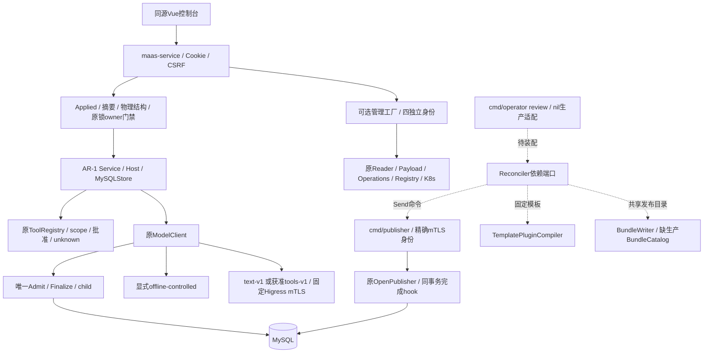

# 下一版隔离组合审查与验收路线

本轮沿正常 `cmd/maas-service`、真实MySQL、唯一Admit/Finalize接续。当前是PR21隔离候选，**QA-MIG-SHAPE-001/P1仍开放**；不表示生产就绪或远端合并授权。本文更新到2026-11-27失联恢复截点，早期tools/页面组合实测对象为 `36d34e2f8e65f394dc457bc499f0f42b2fb3e5f5`；随后文档变更不扩大运行成绩。最终代码、四锁、镜像标签由包根VERSION.json给出。

## 版本、祖先与PR台账

统一默认分支仍为 `agent/MAAS-10-offline-metrics`。GitHub/Git复证PR19于2026-11-24 08:36:29 UTC通过Merge commit `4402c456a155646ee4111e5f4a1f285621c11273` 合入，树等于已交d27；不重复执行该合并。Multica关联表此前为空，属于平台关联缺口，不能仅凭祖先关系证明PR已合并。

| 工作 | 本组合纳入head | 依赖、入口与决定 |
| --- | --- | --- |
| PR11 来源输入卡 | 8032b395a1564e7829794a7d61a285ad5b758967 | 基于8db的历史观察/待批准值，不产生运行权限或配置 |
| PR12 独立publisher | 532b1547b1bcef959c7caa9cc159b21eb8162a61 | cmd/publisher、原OpenPublisher/完成hook；精确mTLS URI、窄身份，缺证明仍ready503 |
| PR20 模板/review资源 | 1dcd9c713b217e9ded778e19e0c1ae09fb2b4744 | TemplatePluginCompiler消费固定digest和公开配置，不是完整Operator |
| PR22 原生验证脚本 | 7cc6b06eb9c93e0a1cf17554d81a51743c80f6c4 | 基于4402；自有kind/kubeconfig/namespace、迁移顺序、保留数据升级 |
| PR24 迁移/取消隔离/tools/物理形状 | eab5d69eea21e2f098ca1e7ade87ce7d39a5d7d8 | 5fffa8b修订保留532/edece87/dd1018e，已纳入主组合；P1独立签收待验 |
| PR25 页面入口/登录/竞态 | eec33eb42d48d78c2dce832c21e188f24403b134 | 锁定da77b39、产品febb4f7；在393正常受控站点独立关闭9页面＋4只读契约，原范围保留 |
| PR21 主组合 | agent/maas/cd9359fccf3e | Merge保全上述祖先；最终代码/锁见主单及VERSION，不以作者独立锁覆盖组合 |
| PR9/PR23 CPU研究 | 未纳入产品 | AA-CPU-01在82284e8由PR23/e191827独立关闭，仅Windows/WSL CPU控制；GPU/模型/性能未知不变 |

#11/#12/#20的原head未包含于4402；#11/#12原merge-base为8db，#20为ca1。组合按依赖保留Merge祖先，冲突仅生成元数据，最终标准锁重算。没有远端合入这些开放PR，也不将整个研究线引入产品安装。

## 模块与调用图

迁移身份先migrate，运行身份仅serve；没有DDL或文件/内存/SQLite业务回退。显式reconcile-product-002仅在无活跃scheduler、原runtime/schema锁及摘要/布局/受控Key验证合格时修复本版本Applying标记，不是在线全域升级或重置账本。runtime新增的只是kernel/release journal只读SELECT，不借四个私有管理身份。

正式工具桥保留原票据v3/body/plan绑定及唯一计量。必须新批准不可变Profile.Tools/UsagePolicy、deepseek-chat-tools/1/non-thinking；整批工具先验证后执行，从原Run/Step.Call恢复source call ID。工具JSON独立采用有符号安全整数域，财务Canonical仍非负；公开AR-1不增私有supplier字段，text-v1不放宽、不剥工具历史或切demo。正式模型需显式ledger.diagnostics，迁移只补缺并拒冲突，runtime只读；示例不表示批准。

独立publisher仅提供CommandClient.Send，完整Control还缺耐久Observe/Read/Drain。cmd/operator仍nil生产适配，Inventory/BundleCatalog和真实receipt/validation/issuer等证明未装配。模板hash、单Ingress/default-disable/FAIL_CLOSE检查不证明Wasm语义或生产身份。管理工厂接线不等于目标验收。

## 证据化问题与关闭条件

| 级别/状态 | 触发、证据、影响 | 原负责人及最小关闭条件 |
| --- | --- | --- |
| **P1已修订、独立关闭待验 QA-MIG-SHAPE-001** | 原1f8/e12的47/3失败保留。eab5d69已接合46181fab，只读41对象/50原唯一键/terminal非NULL、12 SHOW VIEW；组合六顶层22项通过 | 原MAAS-7以最终同树复验3反例及必要正反；不能用作者/集成通过代签。私有数据/marker写/DDL仍拒绝，原取消保锁与unknown-held不重放保留 |
| **P1未完成：正式安装有效权限前置** | migrate.sh只审role_edges/default，预供模式早退；direct/列级grant、角色模板及mandatory/代理/动态权限未全核 | FC-M-AUTH-PRE-1，原MAAS-8唯一实施自动/预供、新装/升级都audit后启动；原架构明确窄自省/一次性合法可见性，缺信息非零，不能靠4角色标签或未绑定JSON放行；运行期full漂移另列未来能力 |
| P1未验：完整发布/生产证明 | release/ports.go、http.go、bundle.go和cmd/operator缺上述真实适配；缺证明Activate准确拒绝 | 原架构/后端沿同一mysqlstore/receipt端口提供装配；批准事实完整后验。未知命令按原ID查回，不自动重发 |
| **P2在393受控站点独立关闭 QA-CHAT-RACE-001** | 旧4402失败件保留；393/c99正常Go/MySQL8.0.44/Chrome158，9页面＋4只读契约，真实原GET四迟到顺序通过 | 本组合console/API零差异保留该范围，停止/批准各一次，4Run/6child/6request6usage6finalized、无重放重计；不外推真实模型/新部署 |
| P2在393受控范围独立验证：R-P01/登录 | 旧未挂载POST405/无RID/账本0增量；PR25默认关闭playground并引导Chat，bootstrap真实401迟到期间禁输入/提交，正常登录1POST | 原QA同站点通过；引导Chat不销掉公共消费Key API或真实/v1验收 |
| P2未验：同版部署/K8s | 旧d27有真实Compose；PR22只有19夹具/14资源schema。续办运行失联无结果，最新621140KiB低于新增节点4096MiB门槛 | MAAS-8恢复原现场/自有资源，条件满足再实装迁移/分权/探针/SSE/PVC/升级；不足保留错误，不收养外部集群或停他人服务 |
| P3历史来源卡漂移 | journal SELECT改变publisher-grants字节，8db卡当前检查正确失败 | 保留历史快照/pending null，当前权限用最新模板与实证；不在失败基线上累计负例通过 |

## 验证矩阵

不同截点/断言不能相加成全仓或A01–A34通过。模型/Higress/rate/publication/closure在本轮SQL中是受控注入，真实供应商调用0。

| 对象/范围 | 实际结果与边界 |
| --- | --- |
| 组合36d34e2 Go协议/Agent回归 | 30顶层/124测试及子项，0失败/跳过；tools-unit-regression.jsonl |
| 组合36d34e2正常入口构建 | Go1.26.0、GOMAXPROCS1/-p1/GOMEMLIMIT256MiB，maas-service构建exit0；不依赖agentcontrolled标签 |
| 组合36d34e2 app真实MySQL | 正常HTTP/Cookie/CSRF→受控mTLS→原Admit/Finalize→两个真实工具/批准/第二child通过，2request/2usage/38Token；非法第二工具0执行且原child计19。另含旧门禁/维护/取消用例，不覆盖后来独立QA的3个漏测结构 |
| 组合36d34e2 kernel真实MySQL | complete/invalid_arguments/missing_usage/partial_cache/eof/source_error/cancel七子场景通过；testExit0、专属容器和卷清理 |
| 组合36d34e2前端 | 5文件64测试、生产build及format通过；同树浏览器独立关闭待验 |
| publisher/模板组合 | 3顶层26测试及子项/构建通过；真实MySQL+mTLS+UID65532进程通过，live204/ready503、幂等/冲突/5项权限拒绝/完成hook回滚/重开，业务写0，不是发布成功 |
| 迁移取消原反例 | 旧0b实际查询中取消关闭持锁连接的失败保留；dd1018e改普通池查询并核原ownerID后，集成反例及实际换owner正反通过，无重新GET_LOCK掩盖失锁 |
| 独立QA 1f8/e12 | **47过/3失**；取消保锁、维护CLI、四窄角色、应用/MySQL重启unknown-held原ID1request1usage范围保留；结构P1开放 |
| 独立QA 4402浏览器 | 10唯一9过/1失；工具/102历史410/双重启/同Cookie及只读hash范围保留，竞态不据作者演示关闭 |
| 来源卡 | 早期62字段/8篡改通过只保留原截点；新journal授权后publisher-grants摘要失败，历史批准不重写 |
| 安装器/锁/schema | 19安装编排、6来源锁及旧14资源schema有证据，不是K8s实装 |
| 已关闭历史 | 879 AR-R01/R02；d27 MANIFEST四种包52/52＋fetch8守卫/8CLI；PR23 CPU按各原SHA保留 |
| 失败原件 | 错误继承GOROOT、Docker临时初始化mysqld误就绪、/proc exe探针权限、npm网络/临时vitest、失联运行及QA真实失败保留。环境/夹具修正与产品结果分列 |

## 真实输入与未验项

仍需批准准确模型/版本/显式模式、adapter/profile/tools能力、tokenizer/template及完整计费输出上界/final usage；固定来源、平台Key/供应商Secret的安全引用；价表/币种/精度、request/token/金额上限及验证额度。不要在评论粘贴Secret，也不套TST/USD示例预算。

Higress仍需获准插件/模板digest、真实实例/boot/listener与配置集合、CA/SAN/issuer/签票材料、Secret UID/RV、receipt/validation生产者和撤销事实。管理需四独立窄DSN、获准Registry/kubeconfig/context/namespace及动作域。缺输入不阻塞本地授权代码，但阻止声称生产可调用或管理目标通过。

真实供应商/生产Higress、管理目标/完整Operator、同最终SHA K8s安装/PVC重启、GPU/付费及整体A01–A34未签收。MCP/外部HTTP工具/文件/shell/长期记忆/子Agent未增加产品执行器。

## 接合、复验、打包与回滚

1. 原MAAS-20交P1最小修订，主单核真实head/差异并保留祖先接合；原QA复验3反例及必要正反，FE竞态和受影响tools按准确同版另列。
2. 提交代码后跑python scripts/lock-unified-source.py，四锁独立提交；冻结code/ref。主单唯一运行python deploy/release/package.py --ref REF --output NEW_DIR生成Compose/K8s两ZIP，并核verify-delivery/verify_bundle、SOURCE、库存、逐文件hash/标签。
3. 原运维按资源执行同版升级/恢复，不以schema/夹具替安装。新包不重命名旧候选，范围随VALIDATION注明；成功构建路径是包内原生构建＋Dockerfile.native，未公开推镜像，纯多阶段网络失败保留。
4. 新PR远端Merge、真实目标部署/付费/发布仍须具体授权；PR19不重复请求。本轮不改全局Git身份、默认分支、权限、WSL集成或他人资源。

升级备份MySQL及安装ID/pepper/cursor/身份配置，停旧scheduler后迁移；失败不serve自动DDL、不清库或重建预算。只在schema兼容时切回应用镜像，保留原request/usage/held/事件和未知执行，不自动重放。每项后续沿原负责人，避免平行内核与重复派发。

## 2026-11-27修订接合截点

原PR24 eab5d69已保全祖先接入46181fab（393＋eab），新门禁以三次批量metadata查询核41对象/50原PK-UNIQUE和usage终态非NULL，九份原DDL、console/API schema零变化。精确12对象SHOW VIEW按FC-M-META-1，不能读私有数据或导出view定义。组合正常Linux入口/测试二进制构建与定向vet通过；生成器完全匹配原清单。SQL组合结果与最终代码/四锁以主单及包VERSION为准，原QA-MIG-SHAPE-001仍待本同树定向签回，不把旧1f8失败件改写。

QA-CHAT-RACE-001已在393/c99正常受控Go/MySQL8.0.44/Chrome158独立关闭：9唯一页面＋4只读契约通过；四迟到顺序、idle/畸形关联、R-P01/bootstrap；4Run/6child，6request/6usage/6finalized，不重放/重计。证据评论01a21af8-56a4、SHA f6ad550d83610b26419b7c073e96935e0c18aa052d28da73dddc5f9ab566e4ad，QA PR26/ca97只作证据分支，不覆盖产品锁。本次未改console与公开契约，按实际差异保留关闭范围；真实/v1消费与新部署仍未验。

正式安装另有必须收口项：原架构FC-M-AUTH-PRE-1（01a21aed-52b6）要求新/升级、自动/预供两模式都先完整effective-grants audit。当前migrate.sh仅角色边/default检查，预供模式早退；direct/列级/role模板变更/mandatory或代理等尚未全覆盖。原MAAS-8在一次性安装入口独立实施，主单评审，不把形状41/50或4角色当完整最小权限；缺可核元数据必须非零，不给runtime mysql.*或借管理DSN，不自动撤旧权。运行期full漂移审计是原后端独立后续，未实现，不由安装通过销项。此候选尚不能签正式稳定安装。

原运维6285原件证明三镜像构建、kind Ready/PVC Bound，安装仍止于mysql-ready exit124，无迁移Job/App/业务。恢复已停止自有节点并保留PVC/Secret/身份，Exit137不称优雅停机或数据库恢复通过。新同版K8s运行须按准确ref/资源重新验证；不把部分基础设施或schema算完整安装。

上方早期问题表/验证矩阵保留发现时点；本节更新取代其后续待实现/待QA描述，最终通过/失败/未验以交付矩阵为准。原879/R01/R02、d27 MANIFEST、PR23 CPU范围不重开。

组合46181fab实际结果：MySQL8.4.7六顶层/22测试及子项全部通过（原三反例＋变体/最窄元数据权限/原journal/reconcile/unknown-held/查询中取消）；另原正常HTTP工具闭环一顶层/3测试及子项通过，完整与非法第二工具分别保持原唯一child用量语义。两阶段均exit0、0失败/skip，专属容器/卷已精确清理。正常Linux产品构建、测试二进制与定向vet通过，九DDL、console和公共AR-1相对393零差异。以上为集成证据，不替代原QA三反例关闭或安装effective-grants验收。最终code/ref由VERSION给出；其后本次只补报告和标准四锁。
