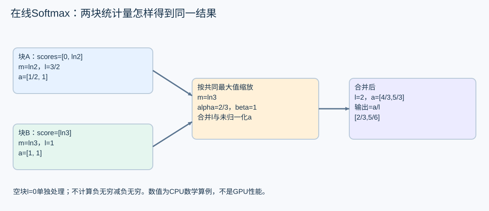

# 在线 Softmax 与分页 Attention 的完整推导

Attention的一行输出是Σ exp(s_j)v_j / Σ exp(s_j)，s_j=q·k_j/√D。直接产生整个score矩阵容易占用大量内存；分块算法维护足以合并的统计量，仍能得到相同数学结果。

## 三个状态量为什么足够

对一块有效score，定义m=max(s)，l=Σexp(s−m)，a=Σexp(s−m)v。输出是a/l。块A与B合并时：

~~~text
m = max(mA,mB)
alpha = exp(mA-m)
beta  = exp(mB-m)
l = alpha*lA + beta*lB
a = alpha*aA + beta*aB
~~~

把A项展开后，每项都是exp(s_j−m)，B同理，因此合并后的分子分母与一次计算全部元素相同。计算保持稳定，避免先求exp(1000)再相除。浮点加法顺序仍可能产生小误差，不能称位级相同。

空块使用l=0、a=0，不对它计算−Inf−(−Inf)。[merge](../../../tools/perf/engineering/attention_lab.py)显式处理空状态，整行全遮罩按本实验约定输出0。这个约定需要和真实backend核对，不能无条件假设所有库行为一致。

## 把合并算一遍

取score=[0,ln2,ln3]，V=[[1,0],[0,1],[1,1]]。第一块两个元素：mA=ln2，lA=1.5，aA=[0.5,1]；第二块：mB=ln3，lB=1，aB=[1,1]。

新最大值ln3，alpha=2/3、beta=1。于是l=2，a=[4/3,5/3]，输出[2/3,5/6]。独立dense softmax权重[1/6,2/6,3/6]得到相同结果。改变分块大小或合并顺序，测试在float64容差内核验；极大score、全遮罩和空状态分别覆盖。

## 从一行扩展到 GQA

实验输入为Q[Hq,Sq,D]、K/V[Hkv,Sk,D]，要求Hq可整除Hkv。查询头h对应KV头floor(h/(Hq/Hkv))。每个查询行分块读取K/V并合并状态，输出[Hq,Sq,D]。

[streaming](../../../tools/perf/engineering/attention_lab.py)逐行逐块实际执行；[dense](../../../tools/perf/engineering/attention_lab.py)使用完整分数矩阵作独立对照。默认案例Hq=4/Hkv=2/Sq=3/Sk=11/D=5，块大小1/2/4/16；第一行人为全遮罩。测试另增加不同尺度与非整尾块。

这实现的是CPU前向参考，没有dropout、反向、MLA或GPU分页kernel。online softmax的状态还可以用于split-KV后归并，但跨block/GPU的通信、归约顺序与额外缓冲须另行实现。

## 位置而不是形状决定 causal mask

当Sq=2、Sk=5，查询对应末尾绝对位置3、4，允许矩阵是[1,1,1,1,0]和[1,1,1,1,1]。左上角三角处理的是另一种位置关系。若使用prefix、chunked prefill或已有KV，应先确定每个q/k的绝对位置和有效长度，再构造mask。

本实验suffix_mask直接按k≤Sk−Sq+q生成，拒绝Sq>Sk。模型滑窗、跨段位置或不同cache布局需专门扩展。只验证输出finite与shape无法发现错mask，所以回归包含明确的允许矩阵。

## 分页地址如何进入 Attention

假设物理storage[P,H,B,D]，逻辑位置p：

~~~text
logical_page = p // B
physical_page = page_table[logical_page]
offset = p % B
linear_index = ((physical_page*H + head)*B + offset)*D + d
~~~

[gather_pages](../../../tools/perf/engineering/attention_lab.py)验证表长、范围和有效长度，将物理页[4,1,3]重组成逻辑序列。最后一页只取有效位置。它只验证地址重组；页是否属于该请求、代次是否仍有效、设备是否在途，要由第5章页池与真实执行协议保证。

真实分页Attention可以在kernel内根据表直接读取，无需先gather成完整连续KV。CPU gather是数学参考，不应把其拷贝当成生产必须成本，也不能宣称已经验证FlashInfer分页GPU实现。

## 哪些资源被节省，哪些工作还在

分块避免把完整score/概率矩阵长期写入HBM；QK与PV数学工作仍存在。块大小影响复用、寄存器、shared、并行度和尾部。Decode长KV还可能通过split分摊，但要付归并与额外调度成本。

在真实实验里保持shape、mask、dtype、KV布局、位置与backend条件，报告正常设备时间、内存和转换成本。局部加速后再看Worker与客户端指标。原论文的实验收益不能移植成当前模型数字。

机制来源：[FlashAttention论文v2](https://arxiv.org/abs/2205.14135v2)、[PagedAttention论文](https://arxiv.org/abs/2309.06180v1)。本节数字、代码与GQA/分页验证是本仓库CPU实验。
