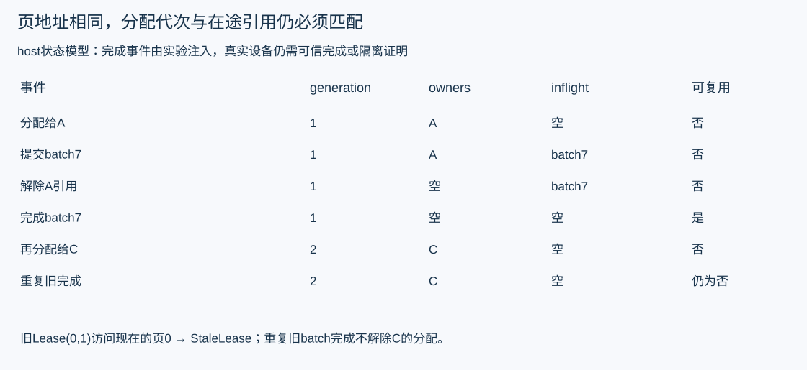

# KV 页池 代次与异步回收的实现

GPU内存管理最危险的错误通常出现在取消、共享与迟到完成交错时。实际实现[PagePool](../../../tools/perf/engineering/kv_lab.py)包含分配、引用、COW、提交pin、完成与回收，并在每次变化后检查不变量。它是host状态模型；完成事件由实验注入，不是实际GPU停止证明。

## 用 Lease 解决地址复用的 ABA

Lease=(physical_page,generation)。一个物理页首次给A是(0,1)，释放再给B成为(0,2)。旧A回包即使仍说page0，也不能访问B的分配。

_page先核对范围、代次以及页是否仍在用，旧lease抛StaleLease。索引相同不代表同一次分配。记录generation只能拒收旧控制消息；旧kernel若仍在运行，仍可能写同一地址，因此还必须有在途pin和真实设备完成边界。

内部assert用于实验状态自检，不能作为生产输入/权限校验；统一runner拒绝Python -O，防止优化模式关闭这些检查后生成成功报告。公开输入检查仍显式抛异常。

页包含owners集合、inflight批次集合和tokens。free集合里的页必须没有owners、inflight或可见payload；在用页必须至少被一个owner或批次持有。该模型故意将请求引用与设备在途引用分开。

## 四个操作的状态变化

| 操作 | 前置与变化 | 失败后应保持什么 |
|---|---|---|
| allocate | 从free取页，generation递增，建立单一owner | 池满抛MemoryError，不借用Retiring页 |
| share | 验证原owner，添加目标引用；部分页有在途访问时拒绝 | 没有非法新增引用 |
| release | 删除本owner；没有owners且没有inflight才回收 | 调用方去重解除事件，不能双释放 |
| complete | 按原batch解除其所有pin，再检查可回收页 | 已完成batch重投为no-op；不碰新代次 |

submit先验证整批所有owner/lease，再统一加pin。若第二个binding非法，不能留下第一个页被部分pin住。相同batch身份同payload不重复提交，异payload冲突。实际系统还要验证Worker incarnation、来源与可信完成；本状态模型没有凭证验证。

## 一次共享尾页的写时复制

A持有页P=[11]，share给B，owners={A,B}。B追加22前，clone_for_write先分配新页Q，再复制P的数据，最后从P解除B引用。Q=[11,22]，P仍为[11]，两者内容独立。

顺序不能反过来。若先解除P上的B再申请Q，池满时B已经丢失原引用。现有代码先allocate，OOM会保持P原owners与内容。测试用容量1复现这一路径，确认没有“优化失败后破坏旧状态”。

满页无需原位追加，应在请求页表添加新的逻辑页。完整不可变前缀可继续共享；部分共享页在写入前COW。真实GPU copy还要等待写者/读者依赖，不能凭host list复制的同步行为推断设备安全。

## 用六种事件顺序验证回收

两owner A/B共享一个页，batch持有该页。枚举release A、release B、complete batch的全部6种排列。任何前两个事件之后仍不能进free；三个都完成后才能回收。每个前缀都运行assert_invariants。

再立即分配给C，旧lease应拒绝；重复旧batch completion返回False，不能把C的页放回free。这个组合同时覆盖引用计数、在途集合、ABA和幂等完成，比只测试allocate/free各一次更有意义。

真实系统还需处理事件丢失、设备错误、多stream、多batch和Worker崩溃。没有可靠完成就保持隔离或按已评审机制停止整个实例，不能靠TTL猜安全。业务slot和未知财务held按原协议独立处理。

## 从页池进入 prefix radix cache

Radix节点通常压缩一段token边；查找时比较最长共同前缀，部分匹配可能拆边。节点关联KV页/位置、锁引用及可逐出状态。命中token长度、命中物理页和可逐出字节是三个不同量。

一个安全的逐出候选至少要没有活跃请求/设备依赖，且从索引解除与物理释放的顺序可恢复。逐出父节点还要确认子节点与引用；不能按最长token节点直接释放其所有底层页，因为它们可能共享。

本实验没有另写生产radix cache。固定SGLang源码中match_prefix和evict的读取路线在第11章；PagePool提供可独立核验的所有权基础。模型、tokenizer、位置、精度、配置和安全域都属于复用条件。

作业：增加两个batch同时pin共享页，分别完成其中一个，证明仍不能回收；再写出真实CUDA事件接入需要的证据字段和失效策略。完成实验不授权解除真实slot、修改账本或强删finalizer。
