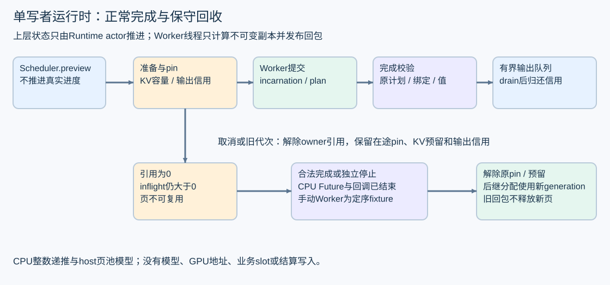

# 调度 KV 页池与异步 Worker 的受控闭环

本章接续工程作业二。Runtime实际复用Scheduler的保守容量策略和PagePool，通过不可变计划、完成队列和单写者状态推进，把独立实验连接起来。ManualWorker用于定序故障，ThreadWorker实际在有界CPU线程池执行；计算为明确的合成整数递推，不加载模型或权重。

代码入口：[Runtime](../../../tools/perf/engineering/runtime_core.py)、[Worker消息与适配](../../../tools/perf/engineering/runtime_worker.py)、[场景CLI](../../../tools/perf/engineering/runtime_lab.py)、[回归](../../../tools/perf/engineering/test_runtime.py)。

## 运行与交付格式

从仓库根目录，用普通Python 3.10+运行，闭环自身仅需标准库：

~~~text
python tools/perf/engineering/runtime_lab.py --output tools/perf/reports/my-runtime.json
python -m unittest discover -s tools/perf/engineering -p "test_runtime.py" -v
~~~

固定参数与事件策略可复现，run nonce和实际线程标识随运行变化。使用新的输出文件名；--scenario可选择backpressure、cancel_reuse、unknown_ack、stale_worker、cow_rollback、invalid_result或threaded。默认全部执行。退出前关闭并join所有本次CPU线程，结果中保留all_run_owned_threads_joined。

报告是cpu-runtime-integration-1.0，独立于八类算法报告、ObservationEnvelope及业务终态。它包含合成输入、固定来源/活动修订绑定、request/trace、页代次、队列和状态轨迹，明确没有GPU、模型或平台API执行，也不输出吞吐/时延提升。

## 一个请求的三个进度

计划、计算完成和消费者读完是三个进度。Scheduler.preview复制当前小规模状态，按原step策略选工作，不推进真实请求；dispatch成功或接受状态未知后，真实状态保留容量和在途关系；合法完成回包到达后才推进prefill/decode与生成数。

消费者通过drain读取已复制到host队列的整数结果。最后一次计算完成可以先释放已安全的KV，但输出仍未被读完。snapshot分别显示reason、output_drained、busy与queued，不能把一个completed标志解释为设备、传输和业务结算全结束。

preview采用deepcopy以便检查教学状态，不作为生产高性能调度实现。真实引擎应使用明确的无副作用计划与状态版本接口，并测量其热路径成本。

## 不可变计划与来源关联

Binding冻结source、CR UID、release revision、publication/epoch及权重/引擎/配置修订。RequestSpec保存合成request/trace和只读输入ID；WorkItem记录阶段、旧进度、context、追加位置和Lease；BatchPlan带Worker incarnation及规范化摘要。

计划检查嵌套tuple、token范围、进度与上下文长度、每batch请求唯一性。frozen dataclass本身并不验证所有内容，所以输入边界还显式检查。更换Worker时要求绑定完整相同且incarnation未使用；不能借恢复自动切换来源或模型修订。

这些是工具内部数据结构，不新增平台API、票据或终态字段。实际接入仍由Go冻结业务绑定，运行时只消费获准任务。

## 一次提交怎样保持资源原子性

| 阶段 | 具体动作 | 失败时的规则 |
|---|---|---|
| 预览 | 排除busy、取消、终止和无输出空间的请求，取得候选 | 不改真实进度或容量 |
| 准备 | 保留内部KV容量，必要时COW，分配未来页，冻结计划 | 未发送给Worker时可完整回滚引用、页表和容量 |
| pin | 验证整批owner/Lease，登记batch在途引用 | 验证失败不留下部分pin |
| 注册 | 在Runtime记录busy与输出信用，再调用Worker | 即时完成的回包也有原计划可关联 |
| 接受 | 已确认接受或ACK未知 | 保留busy/pin/信用，不另造一次任务 |
| 完成 | 核对来源、incarnation、摘要、请求顺序、KV更新和输出类型 | 缺字段、错绑定或矛盾结果故障关闭 |

只有PreAcceptRejected这个受控适配器明确保证“未启动”的错误，才允许解除本次pin并回滚。其他异常均保留ack_unknown；错误类型或网络超时不能证明没有执行。

内部分配故障的回归在COW成功、后续分配失败处注入MemoryError。恢复后原共享页仍为[1]、owners仍为A/B、页表与已提交进度不变，Worker未接收任务。重试时使用新的提交身份。

## 容量与输出信用分别计数

内部KV预留为R(r)=ceil((I+O−1)/page_tokens)。不变量是已分配页≤活跃内部预留≤池容量。它不代表Go的请求额度、Token预留或财务held。

输出也必须先预留：每条请求queued+inflight_output_credits不超过其队列容量，全局总和不超过global容量。每次可产生输出的工作只取一个信用；慢消费者不读时，后续生成暂停。只计算queued而遗漏在途输出，会让同时完成的两批冲破上限。

信用在确认完成、已知未接受回滚或独立停止后解除。取消请求不立即释放仍在途的信用。内容已复制为独立host整数，因此KV释放与消费者排空可以分开；真实backend若输出仍引用设备buffer，必须另外持有它的生命周期。

## 取消与后继页复用的实际轨迹

合成A输入[1,2]、输出cap3、页大小2，完整容量预留2页。第一块prefill已提交时，取消A：

| 观察点 | 内部预留页 | 已分配物理页 | 原batch状态 |
|---|---|---|---|
| 取消后尚未完成 | 2 | 1 | pin仍在；owner引用已解除 |
| B尝试进入 | 2 | 1 | 保守容量不允许B借用A预留 |
| A合法完成到达 | 0 | 0 | 丢弃取消后的结果，解除原pin |
| B取得同一物理页 | 1 | 1 | generation递增，绑定新batch |
| 重复A完成回包 | 1 | 1 | 幂等忽略，不释放B |

完成回包必须属于当前登记的CPU适配器、原batch和原plan。相同结果重投不重复输出；相同身份出现矛盾结果则停止新派发并隔离其他在途任务。已发布的旧结果不重新结算，也没有真实业务终态写入。

## Worker 代次失效与独立停止

replace_worker将旧在途任务隔离并阻止继续调度这些请求。旧incarnation回包即使看起来完成，也不能推进新状态或解除页；缺完成时资源保持保守占用。

回收需通过登记的旧适配器提供独立停止能力。ManualWorker的停止是确定性fixture，停止后不再执行其队列；ThreadWorker关闭执行器并等待实际Future和回调结束，才返回本地stop token。错误token被拒绝。

这个token只是本进程对象能力，不是生产签名、Higress传输证明或GPU停止证据。替换实际引擎仍须沿已有关闭/隔离协议，slot恢复、未知用量和财务held分别处理。

## 真实 CPU 线程的两个竞态

Future变为done可能早于完成回调发布。wait_all先等待Future，再用Condition等待本batch回包已发布；不能简单查看done后就断言Runtime已看见结果。

回调也可能在提交线程里同步执行，因此Receipt保存的是计算函数返回的真实执行线程ID，而不是回调当时的线程ID。测试用两个任务的Barrier验证实际有两个CPU线程，并核对逐请求顺序；不据此宣称并行加速。

Future.cancel对已运行任务不能充当停止。测试让合成计算等待有界Event，取消请求或等待超时后，页和预留仍保持；释放Event、观察合法完成后才回收。所有测试finally都解除门闩并join，不留下运行归属的线程。

## 验证覆盖和可比较结果

38项新增回归覆盖定序乱序、取消/重复/旧代次、ACK未知、嵌套不可变值、来源/计划错配、COW/OOM回滚、错误结果、输出背压、真实CPU线程和CLI门禁。其中一项用24组固定种子交错，按独立多项式闭式oracle验证输出，检查容量、输出上限及有限负载完成。

合成递推state=(state*131+token)%65521，初值17。输入[1,2]输出3个ID应为[29786,492,64944]，用来检查分块和异步推进的一致性；这些ID没有自然语言或真实模型含义。保持相同合成输入改变完成顺序，结果应保持逐请求顺序。

当前实现完成R1受控CPU接线。真实GPU Worker、stream/event、真实KV向量与模型质量、Go/Higress完整链路继续在R2/E1等阶段按批准输入接入；本章不把状态实验当作C02–C08验收或性能收益。

线程语义依据[Python 3.13 concurrent.futures](https://docs.python.org/3.13/library/concurrent.futures.html)及[threading](https://docs.python.org/3.13/library/threading.html)。实现与原始七场景轨迹随本轮交付。
