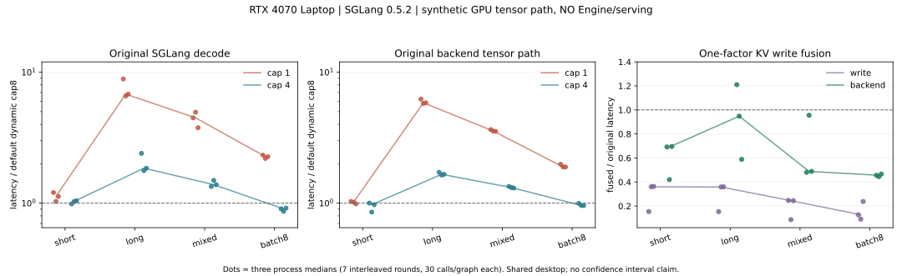

# 16｜SGLang Decode/KV：从真实后端到CUDA核

后续cap6假设已有[第17章GPU实测](17-cap6-empty-cta.md)；本章保留前一批原始假设与取舍，不能据历史未测文字覆盖新结果。

本批直接运行固定SGLang 0.5.2 / b0d25e72c401f37b55d689ddbf05b8c583afe854的Triton decode、请求索引和KV池代码，随后只替换KV写入做融合对照，并补齐已安装sgl-kernel成熟融合核的最终基线。六份安装源码与官方固定提交逐字节一致，见[源码锁与定位](../../../tools/perf/operators/local_gpu/decode-source-lock.json)。

这是**实际GPU上的后端张量实验**：没有权重、ModelRunner初始化、完整Engine、scheduler或serving。后端对象用__new__建立有界状态，再调用原始metadata/forward方法；Triton由实验显式选择，没有证明Engine的自动backend选择。不要把“实际调用了SGLang代码”扩大成“已运行完整SGLang推理”。

当前产物与全部逐进程结果见[summary.json](../../../tools/perf/operators/local_gpu/evidence/decode-v0.16/summary.json)。本章接续[第15章CUDA闭环](15-local-gpu-cuda.md)，不重跑其RMSNorm探索。

## 先看结论与反例

1. **保留成熟动态split策略。** 长序列4097位置，cap8三进程raw decode图事件中位数为172.07/223.98/218.59us；cap1为1529.00/1477.05/1488.62us，降低split上限明显退化。减少分片并不等于减少kernel launch：两侧仍然都是stage1、stage2两个核。
2. **局部收益有边界。** batch8×1024时cap4的raw decode比cap8略快，但没有稳定传到含KV写入的backend范围。保留原配置，不据此修改引擎默认值。
3. **有依据的KV融合原型。** 实测原KV写入为两个ATen索引写核，融合后一个CUDA核。同一batch8 backend张量路径，原图事件中位数120.80/124.31/118.65us，融合为55.09/55.30/55.36us。仅为本地、共享桌面GPU上的探索结果。
4. **退化不能删。** 长序列第一进程原backend154.25us、融合186.68us，退化约21%；另两进程改善，存在明显波动。因此没有通用替换或生产集成结论，更没有Engine/模型加速结论。

每个点为一个进程的中位数；进程内7轮交错、每次图重放含30次调用。三个进程/种子分别配对，不把轮次当独立实验，不提供小样本显著性或置信区间声明。三项研究分别运行，各批对象/内存工作集及图输出保留方式有差异；不能跨批比较绝对时间。最终选型以补齐成熟核的同一次对照为准。

**最终取舍：优先复用成熟库，不采用教学原型替换。** 补查发现sgl-kernel0.3.9.post2已有store_kv_cache；只战胜双写路径不足以建立原型价值。追加三个独立进程的原生双写/成熟核/原型同条件对照后，原型没有稳定跨shape优势；部分backend点更快、mixed两进程更慢，且纯写与backend表现不一致。没有证据承担额外自定义核/ABI/索引生命周期维护成本。

## 1. 请求逻辑顺序怎样变成物理KV地址

核心shape沿现有小模型配置取Hq=9、Hkv=3、D=64，但长度与数据均为合成实验，不表示该模型已运行4097上下文。每条请求只有一个decode query，KV包括当前新token；没有未来token。

- Q：[B,9,64]，FP16，stride=[576,64,1]。
- K/V池各为[physical_slots,3,64]，stride=[192,64,1]。
- page_size=1，一个物理slot对应一个token；本版本decode文件明确只支持这一页大小。
- 物理slot随机打散，保留slot0和未引用位置为NaN。用原始索引核检查它确实按逻辑顺序读取，不能靠连续地址蒙混通过。

例如长度[17,257,1023,2049]：

~~~text
kv_indptr = [0,17,274,1297,3346]
request table[row, logical_position] -> physical_token_slot
kv_indices[indptr[b] + position]     -> physical_token_slot
out_cache_loc                       -> 各序列最后一个逻辑位置的物理slot
~~~

query head7对应KV head floor(7/3)=2。FP16中某个K元素的字节偏移为：

~~~text
((physical_slot * 3 + kv_head) * 64 + dimension) * 2
~~~

不是把第7个query head当第7个KV head，也不是按所有请求的统一最大长度读KV。独立FP64 GPU参考从**原逻辑K/V**计算，不复用被测gather或分阶段softmax。新token位置先毒化为NaN，再要求实际KV写入恢复正确值；未引用池位置继续毒化。池内已写K/V还逐位比较，不只看attention输出近似相等。

## 2. 实际调用链与代码位置

~~~mermaid
flowchart LR
  A[合成请求表/长度] --> B[TritonAttnBackend.init_forward_metadata]
  B --> C[cumsum / 索引 / 动态split]
  C --> D[RadixAttention.forward]
  D --> E[AttentionBackend.forward]
  E --> F[TritonAttnBackend.forward_decode]
  F --> G[MHATokenToKVPool.set_kv_buffer]
  G --> H[decode_attention_fwd]
  H --> I[stage1 partial attention]
  I --> J[stage2 LSE merge]
~~~

[decode_path.py](../../../tools/perf/operators/local_gpu/decode_path.py)只准备请求表/层/池/metadata状态，不实现替代attention。实际执行的是：

| 固定源码 | 本批直接执行的部分 |
|---|---|
| srt/layers/attention/triton_backend.py | init_forward_metadata、get_num_kv_splits、forward_decode |
| srt/layers/attention/utils.py | create_flashinfer_kv_indices_triton，名字含flashinfer不表示安装/执行了FlashInfer attention |
| srt/mem_cache/memory_pool.py | 原始MHATokenToKVPool分配、访问与K/V索引写入 |
| srt/layers/radix_attention.py | 原始层forward及head/scale等配置 |
| srt/layers/attention/triton_ops/decode_attention.py | 原始MHA/GQA分派、stage1和stage2 Triton核 |
| srt/model_executor/cuda_graph_runner.py | KV写路径读取get_is_capture_mode；本实验未启用Engine捕获模式 |

完整文件hash、URL和AST行号在源码锁。GPU trace确实出现create_flashinfer_kv_indices_triton、get_num_kv_splits_triton、_fwd_grouped_kernel_stage1、_fwd_kernel_stage2，以及对应ATen写核。

本批没有模拟scheduler、Radix前缀缓存命中或ModelRunner。真实模型生成后需要另确认哪条backend分支实际被选中。

## 3. 为什么split有收益也有代价

stage1把一个请求的KV长度按split分段，每段做稳定softmax并保存局部输出o_s和LSE_s；stage2合并：

~~~text
LSE_s = m_s + log(sum(exp(score_j - m_s)))
o_s   = sum(exp(score_j - m_s) * v_j) / sum(exp(score_j - m_s))
o     = sum(exp(LSE_s - M) * o_s) / sum(exp(LSE_s - M))
M     = max_s LSE_s
~~~

不能直接平均各段o_s，段长不等或分数尺度不同都会出错。当前query位于上下文尾部，所以看到所有已列KV；复杂sliding window、sink、MLA或speculative路径不在本批结论内。另实际检查了logit cap1.5的tanh路径。

原实现先算每请求动态num_kv_splits，但stage1网格仍用max_kv_splits作为上界；每段长度再对齐到MIN_BLOCK_KV=32。

- 本机实测36个SM，不能套桌面版4070的SM数量。
- short长度33、cap8实际num_splits=7，对齐后每段32，只有两个非空段；一些CTA只做边界判断。
- batch8×1024、9/3 GQA，cap8实际每请求6段。stage1网格为8×3×8=192个CTA，非空约8×3×6=144个。
- cap1的CTA更少，但每个CTA串行处理更长KV，长序列反而明显变慢。没有硬件计数器，不能把这个现象直接命名为DRAM带宽或occupancy瓶颈。

**下一可否证假设**：固定batch8时试cap6，保持实际分段数6，减少空CTA和stage2上界检查。它尚未执行；不能为了获得6而在热路径加GPU→CPU的.max().item()同步。先核对现有动态策略、图capture集合和原生buffer复用，不另造一套CPU调度器。

## 4. KV融合：从profile到ATen/CUDA原型

### 证据与单因素

原set_kv_buffer在当前分支分别执行K索引写和V索引写。CUPTI中3次调用为6个写kernel；融合后3个。backend每次从4个核变为3个，30调用图重放实测120→90个kernel。attention、split上限8、输入、物理位置、精度和输出语义保持不变。

本批只是把当前池对象的写方法替换为试验hook，原SGLang文件未修改。实际调用继续经过原RadixAttention/AttentionBackend/forward_decode。它是backend张量路径集成，不是Engine集成。

### 补齐成熟基线：函数名不能代替实际kernel

已安装sgl-kernel0.3.9.post2导出set_kv_buffer_kernel，其Python包装会捕获RuntimeError并退回两次ATen索引写。直接调用它可能“数值通过”却根本没跑融合核。因此本批追加[run_mature_kv.py](../../../tools/perf/operators/local_gpu/run_mature_kv.py)，调用torch.ops.sgl_kernel.store_kv_cache，遇不支持形状明确记录，绝不静默fallback；CUPTI确认eager写入每次单核、backend每次3核；该成熟对照图另做输出验证，没有另采图内90节点。前述120→90来自阶段一原型trace。成熟wheel版本与RECORD/binary hash单独保存，不冒充SGLang b0d25e7源码证明。

| case | 原backend（三进程us） | 成熟融合（三进程us） | 教学原型（三进程us） |
|---|---|---|---|
| short | 24.17/24.23/39.97 | 16.66/16.66/16.66 | 16.83/16.79/16.79 |
| long | 127.76/128.48/116.43 | 124.52/92.54/109.02 | 124.55/76.63/90.86 |
| mixed | 104.76/103.70/104.93 | 57.11/57.14/57.34 | 91.27/57.17/89.02 |
| batch8 | 86.84/103.01/96.77 | 55.43/71.88/55.26 | 55.19/55.06/55.09 |

成熟核明确要求每token的K/V行字节数满足128字节对齐。本例Hkv=3：D64的384字节行可用，D80的480字节行在FP16/BF16均被拒绝。首次补测因该支持边界退出1，没有性能成功报告；后续将它作为明确unsupported记录，只在支持的D64主负载中对比。教学核覆盖D80不意味着在同一支持契约下胜过成熟核。

三进程short的成熟写核约4.062us，原型约4.198–4.233us；batch8原型纯写略快但backend差异不稳定。不能因一格或某次backend较快，就把整个自定义路线判优。保留所有原始点，选择先验证现有成熟API如何接入当前caller。

源码中的LlamaAttention.forward先做QKV/RoPE再调RadixAttention，未显式传入库现有的FusedSetKVBufferArg。库还提供RoPE+KV融合选项；“API存在”和“该模型/引擎实际命中”是两回事，完整Engine仍需权重和trace核对。下一批优先复用这些已有机制，不把常见融合手法当新算法。

### 工程路线

- [kv_fused.cu](../../../tools/perf/operators/local_gpu/kv_fused.cu)：NVRTC编译CUDA C++，每线程复制一个16-bit元素的K和V，处理count尾部；FP16/BF16原位比特拷贝，无降精度。
- [kv_aten.cpp](../../../tools/perf/operators/local_gpu/kv_aten.cpp)：g++编译ATen主机扩展，TORCH_LIBRARY注册两个可变cache参数，通过CUDA Driver API启动核。主机源码无pybind入口；实际仍使用本机PyTorch构建ABI和其链接库，不是跨版本通用二进制。
- [kv_extension.py](../../../tools/perf/operators/local_gpu/kv_extension.py)：保持NVRTC模块/函数存活，**每次调用**从PyTorch取得当前device/stream，传给主机shim。不能在bind时缓存stream，否则重现第15章的空图问题。
- schema/FakeTensor检查、非默认stream、FP16/BF16、D64/80/128和尾部写入实际通过。未验证autograd、AOT/torch.compile或多GPU。

CUDA kernel把展平i映射到token=i/(Hkv×D)、column=i%(Hkv×D)，再按locations[token]写池。B=8、Hkv=3、D=64时两数组读+写的逻辑载荷约12KiB；这不是DRAM实测字节。小数据更不应拿容量公式直接宣称带宽打满。

这里CUDA graph的Python发射已在捕获阶段完成，所以图内改善不能只解释成“少一次Python调用”。它也可能来自通用索引核与专用复制核的工作差异、kernel/node调度；区分这些机制还需要硬件计数器或更严密对照。

### 限制和回退

仅支持连续、同device0、同FP16/BF16的一层池，固定且唯一的locations在bind前校验；不接受实时变化请求的位置列表，不处理dtype转换、量化scale或跨层offload。原生Engine捕获模式可能把K/V写放到不同stream，本实验该flag为false，不能直接替换那条分支。

C++入口检查shape/dtype/alias/grad等；低层位置越界在写入前触发设备trap。独立子进程绕过bind检查后实际得到异步CUDA错误、退出42；没有复用受损context。**未运行Compute Sanitizer，这不是完整内存安全证明。** 无完整Engine/并发slot生命周期、真实生成和质量回归前保留原实现。

## 5. 测量：哪些数能比，哪些不能加

| 记录 | 包含 | 不包含/限制 |
|---|---|---|
| raw_decode_graph | 固定池/Q/metadata，30次原始两阶段decode，事件时长/30 | 非单kernel duration，无请求调度/模型/网络 |
| backend_graph | KV写入及原始backend attention，捕获后的重复调用 | 非Engine CUDA Graph；Python/分配捕获成本不在稳态内 |
| eager components | metadata、KV write、raw/backend分别的host wall与事件 | 事件包含主机发射间隙，范围重叠，不能相加 |
| CUPTI trace | 独立采样的实际kernel名称、数量和时间线 | 仅batch8；采样时长不进A/B，不能作硬件计数器 |
| nvidia-smi快照 | 频率/温度/显存/功耗/整体利用率 | 非锁频或隔离证据，原时间字符串不跨进程对齐 |

每项研究三个独立进程、每进程7轮交错、每图30次，预热/JIT/捕获与稳态分开。未锁频的共享桌面GPU，进程间波动明显；没有确认模型SLO或质量阈值，不判goodput或生产收益。PyTorch allocator最大约84.3MiB，不是整个进程/整卡占用；调用前检查至少1GiB空闲，allocator fraction0.20也不覆盖全部context或外部库分配。

CUPTI首次cap8采样有显著膨胀，不拿其顺序采样时长与后续cap直接比较。Trace只用于本批路径/kernel计数交叉核对；后续需要采样on/off的隔离对照，不能把未解释时间一概归给GPU。

[独立图数值检查](../../../tools/perf/operators/local_gpu/check_decode_graph.py)覆盖20个图检查：先毒化输出；完整backend还在捕获后改变新K/V并毒化目标池，再重放确认输出及写入更新。它是独立正确性补证，不混入性能分布。

## 6. 构建失败也是工程结果

WSL没有nvcc。下载官方CUDA12.8.1开发组件时，nvcc归档应为79015464字节，实际首响应只有1578336字节且SHA不符；校验拒绝。一次不同缓存键重取又连接中断，未继续反复下载或改全局SDK。失败脚本/摘录在证据包，不是已验证安装器。

使用现有cuda.h与Driver API完成g++/ATen host + NVRTC device路线。首次引用CUDA runtime头缺crt/host_defines.h，收窄到完整可用的Driver头后编译/链接/注册实际通过。**nvcc/ATen .cu静态构建路线仍未执行**，不能写成已经补齐。

官方依据：[PyTorch2.8 C++扩展](https://docs.pytorch.org/docs/2.8/cpp_extension.html)、[NVIDIA固定redist清单](https://developer.download.nvidia.com/compute/cuda/redist/redistrib_12.8.1.json)。本次未改系统驱动/全局CUDA，也未下载模型权重。

## 7. 从已有环境复现

在Ubuntu-22.04的仓库根目录，复用第15章记录的隔离环境（Python3.10、torch2.8.0+cu128、Triton3.4、CuPy13.6、SGLang0.5.2、sgl-kernel0.3.9.post2）。环境路径/ABI细节随原始manifest保存；没有提供跨平台一键安装器。新机器按固定requirements建立自己的环境与任务构建目录，不能拿Windows的nvcc13构建Linux PyTorch扩展。

~~~bash
GPU_PY=/tmp/maas-10-gpu-9bf1ab626448/bin/python
LOCK=tools/perf/operators/local_gpu/decode-source-lock.json

timeout --kill-after=10s 600s "$GPU_PY" tools/perf/operators/local_gpu/run_decode.py \
  --source-lock "$LOCK" --seed 20261113 --profile \
  --output tools/perf/reports/decode-seed1

timeout --kill-after=10s 600s "$GPU_PY" tools/perf/operators/local_gpu/run_kv_fusion.py \
  --source-lock "$LOCK" --seed 20261113 --profile \
  --output tools/perf/reports/kv-fusion-seed1

timeout --kill-after=10s 600s "$GPU_PY" tools/perf/operators/local_gpu/run_mature_kv.py \
  --source-lock "$LOCK" --seed 20261113 --profile \
  --output tools/perf/reports/kv-mature-seed1

# 换seed=20261114、20261115及全新目录，分别得到另外两个独立进程。
timeout --kill-after=10s 240s "$GPU_PY" tools/perf/operators/local_gpu/check_decode_graph.py \
  --output tools/perf/reports/decode-graph-check

# 故意使独立子进程context失败，不和性能计时并行。
timeout --kill-after=10s 180s "$GPU_PY" tools/perf/operators/local_gpu/check_kv_device_fault.py \
  --output tools/perf/reports/kv-fault-check
~~~

run_decode校验安装源与固定hash；两项研究输出report.json、逐轮samples.jsonl，--profile另保存timeline.json。输出目录必须全新，数值/源码错误不发布成功报告；保留失败终端日志，不覆盖旧结果。

首次probe仅在JSON输出时遇到NumPy int64序列化错误，已显式转int；它没有性能成功报告。Windows汇总脚本一次GBK输出错误发生在图检查已经成功之后，未重复该GPU检查，单独补执行未启动的设备错误检查。不要把编排/报告错误写成SGLang数值失败。

## 8. 下一批排序与练习

本地后端下一验证优先级（**不是整模型瓶颈排序**）：

1. 对固定batch8验证cap6空CTA假设；同时核查现有graph metadata/buffer复用和采样开销，保留原成熟动态基线。
2. 优先给成熟KV融合接线补实际Engine捕获分支、动态locations/生命周期与原生多stream语义；长序列退化未解释前不通用启用。补完整nvcc SDK与Compute Sanitizer是独立工程缺口。
3. 完整获准模型目录到位后跑真实model runner/Engine/serving基线与profile，再按实际占比选择优化；135M结果不外推大模型。已有权重下载确认仍待原成员决定，不重复发起购买/下载。

自测与答案：

- 为什么减少split不减少launch？两种配置都发stage1+stage2，改变的是CTA网格、每CTA工作与临时存储。
- 为什么9/3而非9/9存KV？三个query head共享一份KV；地址按kv_head=floor(q_head/3)。
- 为什么不能直接平均o_s？每段归一化权重不同，要用LSE重新加权。
- 图里kernel120→90能证明什么？此处30次backend调用每次4→3个核；不证明模型吞吐提升。
- 有两个带相反方向的long结果怎么办？保留全部进程、检查资源/采样/缓存/顺序并复验，不挑好看的一次。
- 用两个scope的中位数相减能得到“KV占比”吗？不能；它们可能有不同缓存/图/发射间隙，并非同一请求的可加区间。
- ATen host编译用了CPU，是CPU推理吗？不是；g++生成CPU侧dispatcher，真正数据复制和attention在GPU，需以实际kernel证据区分。
- FakeTensor/schema通过等于torch.compile/生产可用吗？不等于；AOT、梯度、动态请求与完整引擎还没验证。

原平台D1/QA及Go/MySQL/Higress授权与生产验收保留原范围，本批不承接平台流量。
