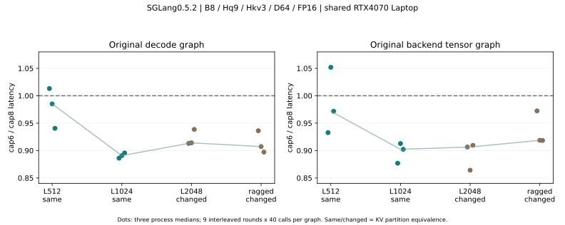

# 17｜cap6空CTA假设：可复现收益与不能推广的边界

上一批e6de90e的受控后端张量范围已由QA在729f740独立复验。本批沿原SGLang0.5.2/b0d25e7、torch2.8+cu128和Triton3.4继续，专门检验“B8实际split6、max cap8”的假设。没有重跑RMSNorm/平台导出，也没有修改引擎默认配置。

**结论：B8/L1024这格保留了相同分段，stage1网格由192减到144个CTA，raw decode三进程约快10.4%–11.4%，backend张量范围约快8.7%–12.3%。这是局部探索，不能改写成完整SGLang或serving提升。** L512有raw和backend退化样本；L2048/ragged的分段已改变，不能拿来证明只减少空CTA。

## 实验与原始数值

| case | cap8 raw（三进程us） | cap6 raw（三进程us） | cap8 backend | cap6 backend | 分段 |
|---|---|---|---|---|---|
| b8_l512 | 103.17/101.58/99.00 | 104.52/100.07/93.11 | 160.28/150.99/162.94 | 149.50/158.82/158.34 | 相同 |
| b8_l1024 | 174.87/179.99/170.70 | 154.96/160.33/152.88 | 245.89/247.65/248.04 | 215.60/226.05/223.80 | 相同 |
| b8_l2048 | 292.10/276.63/276.38 | 266.68/252.85/259.40 | 371.58/384.97/368.54 | 336.82/332.67/335.21 | 改变 |
| b8_ragged | 230.50/233.16/233.47 | 215.78/211.53/209.48 | 284.44/291.76/292.71 | 276.58/268.03/268.83 | 改变 |

每项三个独立进程/种子20261114/15/16；进程内9轮交错、每次图重放40次。未锁频、共享桌面GPU，不给小样本显著性/置信区间声明；采样时间不入A/B，不与上批绝对时延混比。

[本轮摘要与原始报告](../../../tools/perf/operators/local_gpu/evidence/cap6-v0.17/summary.json)保存所有数值。FP16/BF16的四格×两个cap均与独立GPU FP64参考校验，并核对KV写入；非默认stream及捕获后的raw/backend输出finite/close检查通过。不是模型质量验收。

## 为什么1024是有效切片

仍为Hq9/Hkv3/D64、page_size1、随机物理KV索引。cap8和cap6使用完全相同的Q/K/V/物理映射hash；原始SGLang metadata/forward/decode源码未改。

| 项 | cap8 | cap6 |
|---|---|---|
| 实际每请求split | 6 | 6 |
| 对齐后的每段长度 | 192 | 192 |
| stage1 grid，CUPTI实测 | [8,3,8] | [8,3,6] |
| 发射CTA | 192 | 144 |
| 非空CTA（根据源码/实际split推导） | 144 | 144 |
| logits+LSE工作区bytes | 149760 | 112320 |
| 每次raw decode的kernel launch | 2 | 2 |

每段长度公式为ceil(ceil(L/S)/32)×32。L1024/S6得到192，第6/7号分片在cap8网格里没有有效KV；缩小网格移除了48个空CTA。非空数是源码推导，**不是硬件计数器直接测得**。

工作区公式为4×B×Hq×cap×(Dv+1)，原实现FP32 logits/LSE。本次还改变了scratch stride、分配量和stage2循环上界，因此不能把全部时延差异孤立归因于空CTA。它只验证了cap配置的整体局部效果。

## 反例和负对照

- L512的实际split是5，但对齐后每段128，只有4个非空段。两种cap分段相同，仍有某进程raw变慢约1.3%、backend变慢约5.2%。少48个CTA不保证所有shape稳定加速。
- L2048从8段/256位置变为6段/352位置；ragged部分请求也改变分段。数值仍正确，但这些不是“只消除空分片”的对照。
- 真实Engine有动态batch、序列增长、padding和capture集合，不能假设永远B8/L1024。本批没有实现自动选cap策略，不在热路径加.max().item()同步。

## 真实kernel与测量范围

[run_split_cap6.py](../../../tools/perf/operators/local_gpu/run_split_cap6.py)复用原decode_path和run_decode工具，保持旧研究源码逐字节不变。旧工厂限制cap取值，所以两侧都先按cap8建状态，再设置原backend.max_kv_splits并重新调用原init_forward_metadata。断言scratch轴和参数匹配后才做正确性与计时；不是只改报告标签。

独立CUPTI覆盖16个同步区域：四格×两个cap×eager/graph。实际stage1 grid分别为[8,3,8]/[8,3,6]，每个40调用raw图有80个kernel，两个cap都没有减少launch数量。捕获输出保留引用并在计时后检验，避免空图或旧输出误判。

Trace中的registers/shared是静态核属性，类似“estimated occupancy”字段不是硬件利用率。没有Nsight硬件计数器，不宣布occupancy、SM或DRAM瓶颈。raw图只含原始两阶段attention；backend图还含KV写入，二者都不是Engine或客户端TTFT/TPOT。

## 环境恢复与复现

WSL重启后上一批/tmp环境丢失。本批恢复到任务专属/var/tmp/maas-10-gpu-01a1a5ba，继承原全局torch/triton，固定SGLang0.5.2、sgl-kernel0.3.9.post2等本地包；没有修改全局包/驱动。

开发wheel首轮截断，严格拒绝；按精确Content-Range恢复后，378988054字节完整SHA256匹配PyPI元数据fddc3a23e0ba9252381cdefaee20ebfb2722d0ea07648dde73dc7c8e1933e339，才安装。环境恢复和失败日志随附件保存。补齐了实际导入需要的IPython传递依赖；额外runtime-common解析仍有pycryptodomex下载失败，本批只确认该Decode研究路径可执行，不称完整Engine依赖已验收。

~~~bash
GPU_PY=/var/tmp/maas-10-gpu-01a1a5ba/bin/python
timeout --kill-after=10s 600s "$GPU_PY" tools/perf/operators/local_gpu/run_split_cap6.py \
  --source-lock tools/perf/operators/local_gpu/decode-source-lock.json \
  --seed 20261114 --profile --output tools/perf/reports/cap6-seed1
# seed换为20261115/20261116，并使用新目录，分别得到另外两个进程。
~~~

单GPU0、至少1GiB空闲、Torch allocator fraction0.20、batch≤8/总KV≤20000；该fraction不含全部context和外部库。本runner有任务内排他锁，QA仍由协调保证不并发。所有报告目录须全新；数值/源码/grid不符不发布成功report。

## 下一步与练习

下一批先核实际Engine capture/replay、动态batch/padding与成熟KV/RoPE caller的命中和等价性，再评估是否值得条件化cap；优先复用成熟库。完整权重仍待原确认，本轮没有下载或生成，nvcc/Sanitizer缺口保留。MaaS业务代码、共享协议和MAAS-15配置未改。

1. 为什么CTA减少25%，kernel数不变？grid与launch是不同层级，每次仍调用stage1和stage2。
2. 为什么512的split5只有4个非空？32位置对齐使段长128，第5段从512开始，已越过序列末端。
3. 能将2048的改善都叫“消空CTA”吗？不能，分段本身变了。
4. 是否已经证明空CTA占所有时延差？没有，scratch布局与stage2上界也改变，且桌面时序有噪声。
5. cap6已可全局启用吗？不能；仅固定切片有探索支持，尚无真实Engine、质量或serving复验。
