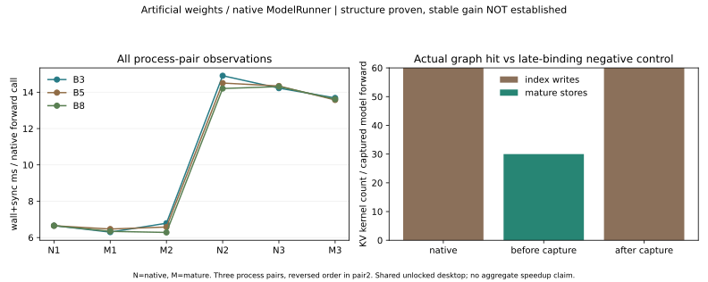

# 19｜成熟KV在原生捕获图中的接线、负控与调用成本

上一批b5e705d原生ModelRunner结构范围已由QA ecff788独立复验通过。本批将已安装sgl-kernel0.3.9.post2的store_kv_cache在**捕获前**接入同一原生ModelRunner，优先复用成熟实现。人工权重、固定SGLang0.5.2/b0d25e7、真实非连续QKV视图和原资源cap继续保留。

**结构接线与等价性通过；稳定调用成本收益尚未建立。** 三变体的12次动态decode分别通过原有数值/非默认stream/回收检查；跨变体24份完整logits逐位相同。成本A/B移除观测后仍出现跨进程约6–7ms与13–15ms状态漂移，不删除第二对、不汇总成一个加速百分比，不改生产/引擎默认。

## 1. 最小接线怎样进入真实图

[native_kv_binding.py](../../../tools/perf/operators/local_gpu/native_kv_binding.py)提供进程内context manager，在原生ModelRunner构造/graph capture前替换MHATokenToKVPool.set_kv_buffer。原SGLang磁盘文件未改。

接线沿真实layer_id取得本层cache，用原始dynamic loc/K/V直接调用成熟torch.ops.sgl_kernel.store_kv_cache。没有wrapper fallback、contiguous转换、主机数据读或绑定时缓存stream；当前流由成熟op实现处理。

支持范围明确限制为同dtype FP16/BF16、非量化MHA缓存、无k/v scale，不符合则退出，不能把它当全部KV/量化/offload路线的通用替代。本批实际模型为FP16。层、槽、图输入buffer生命周期仍由原生框架维护。

~~~mermaid
flowchart LR
  A[进程内mature绑定] --> B[原生dummy ModelRunner构造]
  B --> C[原生capture 1/2/4/8]
  C --> D[真实图内store kernel]
  D --> E[动态padding / locations / 缩批 / 回收]
~~~

[run_native_kv_integration.py](../../../tools/perf/operators/local_gpu/run_native_kv_integration.py)复用第18章已通过的结构runner，未修改旧代码。新增观测只保存图输出的完整快照并核raw trace；它有额外CPU快照/同步，不进入成本研究。

## 2. 晚接入负控为什么必须做

| 变体 | 何时绑定 | graph KV核 | eager KV核 | 图结果 |
|---|---|---|---|---|
| native | 原生 | index写60、store0 | index写60、store0 | 原始双stream |
| mature | capture之前 | index写0、store30 | index写0、store30 | 成熟单stream |
| late | capture之后 | index写60、store0 | index写0、store30 | 旧图仍双stream，负控成立 |

以上每行是一次30层模型forward范围，来自选定B3/pad4两个独立重放区域，全部原始trace保留。图总kernel378→348，eager399→369；计数不是速度收益。

late变体数值依然完全一致，CPU op统计也会看到eager的成熟store；只看“输出对了”或“库op计数非零”都可能误报图已融合。必须确认graph区域中的实际kernel。late的integration.json标明expected_graph_fusion=false，不是融合成功变体。

捕获后修改Python方法不会自动重写既有CUDA图。后续若选择晚绑定，必须走框架支持的显式重捕获并重新验证。本批选择捕获前安装，没有冒称验证了重捕获路线。

## 3. 数值、别名、动态槽与回收

native/mature/late各复用12次真实decode：B1/3/2/5/8各两次，另8→3→1缩减。原生Req/ScheduleBatch/ForwardBatch、ModelRunner和CudaGraphRunner都实际执行；没有手工metadata替身。

- graph/eager参考、毒化输出/scratch、变化输入和非默认stream通过；
- 三变体各五组池回到req8/KV512，未改变allocator或清理他人进程；
- 完整输出快照在下次重放/参考前clone；native对mature、native对late共24份数组逐位相同；
- 真实K/V为stride[960,64,1]的非连续视图，没有新增连续化拷贝，成熟写核确实进入原生捕获图；
- 输入buffer复用/输出别名继续原语义，padding dummy slot0和有效返回行仍由原生框架处理。

完整logits.npz三变体文件SHA也相同，证据包可无损去重保存一份并按manifest重建相同副本。完整原生模型依然是134515008个人工随机参数，不能据此推定预训练语义质量或独立模型正确性。

总体接线成功的标记是integration.json和CLI退出0；framework.json仅是复用的结构子测试。若raw trace未命中新核，子测试通过也不是融合成功。

## 4. 去除观测后的成本A/B

[bench_native_kv.py](../../../tools/perf/operators/local_gpu/bench_native_kv.py)另起六个进程，三对次序N/M、M/N、N/M。只有capture前native/mature两个变体，不测late。相同模型配置与seed，模型参数抽样指纹和初始logits SHA均核对一致。

热段没有profiler、reference、毒化、新增研究hook或CPU输出快照。每格10次预热，9份样本，每份重复10次**同一原生ForwardBatch**的runner.forward；不调用sampler、不推进在线请求队列或输出token。采集event-with-host-gaps与wall+sync两种范围，模型构造/JIT/capture与指纹在计时外。

| 真B/捕获B | native wall（三对ms） | mature wall（三对ms） | mature/native（全部保留） |
|---|---|---|---|
| 3/4 | 6.656/14.908/14.224 | 6.299/6.787/13.685 | 0.946/0.455/0.962 |
| 5/8 | 6.650/14.504/14.343 | 6.469/6.580/13.574 | 0.973/0.454/0.946 |
| 8/8 | 6.652/14.203/14.309 | 6.341/6.282/13.617 | 0.953/0.442/0.952 |

这些是人工权重下的静态原生forward**调用成本**，不是TTFT/TPOT、在线吞吐或预训练模型性能。事件区间包含Python/driver发射间隙，也不是纯kernel duration。

第二对横跨明显状态漂移：成熟先运行约6–7ms，native随后约14–15ms；第三对两侧均约13–15ms。快照SM频率仍1980MHz、温度约70–73℃，不足以解释或归因差异；没有证据把它简单叫降频/热节流。保留全部数据，尚不能隔离绑定的稳定效应或给出显著性结论。

可确定的是图结构、实际kernel与功能等价；调用成本应在更稳定资源窗口、密集但计时外的状态采样/排队证据中复验，不挑好看一对。本批不加代码重试循环、不因数字不漂亮重跑到成功。

## 5. 资源与复现

仍为GPU0、共享research锁、allocator/planner0.20、req8/KV512/context128、每进程600秒，运行前至少1GiB空闲。源码/wheel/环境沿第18章和第17章固定记录；未下载权重，不改全局驱动/包、业务协议或Engine默认cap8。

~~~bash
GPU_PY=/var/tmp/maas-10-gpu-01a1a5ba/bin/python
LOCK=tools/perf/operators/local_gpu/evidence/framework-v0.18/framework-source-lock.json

# 三种结构路径各用独立新目录；capture前/后由脚本显式控制。
timeout --kill-after=10s 600s "$GPU_PY" tools/perf/operators/local_gpu/run_native_kv_integration.py   --variant mature --source-lock "$LOCK" --output tools/perf/reports/native-kv-before
# native、late分别换variant和目录。late应明确保留旧图，而不是算作融合成功。

# 所有结构/跨变体校验先通过后，再运行独立无观测成本入口。
timeout --kill-after=10s 600s "$GPU_PY" tools/perf/operators/local_gpu/bench_native_kv.py   --variant native --pair 1 --output tools/perf/reports/kv-cost-pair1-native
# 成熟变体和另外两对依次运行，第二对反转顺序，禁止并发。
~~~

[摘要](../../../tools/perf/operators/local_gpu/evidence/kv-integration-v0.19/summary.json)和原始JSON存仓；完整向量、raw trace、实际命令/日志随任务附件交付。每个输出目录必须全新。

## 6. 下一工程验证优先级

1. 对成熟接线增加原生capture/stream/动态locations的独立复验及支持范围审查，再决定是否可进入更一般模型路线；
2. 核固定版已提供的RoPE+KV融合caller，保持RoPE原地别名、V视图及save_kv_cache语义，先等价性后成本；
3. 解释并控制调用成本漂移，再评估动态padding下条件化cap；没有隔离证据不放大数字；
4. 完整获准预训练权重到位后另建ModelRunner/Engine/serving质量与性能基线。当前没有Engine façade/在线scheduler/serving或预训练质量验收。

自测：晚绑定为何“数值对、op有、图未融合”？数值只检查语义，eager新调用与旧图不同；为什么378→348不等于8%加速？kernel时长/依赖/并发不同；为什么不取第一对？第二对与所有原始数据都属于观察，资源状态未控制；为何成熟kernel少一条stream仍要验证？原来的K/V复制有跨stream事件依赖，改变DAG不能只检查API签名。
