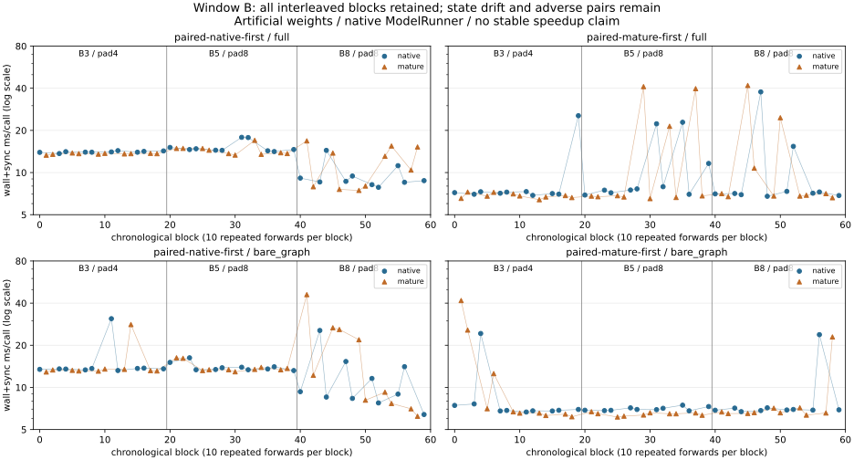

# 20｜窗口B：原生图交错成本、漂移定位与RoPE+KV语义

本章接续[第19章](19-native-kv-integration.md)和19e63a1，后者的图接线/状态范围已由QA cf8cf1c独立通过。本批只新增窗口B及库级RoPE+KV语义，不重跑已关闭结构矩阵。统一基线8dbf99e已以merge dcc5a53同步，原六份v0.19成本JSON逐字节保留。

**结论：漂移原因仍未知，稳定收益未成立。** 交错配对仍出现快/慢态和33/120个成熟路径更慢的配对；裸图重放也有长事件/等待，主机提交很短。下一步应缩小资源/驱动/设备执行状态的不确定性，而不是从减少30个核推导加速。人工权重静态ForwardBatch研究不代表TTFT/TPOT、预训练质量或Engine/serving性能。

## 1. 为什么两个独立进程还不够

旧三对六进程按N/M、M/N、N/M执行，保留6–7ms与13–15ms状态。即便两个进程参数/初始logits相同，也不能假设它们经历同样的主机调度、WDDM/WSL提交、其他GPU活动、缓存/频率/功耗状态。1980MHz快照不是整段频率锁定，温度相近也不证明这些因素相同。

本轮用[bench_kv_interleaved.py](../../../tools/perf/operators/local_gpu/bench_kv_interleaved.py)在同一原生ModelRunner、同一模型参数与request/KV池内交错比较。两个独立进程分别先捕获native、先捕获mature；进程内10轮按N/M、M/N交错，固定B3/5/8，输入长度12后的同一decode ForwardBatch重复执行，不推进token/队列。捕获顺序同时与进程/时间窗绑定，因此不能把两进程差异直接归因为捕获顺序。

每个进程120块、每块10次调用，共240块/120对；两次原v0.19入口独立控制各27块，另有54块。没有剔除离群点或按结果改配对。两个干净进程共18个针对性状态门禁，分别在计时前、full后、bare后核完整logits和全部30层新写槽K/V的finite/位级一致。

## 2. 两套图怎样共存，为什么不能只换graph指针

原生Triton backend的init_cuda_graph_state会新建cuda_graph_kv_indices、attn_logits等buffer。若在同一个backend上重新初始化，再切回旧graph，旧图仍读取旧地址，而replay_prepare可能写入新地址。只保留旧graph对象无法保证重放正确。

本入口为第二变体创建新的原生backend和CudaGraphRunner，并给第二组图独立graph_pool_handle；模型和KV池共享，图输入、KV索引和scratch地址必须不同。每块计时外同时切换runner.attn_backend、runner.graph_runner和ForwardBatch.attn_backend。构造第二套图时在capture前安装对应绑定；不修改SGLang磁盘文件、默认cap或热路径。

图互斥执行，不并发重放；每块结束同步，输出/KV核验只在单独门禁进行。峰值Torch分配约303MiB（317785600字节），仍受单进程allocator0.20约束。不是两个完整Engine或两套权重，也不是生产调度能力。

## 3. 计时公式与范围

每块复用已初始化的CUDA事件，重复10次：

~~~text
t0 = perf_counter_ns(); c0 = thread_time_ns()
begin.record()
repeat 10: forward() 或 captured_graph.replay()
end.record()
t_submit = perf_counter_ns(); c1 = thread_time_ns()
end.synchronize()
t_done = perf_counter_ns()

event_us/call = begin.elapsed_time(end) * 1000 / 10
host_enqueue_us/call = (t_submit - t0) / 1000 / 10
thread_cpu_us/call = (c1 - c0) / 1000 / 10
wait_us/call = (t_done - t_submit) / 1000 / 10
wall_us/call = (t_done - t0) / 1000 / 10
~~~

wall = host_enqueue + wait逐块成立。CUDA事件区间可含主机/driver发射间隙，不能叫纯kernel时间；主机提交短也不能区分设备内计算、驱动/WSL等待、未观察到的其他工作。

full执行原生runner.forward，含原生replay_prepare；bare_graph先在计时外准备同一图输入，再直接重放已捕获图，绕过metadata更新，仅用于定位。它不能作为删除真实动态准备步骤的优化方案。两种范围都使用静态输入。

源码中的cold_calls字段实际是**构造和正确性门禁之后的12轮交错收敛观察**，不是首次CUDA初始化或模型冷启动；initialization字段单独记录加载/捕获秒数。不能拿这组数当在线cold-start。

Profiler另用独立进程，干净热段没有profiler/结构reference/毒化/CPU快照。nvidia-smi与host_state在每块外采集。这个采样节奏与v0.19不同，查询带来的空闲间隔可能影响状态；当前尚未做“每块查询/仅cluster边界查询”的单因素对照。

## 4. 全部配对与独立控制

以下是full范围；中位数是各自10块的中位数，比值是逐轮M/N比值中位数，两者不能互相替代。方括号为最小/最大比值，是描述范围，不是置信区间。完整bare_graph和原始每块见[analysis.json](../../../tools/perf/operators/local_gpu/evidence/window-b-v0.20/analysis.json)。

| 进程 | B | native wall ms | mature wall ms | 配对M/N中位数 [min,max] | M更慢 |
|---|---|---|---|---|---|
| paired-native-first | 3 | 14.005 | 13.642 | 0.972 [0.948, 0.988] | 0/10 |
| paired-native-first | 5 | 14.596 | 14.148 | 0.968 [0.747, 1.019] | 3/10 |
| paired-native-first | 8 | 8.701 | 11.745 | 1.100 [0.789, 1.844] | 5/10 |
| paired-mature-first | 3 | 7.149 | 6.793 | 0.938 [0.260, 1.037] | 2/10 |
| paired-mature-first | 5 | 7.571 | 6.798 | 0.925 [0.290, 5.686] | 3/10 |
| paired-mature-first | 8 | 7.101 | 6.976 | 0.970 [0.285, 6.026] | 4/10 |

B8/native-first进程的full配对中位比值>1，且另一些块有很大的双向异常。不能用“多数中位数低于1”删除负结果。120对含两个范围、多个batch和同进程相关重复，不是120个独立实验，未给总体置信区间或显著性结论。

另按未改的bench_native_kv.py运行M/N两个进程：mature的B3/5/8中位约6.323/6.258/6.240ms，native约14.293/14.218/14.716ms；mature B3还出现25.846ms样本。这个表面两倍差距再次说明顺序独立进程比较受状态混杂，不能判为融合收益。

裸图也有约13ms事件/等待，而主机提交通常仅几十微秒；full提交为几百微秒。这排除了“主要差距全由Python准备占用时间解释”的简单假设，但没有定位到某个kernel或驱动。GPU频率/温度/功耗只是块前快照，未锁定、未覆盖整个块；未完整记录其他GPU活动。原因保持unknown。

## 5. 图节点计数：修正区域总数的简称

[analyze_kv_trace.py](../../../tools/perf/operators/local_gpu/analyze_kv_trace.py)把annotation中的cudaGraphLaunch correlation连接到GPU事件，原生图实际节点为native364、mature334，KV分别60 index/0 store与0 index/30 store；full和bare均核实命中。

上一批378/348是含准备和观测的annotation区域总数，称“图总kernel”不够精确。本轮只读审计旧四个区域：其中纯图364/334，另14个属于图外操作。旧JSON与trace未改，新[口径审计](../../../tools/perf/operators/local_gpu/evidence/window-b-v0.20/old-region-scope-audit.json)保留源hash及额外核名称。无论哪种范围，少30个核都不能直接换算速度百分比。

独立Profiler记录每个图的kernel envelope、busy union、逐核时长和热点名称。它们用于关联/DAG核查，不能混入干净240块，不能把Profiler的时长当稳态成本或据此宣布模型瓶颈。

## 6. 固定版RoPE+KV：已经有能力，caller尚未接入

本机sgl-kernel0.3.9.post2的elementwise.py提供FusedSetKVBufferArg及apply_rope_with_cos_sin_cache_inplace；参数含value、k/v buffer、loc，scale必须None，loc须int64，cos/sin cache须FP32。RotaryEmbedding.forward_cuda对64/128/256/512 head可透传该参数，fallback路径拒绝融合参数。

固定SGLang0.5.2/b0d25e7的Llama caller在llama.py:194–197只做qkv split→rotary_emb(positions,q,k)→attention，未传融合KV参数。RadixAttention有save_kv_cache，Triton backend在该值为真时另写缓存。因而“库里有融合API”不代表当前Llama捕获图已经融合RoPE+KV。DeepSeek MLA的cache/save路径不同，不能复制其save=False到MHA而不证明已写入正确缓存。

[check_rope_kv_semantics.py](../../../tools/perf/operators/local_gpu/check_rope_kv_semantics.py)只做直接库语义检查：人工FP16 QKV共960列、Q9/KV3/head64，split保留stride960；B3/5/8、默认/非默认stream共6格，位置含0/127，loc非连续且两套偏移。分开调用RoPE+成熟store作为库参考，再比较融合调用，并用实际FP32 cos/sin缓存构造FP64数学参考（rtol=.001、atol=.002）。

六格Q/K目标缓存与分开调用最大差0；Q/K保持原地别名且K内容已旋转，V视图/缓存逐位不变，非目标512槽保持哨兵。库探针有独立raw trace，无性能计时，没有接入Llama/ModelRunner，也没有把save=False实际产品路径验收。该容差是本实验数值门槛，不是预训练模型质量标准。

下一次caller候选必须在RoPE完成同次KV写入后才设置save_kv_cache=False，保留原地别名和V视图，捕获前安装；验证新图确实命中融合核、无重复写/漏写，以及动态padding/loc/stream和不支持输入在写前拒绝。漂移未解前不加新收益百分比。

## 7. 复现与退出条件

~~~bash
GPU_PY=/var/tmp/maas-10-gpu-01a1a5ba/bin/python
BASE=tools/perf/operators/local_gpu
# 目录必须全新。各命令串行；脚本内使用同一非阻塞research锁。
timeout --kill-after=10s 600s "$GPU_PY" "$BASE/bench_kv_interleaved.py" --capture-first native --output tools/perf/reports/windowB-N
timeout --kill-after=10s 600s "$GPU_PY" "$BASE/bench_kv_interleaved.py" --capture-first mature --output tools/perf/reports/windowB-M
timeout --kill-after=10s 600s "$GPU_PY" "$BASE/bench_kv_interleaved.py" --capture-first native --profile-only --output tools/perf/reports/windowB-profile
timeout --kill-after=10s 600s "$GPU_PY" "$BASE/check_rope_kv_semantics.py" --output tools/perf/reports/windowB-rope
~~~

实际两次原入口控制、CPU分析与全部参数见附件command.json。分析器要求固定目录名paired-native-first/paired-mature-first、isolated-native/isolated-mature；可对附件直接运行：

~~~bash
python tools/perf/operators/local_gpu/analyze_kv_window_b.py --input EXTRACTED_EVIDENCE --output NEW_ANALYSIS.json
python tools/perf/operators/local_gpu/analyze_kv_trace.py --trace EXTRACTED_EVIDENCE/profile-native-first/timeline.json --output NEW_TRACE_ANALYSIS.json
~~~

四个CPU负控：少一块、NaN、配对变体重复、把profile报告当成本，均退出非0且不写成功结果。它们是分析器输入变异，不是GPU故障注入。旧六份JSON与19e63a1 Git blob逐字节一致。

资源仍为GPU0/同research锁、allocator/planner0.20、req8/KV512/context128、进程600s和运行前≥1GiB空闲。四个干净成本进程、一个独立Profiler进程和一个库语义进程均收齐，无自有GPU后台任务。没有权重下载、全局驱动/功耗修改或目标部署。

## 8. 下一批的可否证问题

1. 先固定采样间隔：同一图只改nvidia-smi查询位于每块前还是cluster边界，保留所有轮次，检查查询/空闲节奏能否重复触发快慢切换；
2. 同进程加入固定shape GEMM或最小CUDA图控制，区分本模型DAG特异性与更广的GPU/driver状态；测量与Profiler仍分离；
3. 捕获先后需在多个时间块交叉重复，不能用目前“一顺序一个进程”判断因果；不把重测直到变快当方法；
4. RoPE+KV先做caller级语义/图命中，再在可比状态下测成本。完整获准权重到位后另开预训练ModelRunner/Engine/serving质量与性能基线。

工程自测：为什么bare变快也不代表可删replay_prepare？真实动态请求需要更新元数据；为什么M/N中位数不等于两列中位数相除？轮次配对与边际统计不同；为什么记录SM1980仍保留unknown？瞬时采样没有排除设备/驱动/其他工作；为什么融合库通过还不能直接save=False？当前caller必须先证明写了同一层/槽/来源，且捕获图已包含该写入。
