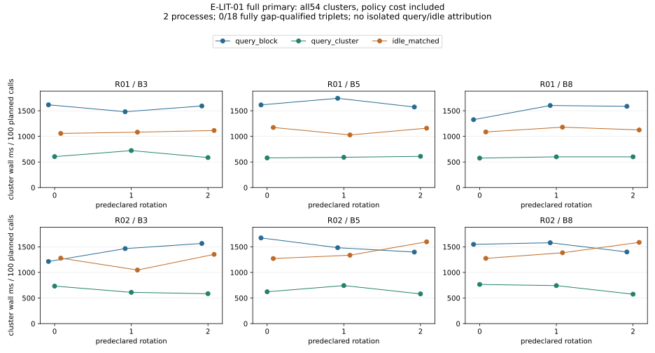

# 22｜E-LIT-01真实三策略入口与冻结首批

本章接续[第21章](21-literature-to-experiments.md)的E-LIT-01，仅实现查询/空闲策略。E-LIT-02/03与原0.21设计快照不改，旧bench_kv_interleaved默认行为和原始样本不变。

## 实现与预登记分母

新增cadence_protocol.py生成/校验不可变计划；bench_kv_cadence.py执行；analyze_kv_cadence.py按计划复算。CLI --help/--validate-only无需导入GPU框架。计划含实际源码hash，错误配置/身份/源码在GPU导入前拒绝。

首批两独立进程R01/R02，固定native先捕获；策略按三轮Latin轮转及反向次序，N/M配对顺序同样预登记。每cluster是**总共10块**，N/M各5块，每块10调用，共100调用（每变体50）。Full为主scope：主指标是完整cluster的wall纳秒/100个计划调用，包含策略和准备，从首块prepare之前到末块完成；不含cluster边界归档I/O。Bare_graph单列诊断，不能与full合并。

矩阵B3/5/8，prefill12后KV上下文长度13，静态重复不推进生成token。每scope/每进程27cluster；两scope×两进程共108cluster、1080块、10800调用/重放，其中full540块、bare540块。块有相关性，不当总体显著性样本数。

## 三水平及匹配定义

- query_block：每块前调用既有telemetry。
- query_cluster：仅cluster首块前查询；其余块不查询、不额外sleep。
- idle_matched：不查询，等待至“上一完成host观测时间＋采前冻结目标gap”的deadline。只sleep一次，不忙等、不重试追赶快样本。

采前用B3/full准备模板，对N/M各校准10次真实查询，保存全部20次。目标为各变体完成→提交代理gap的中位数；最大允许500ms，超限不进入主采集。Runtime manifest在任何比较块前冻结目标、校准hash、模型完整参数hash、图/指针、版本及clock_scope。每cell在其首块前冻结实际input hash，不采完重定配对。

每块保存query开始/结束、上一完成/ready/submit/enqueue/done、准备前缀、ready→submit、请求/实际sleep、目标gap、绝对/相对误差。匹配阈值预定max(0.25ms,5%目标gap)，超差块保留并降级归因资格，不过滤后宣布收益。该gap为host观测的自身device完成到下一提交，不是物理GPU idle计数；准备kernel/CPU记录和未观察的其他活动仍可能影响它。

三水平比较复合策略效果，不自动分解出查询或idle根因。主cluster wall与按变体的块event/host/wait分别报告；CUDA事件可含host/driver间隙。Cluster边界I/O被下一块的实际gap记入，不隐藏其扰动。

## 门禁与异常

复用已验原生dummy ModelRunner、独立backend/图pool，默认cap8。完整logits、全30层真实写槽在校准与cell前/后检查，快照按内容hash无损去重，校验不进入热段；参数全hash、图/指针及静态input再核一致。没有Profiler混入干净热段，本批不重跑旧DAG QA。

计划、run/replicate、scope、cluster/triplet、N/M pair、slot、clock与源码身份逐项校验。缺测仍有计划ID，超时/中断不补快块；没有结果的进程也在1080块分母。锁忙、低显存、数值/图身份、query错误和deadline即停，不产成功采集结论。内部570s保留收尾时间，外部timeout600s；一进程失败后不继续下一GPU进程。

资源沿GPU0/原research锁、allocator/planner0.20、req8/KV512/context128、运行前≥1GiB空闲，单GPU串行。人工权重静态调用/重放不代表预训练质量、TTFT/TPOT、Engine/serving或平台收益。

## 实际入口与复现

~~~powershell
# 在仓库目录，先提交代码/来源锁，再冻结计划；运行目录必须全新。
$cadenceCheckout = git rev-parse HEAD
python tools/perf/operators/local_gpu/cadence_protocol.py create --experiment elit01-pilot1-20261115 --checkout-commit $cadenceCheckout --output ../deliverables/elit01-v0.22/plan.json
python tools/perf/operators/local_gpu/bench_kv_cadence.py --plan ../deliverables/elit01-v0.22/plan.json --run-id R01 --output ../deliverables/elit01-v0.22/R01 --validate-only
~~~

GPU执行需在原获准WSL/venv。实际600s前台命令随本批command.json交付。入口为：
~~~text
bench_kv_cadence.py --plan PLAN --run-id R01 --output NEW_R01_DIR
bench_kv_cadence.py --plan PLAN --run-id R02 --output NEW_R02_DIR
analyze_kv_cadence.py --plan PLAN --root ROOT_WITH_R01_R02 --output NEW_ANALYSIS.json
~~~

## 本批实际执行与结论

首批按预登记计划ab0ac451d9d4beffd6a879ff04bcdcd4000a256ec3194b710f5e7dabca49d9c9执行，checkout6477d5d、实际代码4fbb921；采前已有提交和来源锁。两进程分别94.08s/86.22s，均exit0，共108cluster/1080测量块、10800静态调用/重放；Full540块/Bare540块分开。未补样，实际缺测/无效0，原独立QA不重跑。

两进程共26次正确性门禁，全logits及30层写槽finite/逐位一致；完整参数和模型配置跨进程hash相同，静态input、图对象与输入/scratch地址在策略间未改。峰值Torch分配316955136字节，约302.27MiB。436次协议内查询分为40校准与396策略查询，原始CSV和时点保留。采后单独记录驱动581.29/8188MiB/CC8.9，明确不是连续过程控制。

**执行完整不等于因果匹配完整。** Idle块342/360命中冻结目标，query_block仅72/360命中；Full完整匹配的三策略组为0/18。因此本批只给复合策略的描述结果，不能核实单独query/idle根因、稳定KV收益或模型瓶颈。

### Full主指标：每100次计划调用的cluster wall毫秒

每格为同一进程/同一B/同策略3个cluster的中位数；每cluster总10块/N-M各5，不是每变体10块。包括查询/等待与准备，非请求TTFT/TPOT；不能把query_cluster更小直接叫模型加速。所有54个主scope cluster与全部block另见JSON/原始账本。

| 进程 | B | 块前查询 | cluster前查询 | 匹配空闲无查询 |
|---|---|---|---|---|
| R01 | 3 | 1593.59 | 604.32 | 1081.67 |
| R01 | 5 | 1614.44 | 591.49 | 1159.12 |
| R01 | 8 | 1586.59 | 600.03 | 1125.42 |
| R02 | 3 | 1465.21 | 610.93 | 1278.33 |
| R02 | 5 | 1482.59 | 621.94 | 1335.98 |
| R02 | 8 | 1547.92 | 742.26 | 1383.59 |

### 匹配覆盖与全部误差

| 进程 | scope | 策略 | 匹配/总块 | 绝对误差中位ms | 绝对误差最大ms |
|---|---|---|---|---|---|
| R01 | full | query_block | 8/90 | 7.595 | 120.402 |
| R01 | full | idle_matched | 81/90 | 0.111 | 23.000 |
| R01 | bare_graph | query_block | 7/90 | 10.570 | 2449.090 |
| R01 | bare_graph | idle_matched | 81/90 | 0.103 | 128.644 |
| R02 | full | query_block | 25/90 | 4.864 | 55.739 |
| R02 | full | idle_matched | 90/90 | 0.110 | 0.151 |
| R02 | bare_graph | query_block | 32/90 | 3.982 | 42.910 |
| R02 | bare_graph | idle_matched | 90/90 | 0.110 | 0.148 |

query_cluster不以每块gap匹配为策略目的，不混入匹配率分母。所有超差/慢块均在主描述结果中，未挑出“合格快块”单独算正收益。按native/mature的72份策略三联对照单列，其中Full36份，仍是相关重复，不作总体显著性样本数。

R01冻结N/M目标总gap约34.461/34.589ms，校准查询本身约33.78/33.84ms；主采集查询中位却约40.88/44.13ms。R02目标45.017/42.893ms，主查询约44.31/44.84ms。实际准备/边界前缀也变化，最大gap误差含约2.449s异常；gap不是kernel时长，也不是物理GPU idle。该对照未证明校准模板代表热段后的实际query-block节奏。

### 验证与已知限制

16项无GPU回归通过；另对实采元数据做4个CLI损坏输入：跨clock、NaN event、匹配字段篡改、重复block ID，均非0且无成功结果。故意隐藏R02时仍为1080计划块/540测得/540缺测，54完整cluster；这是CPU缺测回归，真实首批没有缺测。

原始状态向量按内容hash去重保存，仍记录每次run/cell/gate/variant的独立采集引用；不把相同数组误当另一个进程采集。实际代码/完整分母/clock/hash/cell/校准目标和全部快照均经离线校验。

本批没有Profiler混入热段，也没有重新做DAG性能签收；沿已验原生构造并核新运行对象/地址与数值。Query CSV仅在该策略实际查询时存在，idle策略没有同期NVML快照，不假装已控制频率、其他GPU活动或功耗。

### 下一步只改什么

下一轮仍应先收窄E-LIT-01：预登记一个能代表实际热段后处理/查询状态的参考采集模板，明确含哪些bookkeeping/边界前缀，先验证后续query-block的gap分布能否由该模板代表。校准参考若继续漂移就降级或停止归因，不改完目标重跑到看起来匹配，更不能拿本次结果反填新参考。

三策略主cluster wall不同，部分差异本就来自查询/等待次数；block event在同策略内也有慢态，不能拆成query或idle单独根因。不追加GPU实验追好结果。E-LIT-02/03门槛继续保留：stage2所有可读段须有定义；真实同次同层同槽融合写入已证后才能save=False。

每cell统一预热，未在策略切换之间另作洗脱；预置正/反轮转仍不能排除carryover和未观测桌面负载。历史E-LIT-03字段decode_length在未来实现应明确为KV上下文长度，不当额外生成token数；本协议已明写KV_context_length=13。
