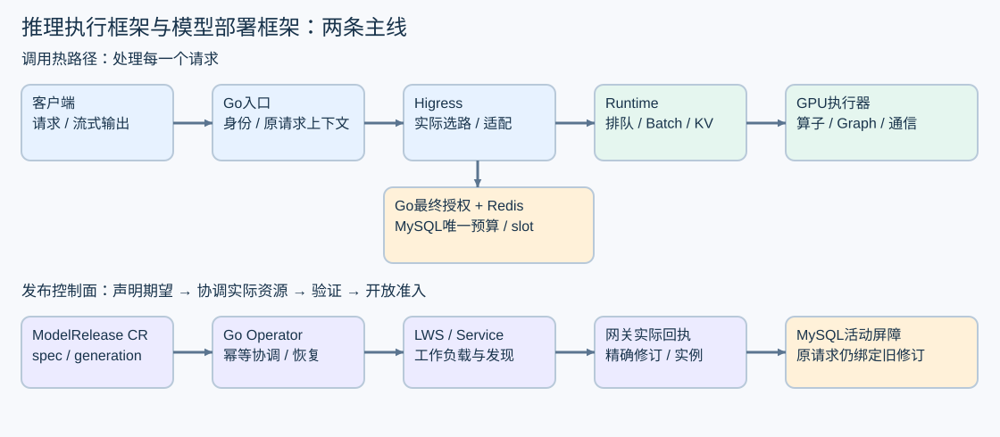

# 一条请求怎样变成张量计算

假设用户输入“解释这段代码”，模型开始逐字输出。客户端看到的是一串内容片段；GPU 处理的是 token ID、矩阵和缓存地址。开发推理框架，第一步是把这两种视角连起来。

## 从文字到隐藏向量

Tokenizer 是把文本转换成整数序列的程序。同一个汉字可能独占一个 token，也可能与相邻字符合并；中文字符数、UTF-8 字节数、SSE chunk 数都不是 token 数。聊天模板还会加入角色、分隔符等额外内容。可复现输入需要固定 tokenizer、模板、特殊 token 规则与实际 token ID，而不只是固定一段字符串。

用一个虚构的 decoder-only 模型练习：单个请求输入 4 个 token，隐藏宽度 d_model=8，查询头 Hq=4，KV 头 Hkv=2，每头宽度 D=2。下面省略 batch 维，便于手算。

| 阶段 | 张量 shape | 含义 |
|---|---|---|
| 输入 ID | [4] | 四个整数 |
| Embedding 后 X | [4,8] | 每个位置一个隐藏向量 |
| Q 投影后 | [4,4,2] | 4 个位置、4 个查询头 |
| K/V 各自 | [4,2,2] | 2 个 KV 头供查询头分组复用 |
| 每头 Attention 分数 | [4,4] | 每个查询位置对输入位置的关注 |
| 拼头与输出投影 | [4,8] | 回到隐藏宽度 |
| 最后位置 logits | [vocab_size] | 对下一个 token 的打分 |

GQA 是“多个查询头共用一组 K/V”。本例 Q 头 0、1 对应 KV 头 0，Q 头 2、3 对应 KV 头 1。它减少 KV 存储与相关访问，但不能把所有查询头简单当成同一个头。模型真实结构可能采用 MLA、滑窗或其他缓存方式，不能套用本例的 shape 和显存公式。

每层还包括归一化、位置编码、残差和 MLP；这些运算在各层重复。logits 经选定的采样策略得到 token ID，Detokenizer 再把 ID 转成文本。采样随机种子、温度和截断规则也影响可比性。

## Prefill 和 decode 到底差在哪里

Prefill 处理已有输入。因果 Attention 中位置 i 只能看到自己及之前的位置，但四个位置仍可以在一轮张量计算中并行处理。Prefill 最后一个位置的 logits 通常已经能采样出第一个输出 token，不能默认“prefill 完成后，还要额外跑一次 decode 才有首 token”。

之后的 decode 每次消费上一次生成的 token，并读取已经保存的 K/V，计算下一个输出。本例首次 decode 的 Q 为 [1,4,2]；已有 4 个输入位置的 KV，再写入被消费的生成 token，当前可读长度成为 5。下一次 decode 长度再增长。最后一个刚采样出来的 token 若请求立即结束，通常无需再为它执行下一轮前向。

这也解释了一个容易写错的统计：生成了 3 个 token，不等于已经往 KV 中追加了 3 个 token。第二章的脚本明确区分 generated 与 decoded，前者是累计采样输出数，后者是额外 decode 前向次数。

Prefill 通常有较大的矩阵行数 M；低 batch decode 的 M 较小，并反复访问模型权重和 KV。哪一部分受计算、带宽、launch 或通信限制，需要看目标模型、batch 和 profiler，不能只凭“prefill 计算密集、decode 带宽密集”就决定优化。

## 一次调用有三类控制权

运行时回答“这一批 token 由哪些 GPU 算、内存在哪里”；部署控制面回答“哪些实例正在运行哪份修订、何时切流”；业务服务回答“这个 Key 是否有权调用、额度如何预留和结算”。slot 是业务并发槽位；held 是尚不能确认为实际用量、按协议保留的占用。它们共享请求和修订身份，但不共享一份任意可写的状态。

例如 A 的 GPU 已经停止，运行时可以提交停止证据；它不能直接把业务 held 用量改成 0。Operator 看到 Pod Ready，可以继续验证发布；它不能单凭 Ready 就宣布平台可调用。Higress 负责实际来源路由与适配，Go/MySQL 负责最终准入与唯一结算。Redis 限流也不能替代耐久预算。

推荐为一次诊断建立关联表：server request/trace、尝试与固定来源、模型 CR UID、活动 revision/publication/epoch、权重/引擎/配置修订。字段使用已确认协议，不自行发明新的公共头。普通日志只留允许的标识与长度摘要，不记录 Key、完整提示词或上游凭证。

## 把首 token 延迟拆开再计算

考虑同一客户端 monotonic 时钟上的教学记录：发送 t=0ms，收到 role-only chunk 为 15ms，空 content 为 18ms，第一个非空 content 为 30ms，最后一个 content 为 90ms，流结束为 100ms。冻结 tokenizer 对完整输出计数 N=4。

- 客户端 TTFT=30−0=30ms。role-only 和空内容不算首内容。
- TPOT=(90−30)/(4−1)=20ms/token。N≤1 时为 null。
- E2E=100−0=100ms。它包含末内容之后的协议与收尾时间。
- 两个非空 chunk 可能承载四个 token；不能由两个 chunk 算出 N=2，也不能把平均 chunk 间隔称为 token ITL。

TTFT 可能包含网络、Go 准入、网关、运行时排队、prefill 和首内容 flush。Worker 的首 token 时间只覆盖自己的边界。可以分别报告各自本地时间差；跨进程 monotonic 时间未经可靠归一化，不能直接相减。尤其不能把两个客户端的不同 clock_scope 拼成共同 RPS 时间窗。离线分析器的 C01 就是在防止这种错误。

SLO 是事先约定的可接受服务目标，例如特定负载下的 TTFT/TPOT 上限。它必须针对模型和硬件确定。再看吞吐：共同观察窗 10s 内 sent=10，其中 2 拒绝、1 失败、1 取消、1 仍 pending，5 成功，只有 4 个同时满足质量和适用时延目标。有效吞吐 G=4/10=0.4 请求/s；达标率=4/10=40%。5 个成功不能把另 5 个从 sent 分母删除。缺失 SLO 或质量判定时，只能报告描述指标与覆盖率，不能宣称达标。

## 高级工程师要跟踪三个结束时刻

“客户端断开”“GPU 不再访问内存”“业务唯一终态已耐久提交”可以发生在不同时间。若把三个时刻压成一个 done 布尔值，会遇到提前复用页、漏结算或错误退款。

当前共享语义还要求区分累计诊断 usage 与可结算终态 usage。中间 usage 只能用于诊断；只有符合协议的成功终态经过唯一耐久提交确认后，才能发送相应 final usage 和成功结束标记。原始 EOF、取消、错误不能伪装为成功 [DONE]。提交已成功但 ACK 未知时，恢复应读取原请求的耐久结果，不能再造一次结算。

客户端请求的 server request ID R 应沿受信链路关联；后续查询 HTTP 请求的 ID Q 是另一条请求。不能用 Q 覆盖要查询的 R，也不能拿客户端自填的 ID 当服务端身份。具体响应字段按最新架构契约，本教材只解释为什么需要这些约束。

## 动手与检查

先画出本例第一次 prefill 和两次 decode 的 Q/K/V shape，再重算 30ms、20ms/token、0.4 请求/s。最后解释：若 GPU prefill 只有 5ms，但 TTFT 是 300ms，下一步需要队列、Go、Higress 和 flush 的哪一份证据？答案应是测量计划，而不是立即更换 Attention kernel。

下一章把请求放进共同 batch，看看输出进度、KV 页数和完成事件怎样一起变化。

参考：[固定 SHA 源码路径](../sglang-source-analysis-v0.5.md)、[测量点和口径](../architecture-and-metrics.md)、[PyTorch 2.9 SDPA 接口](https://docs.pytorch.org/docs/2.9/generated/torch.nn.functional.scaled_dot_product_attention.html)。本节 shape 与时间均为教学算例。
