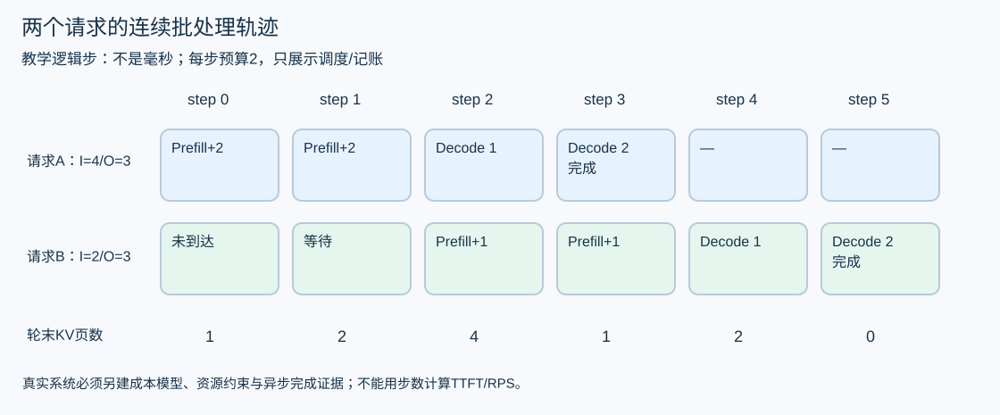
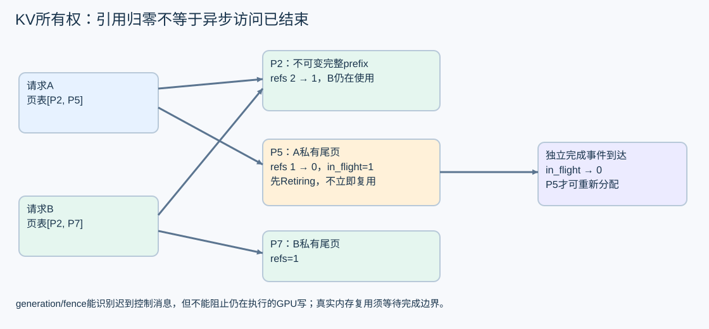

# 调度与 KV 页如何一起工作

连续批处理的关键是：一次 GPU 迭代结束后，完成的请求退出，其他请求继续，新请求可以加入。它需要同时回答“下一轮算谁”和“这些计算会读写哪些内存”。只研究排队策略而不管内存生命周期，框架会在压力和取消时出错。

## 用六轮推演一次连续批处理

教学规则如下：A 在 step 0 到达，输入 4 个 token；B 在 step 1 到达，输入 2 个 token。两者均输出 3 个 token：最后一次 prefill 采样第一个，再各执行两次 decode。每轮虚构工作预算为 2，先给已可 decode 的请求各一个位置，剩余预算按到达顺序做 prefill。逻辑页大小为 2 个 token。

这里把 prefill token 与 decode 位置都记作 1 个预算单位，只为展示排程，不表示它们 GPU 成本相同。work 是该轮工作项清单，不保证由一个 kernel 同时执行。每轮同步完成，最终完成请求立即释放页；真实异步回收在下一节单独处理。

运行：

~~~text
python docs/performance/foundations/labs/runtime_walkthrough.py
~~~

应得到 work 顺序与轮末驻留页数：

| step | 本轮 work | A 累计输出 | B 累计输出 | 轮末总页数 |
|---|---|---|---|---|
| 0 | A:prefill+2 | 0 | 0 | 1 |
| 1 | A:prefill+2 | 1 | 0 | 2 |
| 2 | A:decode，B:prefill+1 | 2 | 0 | 4 |
| 3 | A:decode，B:prefill+1 | 3，已完成 | 1 | 1 |
| 4 | B:decode | 3 | 2 | 2 |
| 5 | B:decode | 3 | 3，已完成 | 0 |

Step 2 中 A 的 KV 长度是 4+1=5，占 ceil(5/2)=3 页；B 的长度为 1，占 1 页，合计 4。Step 3 中 A 完成并释放，B 输入处理完毕占 1 页。刚采样的输出没有自动成为已经写入 KV 的位置，这正是 generated 与 decoded 分开记的原因。

脚本没有容量不足、EOS、抢占、公平性或真实 kernel。它演示的策略也不保证生产最优。若只不断优先 decode，持续到来的 decode 可能饿死长 prefill；若每次跑完整长 prefill，短请求和已有 decode 又可能长时间等待。可研究 chunked prefill、等待时间上界和公平队列，但每一项都要付出调度、分块与显存代价。

## 页表如何避免搬动整段 KV

把逻辑 token 位置切成固定大小页，页表把“第几页”映射到物理页。例如页大小 2，A 的逻辑位置 0、1 在 P2，位置 2、3 在 P5；追加位置 4 时分配新页。kernel 要根据真实页表与有效长度读写，不能假设逻辑连续就等于物理连续。

若 A、B 具有完全相同且允许共享的前缀，完整且不可变的 P2 可以共享。复用条件至少要涵盖权重/模型配置、tokenizer/模板、确切 token、位置和安全隔离上下文。相同自然语言开头不等于相同 token，更不等于可以跨租户无条件共享。

共享的最后一页若尚未填满，后续追加可能写进另一请求正在使用的区域。必须先建立不会污染其他引用的副本或采用明确的等价隔离机制，再 append。只给页 refcount 加一并不能解决部分页写入；这是写时复制需要处理的具体问题。

## 取消时为什么 refs 为零还不能释放

脚本的另一段轨迹把 A 页表设为 [P2,P5]，B 为 [P2,P7]。P2 有两个引用；P5 只有 A 引用，但还存在一次 GPU 在途访问。A 取消后：

~~~text
P2: refs 2 → 1, inflight 0
P5: refs 1 → 0, inflight 1
P7: refs 1,     inflight 0
free_before_completion = []
收到模拟 P5 completion 后：
free_after_completion = ["P5"]
B_table = ["P2", "P7"]
~~~

取消标记阻止后续调度，不会自动撤销已经提交的 GPU 指令。若此时把 P5 给 C，A 的迟到写入可能破坏 C。页必须等所有相关 stream 的访问完成，或由能证明安全的隔离/回收协议处理。仅增加 generation/fence 可以拒收旧 host 回包，却不能让旧 kernel 停止写同一地址。

生产设计应分开“解除请求引用”“登记待回收”“实际完成后进入空闲池”。Completion 需要标识 Worker incarnation、batch/提交序号和页分配代次；重复回包不能重复入池。Worker 崩溃或通信丢失时，没收到回包不代表设备已经停止，恢复策略可能需要隔离整个资源实例，而不是继续复用地址。

业务 slot、GPU 页和财务 held 是三种资源。各自的释放依据由对应协议定义。运行时页可安全回收，不会把未知 Token 自动变成真实 0，也不会授权退款。

## 手算一次 KV 容量

使用虚构的普通 MHA/GQA 缓存：层数 L=24，KV 头数 Hkv=4，头维 D=64，元素 2 字节。每个 token 的全层 KV 字节数为：

~~~text
K 与 V 两份 × L × Hkv × D × element_bytes
= 2 × 24 × 4 × 64 × 2
= 24576 bytes = 24 KiB
~~~

输入 1024、输出上限 256，按保守 1280 个位置估算单序列 KV 为 30MiB。页大小 16 时，每页 384KiB，每序列上界 80 页。真实请求的最后一个输出可能不再前向，容量规划仍可使用明确的保守上界。

再假设一张虚构 8GiB 卡：权重 4096MiB、activation 512、Graph 256、workspace 256、安全余量 1024，剩余 KV 2048MiB。可放 floor(2048MiB/384KiB)=5461 页，即 floor(5461/80)=68 条这样的序列。

~~~text
python docs/performance/foundations/labs/worked_numbers.py
~~~

输出应含 kv_bytes_per_token=24576、sequence_mib=30、physical_pages=5461、kv_only_upper_bound_sequences=68，safe_platform_concurrency=null。68 只是这些假设下的 KV 容量上界，既不是满足 SLO 的 batch，也不是平台允许的 slot 数。

需要按实际 rank 再核算：KV 是否分片或复制、权重驻留、通信 buffer、峰值 activation、图池与碎片。MLA、量化 KV、滑窗和 prefix 共享改变公式或有效长度；不要简单将全局字节除以 TP 数。真实准入还受算力、带宽、队列与业务约束限制。

## 把调度问题变成可验证假设

如果 J02 混合长度下 decode TPOT 尾部升高，同时 timeline 显示长 prefill 连续占据关键路径，可提出“减小 prefill chunk 能降低干扰”。实验保持相同 200 条序列、到达计划、资源和精度，只改一个 chunk 参数，分别看长/短 TTFT、TPOT、G、CPU 调度与 KV 峰值。长请求饥饿或拒绝增加，说明局部改善不足以成立。

如果 trace 显示逐出和重算，先确认是 KV 本身不足，还是 Graph/临时张量挤占预算。盲目增加 graph capture shape 可能让 launch 更少，却造成更多 KV 逐出。高级工程师需要联合预算和时间线解释结果。

本章对应优化卡 R01/R02/R03，进入真实实验前按[工作台](../operator-lab.md)和[运行时计划](../runtime-experiments-v0.5.md)补齐环境与批准条件。下一章把一个 batch 内部的矩阵运算拆开。
