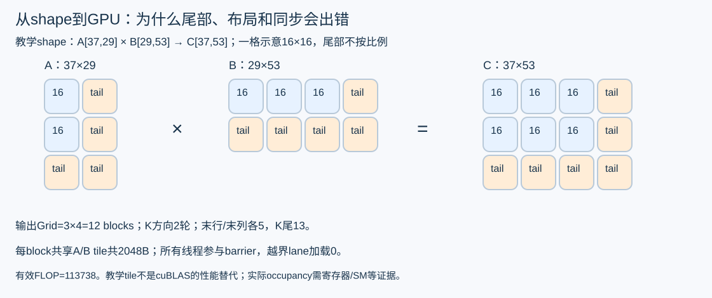

# 从数学算子走到 GPU 实现

先有能解释的数学语义，再有 GPU kernel，最后才讨论快多少。数学参考用于判断正确性，性能基线应选当前可用的成熟实现；用慢 Python 循环衬托 CUDA，不能说明值得替换现有框架。

## 从一个能手算的 GEMM 开始

令 C=A×B，A 为 2×3，B 为 3×4：

~~~text
A = [[1,2,3],       B = [[1, 2, 3, 4],
     [4,5,6]]            [5, 6, 7, 8],
                         [9,10,11,12]]

C = [[38,44,50,56],
     [83,98,113,128]]
~~~

C[0,0]=1×1+2×5+3×9=38。最直接 kernel 让一个线程计算一个 C[i,j]，沿 k 累加。这样能解释公式，却可能重复读取 A/B，无法代表成熟 GEMM 的分块、向量化或 Tensor Core 路径。

cuBLAS 经典接口按列主序解释存储。行主序缓冲可利用 Cᵀ=Bᵀ×Aᵀ 交换操作数，使原 B 按列主序视为 N×K，原 A 视为 K×M。对连续行主序示例，转置视图的 leading dimension 分别为 N、K，输出为 N；但 stride、批量与转置组合变化后必须重推。不能看到结果 shape 正确就认为布局适配正确。

## 16 乘 16 tile 的索引怎样落到尾部

教学 GEMM 取 M=37、N=53、K=29，tile=16。grid 为 ceil(53/16)×ceil(37/16)=4×3，共 12 个 block；K 方向跑 2 个 tile。最后一个输出 tile 只有 5 行、5 列有效，最后一次 K tile 只有 13 个有效元素。

二维线程坐标 tx、ty 时，row=block_y×16+ty，col=block_x×16+tx。每轮载入 A[row,k0+tx] 与 B[k0+ty,col]。越界加载填 0，所有线程仍进入同步；完成 tile 累加后再同步，才可覆盖共享内存。最终只有 row<M 且 col<N 的线程写 C。

~~~text
for k0 in range(0, K, 16):
    As[ty,tx] = in_bounds_A ? A[row,k0+tx] : 0
    Bs[ty,tx] = in_bounds_B ? B[k0+ty,col] : 0
    block_barrier()
    for kk in range(16):
        acc += As[ty,kk] * Bs[kk,tx]
    block_barrier()
if row < M and col < N:
    C[row,col] = acc
~~~

不能让越界线程在第一个 barrier 前提前 return，否则同一 block 的线程可能无法共同到达屏障。float32 的两个共享 tile 占 2×16×16×4=2048 字节；有效计算量 2MNK=113738 FLOPs。按补齐矩形算出的工作量不是有用 FLOPs，也不一定等于真实机器指令数。

生产优化还涉及每线程多个输出、warp tile、向量加载、bank conflict、寄存器占用与流水线；增加 tile 可能提高数据复用，也可能降低 occupancy 或加重尾部浪费。先用实际 shape 分布和 Nsight 证据选择参数，不能把“tile 更大”当通用规律。现有 16×16 CUDA 只作教学骨架，成熟 cuBLAS/框架实现才是性能对照。

## Attention 最容易错的是位置语义

Q 长度 2、KV 长度 5，假设两个查询对应整个序列位置 3、4。suffix causal 允许矩阵应为：

~~~text
query at position 3: [1,1,1,1,0]
query at position 4: [1,1,1,1,1]
~~~

若误用一个左上角 2×5 下三角 mask，会变成 [1,0,0,0,0] 和 [1,1,0,0,0]，结果 shape 一样但语义错误。PyTorch 2.9 SDPA 文档所示非方形 is_causal 需要核对其位置约定；本项目的 suffix 参考显式构造 mask，不能无条件替换成 is_causal=True。参见[官方接口说明](https://docs.pytorch.org/docs/2.9/generated/torch.nn.functional.scaled_dot_product_attention.html)。

对于一行有效 logits [0, ln(2)]，softmax 是 [1/3,2/3]。若对应 V 是 [3,0] 与 [0,3]，Attention 输出为 [1,2]。稳定实现先减去行最大值再 exp；全遮罩行会遇到 −Inf−(−Inf)，必须按明确策略处理。本教材 CPU 参考约定全遮罩输出为 0，并检查 finite；真实 backend 必须验证相同业务语义。

Dense 参考显式生成分数矩阵，只用于验证。Flash 类路径分块维护 softmax 统计，分页路径还要解释页表、有效长度和布局；它们不必生成整个分数矩阵。不能据此拿 dense CPU 时间推断分页 GPU Attention 的收益。

## RMSNorm 融合究竟省掉了什么

RMSNorm 对一行 x 计算 y=x/sqrt(mean(x²)+epsilon)×w。取 x=[3,4]、w=[1,1]，epsilon 很小时，mean(x²)=12.5，y 约为 [0.848528,1.131371]。epsilon 的位置、归约精度和输出 dtype 都是语义。

若原路径是 r=x+residual，再 y=RMSNorm(r)，融合实现必须保留调用者需要的两个输出 r 和 y。少写回 r 可能很快，但下游若还要 r 就是功能缺失。真正可以节约的是中间张量往返或 launch；寄存器压力、布局变化、重复计算也可能抵消收益。RMSNorm 的逻辑字节量只是代理，真实 DRAM 流量还受缓存与实现影响。

## 用算术强度筛选候选

Roofline 用“每搬运一个字节完成多少有用 FLOP”帮助判断上界。对 float32 GEMM，若理想地各读一次 A/B、写一次 C，逻辑字节为 4×(MK+KN+MN)，算术强度为 2MNK/该字节数。这是理想代理，缓存、额外读写和布局准备会改变真实流量。

取 K=N=4096：M=1 时有效 FLOP=33554432，逻辑字节=67141632，约 0.50 FLOP/byte；M=128 时 FLOP=4294967296，逻辑字节=71303168，约 60.24 FLOP/byte。同一权重矩阵被更多行复用，强度显著变化，说明小 M decode 与较大 M prefill 可能需要不同路径。

上界公式为 min(有效峰值算力, 有效带宽×算术强度)。峰值需按目标硬件、dtype/指令与精度政策核对，不能把宣传的 Tensor Core 峰值套给任意 float32 kernel；实际 Nsight DRAM 字节也不能用上面逻辑字节冒充。该模型用来缩小调查范围，最终仍看计时和硬件证据。

## 正确性门禁必须先于计时

候选、成熟基线和参考都应先检查 finite，再检查约定的 atol+rtol×abs(reference)。NaN 参与“大于容差”的比较可能返回 false，因此只有误差比较不够。既有 [GEMM 修复](../gemm-finite-fix-v0.5.1.md)把同一校验函数用于 CUDA 主程序和宿主回归，失败时不进入预热、计时或成功报告。

有限值检查也不能取代语义检查：对错 layout、错 mask、漏输出，结果仍可能全是有限数。样本应包含非整 tile 尾部、N≤1 边界、非连续布局、GQA、全遮罩和异常输入策略。降精度、近似、量化必须登记质量目标，不能放宽容差后就宣布“数值正确”。

## 怎样测到异步 GPU 的实际耗时

CPU 提交 kernel 后很快返回，普通 host stopwatch 包住 launch 可能只测到提交。设备事件需要在覆盖目标工作及其依赖的 stream 上记录起止，等待结束事件完成后读取；跨 stream 必须建立正确依赖。预热、编译、capture、分配与稳态应分别记录，不能一边测包含准备的 baseline，一边测排除准备的 candidate。

排查次序是：先用系统时间线找 CPU 空洞、拷贝、同步、GPU kernel 与通信的关系，再对已定位 kernel 用硬件计数器研究访存、算力和 occupancy。Nsight Compute 采样或 replay 可能改变执行状态，不应用采样运行直接代替无 profiler 的最终吞吐；另做采样开销对照。

假设某个 kernel 在可比串行关键路径中占 p=0.2，优化到 2 倍，端到端上界约为 1/(0.8+0.2/2)=1.111。若与其他工作重叠，或排队/容量发生变化，这个简化模型不能预测吞吐。通信也是如此：总通信 20ms 中若已有 15ms 被计算覆盖，关键路径暴露的部分才约 5ms，简单将所有 NCCL 时间相加会夸大空间。

微基准先列 shape/dtype/layout/精度、baseline、准备范围、计时与正确性，再执行[算子工作台](../operator-lab.md)给定命令。现有 GPU 入口和采样计划仍受门禁控制。可先独立完成宿主算例、shape 表和采样 dry-run。

参考：[CUDA Best Practices Guide](https://docs.nvidia.com/cuda/cuda-c-best-practices-guide/index.html)、[cuBLAS 文档](https://docs.nvidia.com/cuda/cublas/index.html)、[既有源码分析](../sglang-source-analysis-v0.5.md)。后两章把相同的“明确状态、所有权和完成证据”思路应用到部署与框架设计。
