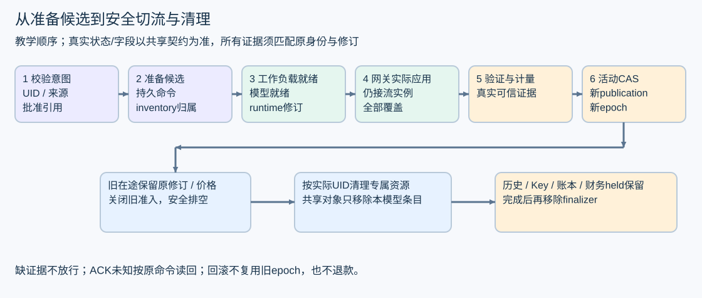

# 模型发布为什么需要协调器

运行时解决“怎样计算”，部署框架解决“怎样把指定模型修订持续、安全地变成服务”。创建一个 Pod 只是过程中的一步。资源已存在、进程已启动、模型已加载、路由已生效、平台允许新请求，分别需要不同证据。

## 从用户写下一个 CR 开始

CR 可以理解为用户提交的期望状态文档。MaaS 的 ModelRelease 描述模型别名、固定来源、批准引用和生命周期。来源选择要明确：ExternalAPI 使用获准上游及 Secret 引用；私有推理使用工作负载、引擎和权重引用。不能因为私有实例启动失败，就自动换外部供应商生成。

假设用户把模型 M1 的 desired generation 从 6 改成 7。Operator 读取期望与实际状态，决定下一步，执行有限动作，再重新观察。Reconcile 被重复调用是正常情况；网络失败、进程重启、重复事件也应收敛到同一结果。Kubernetes [Controller 文档](https://kubernetes.io/docs/concepts/architecture/controller/)描述的正是这种持续协调模式。

不要让一次 reconcile 从创建工作负载开始阻塞到完整验证结束。应把长操作及其身份持久记录，下一次从可核验状态恢复。status 用来报告观察结果，不能成为绕过账本/发布屏障的准入开关。

## 把名称、版本和一次发布分开

| 标识 | 它回答的问题 | 常见错误 |
|---|---|---|
| namespace/name | 用户在哪里找这个对象 | 删除后同名重建，误认成旧对象 |
| CR UID | 这是哪一次对象生命 | 用名字清理新 UID 的资源 |
| generation | 用户期望变更到第几版 | 把旧 generation 的 Ready 用于新 spec |
| revision | 哪份冻结 spec 与解析依赖 | 只 hash 当前 spec 冒充历史完整修订 |
| publication / activation epoch | 哪次发布与活动切换 | 复用旧回执或让旧 owner 重新激活 |
| 实例身份/启动代次 | 哪个实际进程接受了什么 | 新进程继承旧 Pod 名字的回执 |

CAS 指比较后写入：只有当前版本仍等于预期版本才更新，否则交回冲突重读。fence 是用于拒绝旧 owner 的代次，但它本身不会撤销已经发生的外部副作用。

本章用 r7/p7/epoch12 作为教学值，不定义新公共字段。实际项目 revision 的计算还包含精确 Resolution，必须保存原输入和算法；当前架构增量见 [2319eb6 内核基线](https://github.com/jianzi123/maas/commit/2319eb62d84f278d1dd6d444ce52e532e202766e)及任务中的架构附件。历史快照只保留允许的 Secret 引用元数据，不存 Secret 正文或其正文哈希。

回滚是重新提交一个期望，重新解析当前批准依赖并产生新的发布身份。它不是直接把旧 active 指针写回去；旧 Secret、旧 validation 或旧网关回执可能已经失效。

## 发布屏障把哪些证据连在一起

可以按五个问题解释屏障：候选工作负载是否对应目标修订；实际仍服务的 Higress 实例是否都采用目标配置；验证是否经过授权并验证了正确来源；准入与计量依赖是否就绪；活动切换是否在正确 owner/fence 下唯一提交。具体顺序和可信证明按共享契约，不能由性能教材另造捷径。

例如 gw1 已采用 r7，gw2 仍有旧连接在服务，即使 gw2 暂时不 Ready，也不能只因为它不在“当前 Ready 列表”就忽略。真正的服务集合、实例启动身份与回执新鲜度都要核验。新实例加入后也不能沿用旧实例回执。xDS ACK 只说明对应配置交付，不自动证明模型、鉴权、计量链路和业务可调用均通过。

验证动作本身同样受 Key、固定来源、预算与额度约束。控制器不能创建一条旁路“健康检查”无限调用收费模型，也不能在缺证据时把候选标成 Ready。

## 为什么 ACK 未知不能直接重试成新命令

设命令 C 的稳定身份与 payload 摘要已记录。服务端完成事务，但返回 ACK 的网络断了。客户端只知道“结果未知”，并不知道失败。

恢复应该先用原身份读回核对。原事务已提交，则返回同一结果；同一身份不同 payload 则冲突。若每次超时都生成 C2、C3，会把“确认原操作”变成“重复写入新操作”。Kubernetes resourceVersion CAS 和 MySQL 事务各自保护自己的状态，不组成一个自动的跨系统原子事务。

可运行的纯内存演示：

~~~text
python docs/performance/foundations/labs/release_walkthrough.py
~~~

应看到 partial_receipt→pending；补齐覆盖后 commit_then_ack_unknown 的 store 结果为 applied、client_ack 为 unknown；原命令查询与重试仍为 applied；同 ID 改 generation 为 conflict；旧 generation 证据不能切换；删除后迟到 owner 返回 closed。activation_writes 必须保持 1。

这段脚本仅演示身份相等、集合覆盖和幂等轨迹，没有 MySQL、CAS、可信回执、签名验证或真实资源。它的 toy_can_switch 布尔值绝不能成为生产 Callable 判断。生产协议还要处理 prepare 后崩溃、外部动作已发生但本地未记账、恢复查询不可用和 owner 失效等情况。

## 把崩溃点落到可恢复步骤

一个教学级副作用流程可拆成：核验 owner 与原身份 → 耐久记录准备意图 → 发起外部动作 → 查询/记录实际对象身份与证据 → 在短事务内核验屏障并切换活动态。每一步之间都可能崩溃。

| 崩溃位置 | 恢复需要查什么 | 禁止的捷径 |
|---|---|---|
| 只保存意图，尚未创建 | 原 command、payload、目标 UID 与最新 owner | 新造 command 跳过旧意图 |
| 对象已创建，回执未保存 | 按预先绑定的身份查实际对象，核对归属和 UID | 同名就认领，或直接再建一套 |
| 活动切换已提交，ACK 未知 | 原 journal/耐久活动结果 | 盲目再次激活、重复触发验证 |
| 排空中控制器重启 | 原 allocation、停止证据、inventory 与清理进度 | 看到旧 Pod 不 Ready 就退款/删账 |
| 删除时同名 CR 重建 | 原 CR UID 与每个资源真实 UID | 按 namespace/name 批量删除 |

写库失败、查不到可信对象和依赖不可用需要保留不同原因，既不能猜成功，也不能无限重放副作用。上表是设计练习；实际事务顺序、锁序、权限和查询口仍由既有 Go 发布服务契约约束，Operator 不自行取得 MySQL 核心账本身份。

## 清理为什么要记录对象归属

inventory 是记录本次发布计划创建、实际创建及待清理对象的归属清单。执行副作用前，发布服务需要可恢复地记录意图和对象归属；执行后补充真实 UID/版本与观察结果。否则创建资源成功后进程退出，重启时可能不知道该资源归谁。

清理应核对 cluster、CR UID、publication、资源 UID 与允许的归属。名称相同但 UID 不同，不能删除。共享 Service/路由等只更新本发布拥有的条目，不能为了清理一个模型删除整个共享对象。Operator 不应因便于查询而取得核心预算账本写权限或 Secret 正文权限。

Finalizer 是删除前的协调钩子：对象收到删除请求后进入带 deletionTimestamp 的状态，控制器完成所需工作再移除对应 key。它不会自己执行清理，也不会自动解决所有 ownerReference/垃圾回收排序。[Kubernetes 官方说明](https://kubernetes.io/docs/concepts/overview/working-with-objects/finalizers/)还解释了依赖删除策略的作用。没有停止或归属证据时，强删 finalizer 只会绕过屏障，不能证明资源安全。

排空至少要分别观察在途请求和未安全回收的 allocation；financial held 保留是另一个维度。脚本中 drain_can_cleanup 从 false 变 true，financial_held 始终是 140。此处只演示这两个计数条件，生产清理还需完整 inventory、停止证据、UID 与屏障核验；它不退款，也不把未知 actual 改为 0。

## 资源组和蓝绿发布的容量账

LWS 把多个协作 Pod 组成一个 LeaderWorkerSet group；它有助于表达多节点推理的共同生命周期，但应用仍要处理 rank、启动、连接、通信与故障。[LWS 概念](https://lws.sigs.k8s.io/stable/docs/concepts/leaderworkerset/)及[滚动更新说明](https://lws.sigs.k8s.io/stable/docs/concepts/leaderworkerset/rollout-strategy/)需按部署时固定版本复核。

教学容量为 2 个 group，每组 2 Pod，每 Pod 2 GPU：当前总计 8 GPU。蓝绿期间保留新旧两版，简单全量重叠就需 16 GPU，尚未算额外预留。若资源只有 8，可能根本无法创建完整新版本。需要评审限流、分组滚动或停机切换等可用性取舍，不能写“零停机”却不算容量。每模型一个 CR 也不等于每模型安装一套共享网关、数据库或集群基础设施。

## 历史读取也是正确性问题

当前 CR 只能说明现在，不能重建过去的完整 spec、解析引用、可信时间和原 UID。历史读取若已知应有记录却证据缺失，应按现行架构返回依赖不可用；真正没有可见记录才用 404。不能以 200 空页掩盖迁移失败，也不能把 hash 包装成完整历史。

历史接口、发布操作、请求账本分别有权限与身份域。管理查询可展示脱敏历史，不应返回内部 credential handle 或原始 Resolution。202 只代表操作受理，CR 改变也不证明原操作的未知 ACK 已解决。高级工程师要能画出“谁有权写哪份事实”，而不只是画组件连线。
