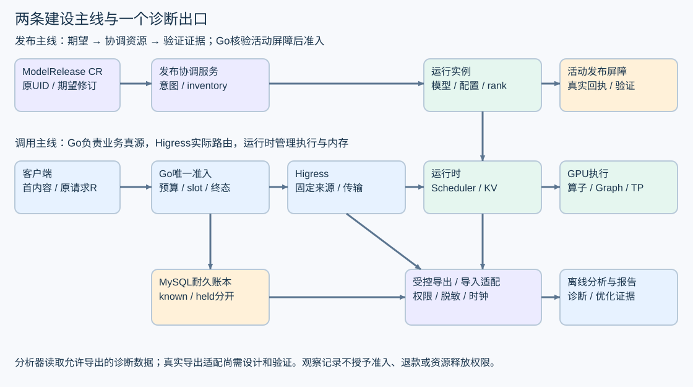

# 教材与研发整合地图

先将资料整合为一个入口，再将教材中的机制接到现有项目接口。建议沿用现有 Go/MySQL 业务内核与发布服务，把 SGLang 等成熟执行后端作为运行时接入起点，在真实热点处研究算子与调度。自研运行时、共享协议或跨仓网关改动分别走明确里程碑与架构评审；本轮交付是整理后的文档与静态接入核对。

## 统一为一套资料结构

[性能总入口](README.md)负责指路，[六章教材](foundations/README.md)负责解释机制，[练习索引](exercises/README.md)负责把知识变成可交作业。做项目时再进入目标卡和执行规程。原资料保留各自用途：

| 原资料 | 整合后的用途 | 更新规则 |
|---|---|---|
| foundations 六章与五张图 | 概念、推导、接口与故障案例的主教材 | 新机制优先补到对应章节，练习页链接回教材 |
| onboarding 的 B01–B06 | 基础练习详解与命令 | 保留编号、预期和资源条件；随主教材选做 |
| advanced 的 A01–A04 与检查项 | 性能推导、设计作业与评审详解 | 性能方法在此核验，框架机制引用主教材 |
| optimization-goals.md / JSON | 八张优化课题卡 | 修改课题时同步人读与机读口径；执行阈值按批准记录 |
| optimization-playbook.md | 实验前后执行规程 | 版本、样本、baseline、停止、证据和回退 |
| operator-lab / 源码分析 / J02方法 | 工具和固定版本参考 | 定位到真实文件与版本，不复制成另一套教程 |
| progress-and-summary / learning-change-log | 当前摘要与历史记录 | 新事实置顶，历史保留当时基线与证据级别 |
| docs/contracts 与 tools/perf/contracts | 架构原件及固定来源快照 | 保持原字节与 provenance；升级由架构师维护 |

四类编号要分清：R0–R3、D0–D3是“建设到哪一步”；K01–K03、R01–R04、E01是“优化什么”；E1–E3是“怎样做实验”；OBS01–OBS19是“采哪些观测”。它们的对应关系见下面各表，不合并成一套混用的编号。

## 两条研发主线在同一调用链汇合

运行时建设处理请求排程、KV 页、batch、Worker 完成和输出背压；部署建设处理期望、修订、真实实例、切流、排空与清理。两者通过冻结的活动修订和实际实例关联。性能分析器位于链路旁边，读取允许导出的诊断数据。

部署成功的验收需要一次受保护调用，运行时收益的端到端验收也需要它。Go/MySQL 的准入与结算、Higress 的固定来源、未知用量和 slot 分离始终沿用既有协议。观测记录不能代替签名证据或授予释放/退款权限。

## 把教材内容接到现有代码

下列后端路径对应已核对的固定提交 [0f07c5d](https://github.com/jianzi123/maas/tree/0f07c5db91464ef750e2822daee75ab1e1247c58)，前端对应 [428d44e](https://github.com/jianzi123/maas/tree/428d44e0b4f64ec628e6a945fd4b63a0e45c260b)。教材分支没有合入这些最新实现；需要读相应提交，不能根据本分支旧根 README 推断整个项目现状。

| 接点 | 已有位置与责任 | 下一步要接什么 | 完成证据 |
|---|---|---|---|
| 请求准入与终态 | 后端 internal/kernel/admit.go、finalize.go | 运行时沿原 request/attempt/来源/活动绑定接收任务；按原协议返回结果 | 预算/slot 竞争、重复终态、取消与 ACK 未知保持唯一且保守 |
| 管理 API 与历史 | 后端 internal/controlapi/http.go、internal/release/history、mysqlstore/history.go | 前端与诊断使用脱敏投影和原 UID；保留可信历史、查询身份及原 R | 真历史/缺证据503、权限、同名新UID、分页与恢复 |
| 发布协调 | 后端 internal/release/ports.go、reconciler.go、mysqlstore | 接实际 runtime/placement、inventory、停止与回执适配；复用现有耐久发布服务 | publication/epoch、重启恢复、全服务实例覆盖、UID清理 |
| 网关与凭证 | 后端 internal/gateway；跨仓接点见其 docs/higress-minimal-patch-scope.md | 按原 H1–H4 分工装配 Secret/路由授权/传输与发布证据生产者 | 实际路由、一次attempt、真实关闭/新鲜度/覆盖证明 |
| 私有推理运行时 | 后续获准的 Worker/执行后端，性能角色协作算法/运维 | 原活动修订→模型/权重/引擎/配置/rank；queue/batch/KV/Graph/通信观测 | 成熟baseline、数值/质量、异步回收、同资源负载结果 |
| 前端消费 | console/src/api/stream.ts、recovery.ts、pages；前端原负责人 | 沿真实响应与原 request ID 展示状态、未知usage及恢复，不改算子调度 | 实际Go联调、错误/EOF/取消、并发UI与ID一致性 |
| 离线诊断 | tools/perf/analyze.py、runtime_metrics.py、operators | 先保留现有输入契约；真实导出适配单列设计和受控验证 | 脱敏、clock_scope、null/0/held、分母与修订对应 |

本表列的是接入职责和验收要求，不将准备接点计为已实现。MAAS-3、MAAS-11、MAAS-5仍由原负责人维护；性能工作只改自身目录，通过接口协作。

## 真实数据导出需要单独补一段接线

现有分析器接受的是工具自己的脱敏 JSON 输入，包含 requests、observations、terminals、runtime_metadata、gateway_observations、共同窗口与 SLO。它没有通用生产导出器。直接把数据库表或内部诊断快照倒进分析器，可能产生以下错误：

- 将累计诊断 usage 当作唯一终态 actual，或把未知填成0。
- 用每次GET的查询 ID 覆盖原生成请求 R，或把期望修订当活动修订。
- 拼接不同客户端 monotonic 坐标，或删除拒绝/失败/pending后计算吞吐。
- 将生产 SSE 正文、Key、票据或内部 credential 信息写入常规日志。

建议由后端/网关/客户端按原权限提供受控导出，性能侧定义工具侧导入适配。先共同冻结最小字段、脱敏/保留期、来源真实性、clock_scope 与缺失表达，再做固定样本正反校验。若需不保留正文的时间/计数 sidecar，应明确新工具输入版本与兼容规则；不能伪造 SSE 内容以满足旧格式，也不能给封闭业务事件随意加字段。

| 观测分组 | 现有19项映射 | 接线重点 |
|---|---|---|
| 请求、来源、修订、拓扑 | OBS01–05 | 原 request/trace、活动绑定、实际路由、模型工件与rank |
| Go、Redis、MySQL、预算 | OBS06–09 | 本地耗时、事务/ACK、拒绝原因、known/reserved/held |
| 网关、终态、取消、slot | OBS10–13 | 实际传输、唯一事件、独立停止/释放时刻与原allocation |
| 发布与共享资源 | OBS14–15 | desired/observed/active区分、inventory、全实例回执与安全清理 |
| 引擎、GPU、主机 | OBS16–18 | queue/prefill/decode、KV/Graph、通信、采样开销和缺失 |
| 隐私与基数 | OBS19 | 高基数留受控关联表，指标标签有界；凭证/正文不入日志 |

字段的原映射保留在[19项CSV](../../tools/perf/docs/observability-handoff-v0.2.csv)。本轮没有新增生产埋点或导出权限。

## 建设阶段怎样落到优化目标和实验

| 建设里程碑 | 对应教材与优化课题 | 接入验证 |
|---|---|---|
| R0 数学/身份参考 | 第1、3章；K01–K03 | 先对语义、shape、finite和布局；三个教学模型只作解释 |
| R1 调度/KV状态 | 第2、5章；R01/R02 | fake Worker确定事件顺序、半页COW、异步回收与取消 |
| R2 获准GPU Worker | 第3、5章；K01–K03/R03/R04 | 成熟baseline、设备完成、真实拓扑、OOM/进程异常 |
| R3 框架负载 | 第6章；R01–R04 | E2对应R01，E3对应R02；固定J02、质量、尾延迟、资源及失败分母 |
| D0/D1 计划与耐久协调 | 第4、5章 | 复用发布服务；意图/副作用/回查截点和UID归属 |
| D2 实际适配 | 第4章及现有H1–H4范围 | 真实组件、窄权限、回执/停止/验证证据 |
| D3 调用与生命周期 | 第1、4、6章；E01 | E1真实平台＋受控上游先归因，再进行获准模型实验 |

E1/E2/E3是既有实验计划，不由本表自动启动。首批测量所需模型、权重、GPU、版本、SLO、调用额度/预算及停止阈值仍按原门槛确认。自研新 kernel 或并行策略由真实 profile 选题，先复用成熟路径建立合理基线。

## 当前分支与合并顺序

本轮只读核对得到：

| 项目 | 固定事实 |
|---|---|
| GitHub 默认分支 | agent/MAAS-10-offline-metrics，86f5408；默认分支本身尚不含全部交付 |
| 发布集成线 | agent/MAAS-11-integrate-controlled-release，aba38f5 |
| 调用内核 PR #2 | draft/open，head 0f07c5d，base 为发布集成线；已包含aba38f5历史 |
| 前端 PR #4 | draft/open，head 428d44e，base 为当前默认分支 |
| 本性能/教材分支 | agent/MAAS-10-operator-runtime-lab，进入本轮前为b67a805 |
| Multica关联 | 本轮查询MAAS-10/MAAS-11均未返回关联PR；GitHub状态单独读取，不能用空表推断PR不存在 |

建议先沿原发布集成线评审调用内核，再接前端与性能目录；由 Mika/原负责人确定最终合入及长期默认分支，保留现有PR关系。把整个旧教材 checkout 覆盖到新内核目录会带回旧状态，优先使用保留历史的正常合并，并核对限定目录差异。

本轮运行 git merge-tree --write-tree，仅创建未引用的结果tree，不移动分支/索引/工作树：

| 静态预演 | 结果tree | 结论范围 |
|---|---|---|
| 性能b67a805＋内核0f07c5d | ba8482c | 退出0，无文本冲突 |
| 内核0f07c5d＋前端428d44e | 0fa718d | 退出0，无文本冲突 |
| 性能b67a805＋前端428d44e | cd55e34 | 退出0，无文本冲突 |

这是三组两路预演；三路实际合并及合并后的构建、契约、浏览器和端到端验证尚未执行。后续整合分支应先做路径/来源核对，再按各目录原验证入口完成回归，最后验证真实接线。现有组件测试计数不累加成整体验收数。

## 下一次交接应拿到的材料

文档整合可以直接评审本提交。代码整合由原负责人沿已确认基线推进，至少交：固定合入SHA/父历史、目录与契约差异、每套验证的原始日志及skip原因、导出适配的脱敏正反样本，以及尚未装配依赖清单。实际链路具备后由Mika交接E1；模型/GPU阶段继续使用批准计划。

运行时和部署框架的实现范围、授权资源或共享接口有变化时，先更新ADR及对应任务，再开始实现。本轮没有合并他人分支、修改默认分支、部署、调用供应商或启动新的框架任务。
